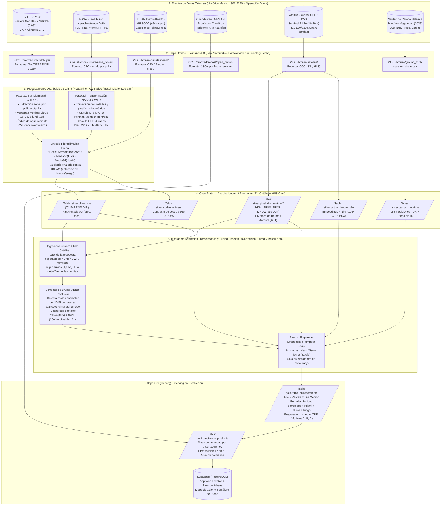
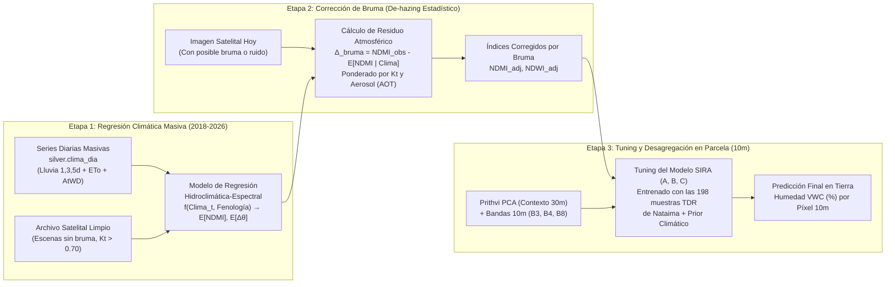

# 02 — Arquitectura de Big Data: Tratamiento, Almacenamiento y Regresión de Datos Climáticos (`Clima por Día`) en SIRA

**Proyecto:** SIRA (Sistema Inteligente de Riego para Arroz en el Alto Magdalena)  
**Equipo:** Equipo 10 — Maestría en Ciencia de Datos y Analítica (Universidad EAFIT)  
** Enfoque del Documento:** Subsistema de Ingesta, Procesamiento Distribuido, Almacenamiento Lakehouse y Regresión Hidroclimática (CHIRPS + NASA POWER + IDEAM) para el ajuste (*tuning*) de predicción de humedad del suelo por píxel ante bruma atmosférica y baja resolución satelital.  
**Documentos Base:** [`sira_flujo_entrenamiento.html`](../sira_flujo_entrenamiento.html) · [`HANDOVER.md`](../HANDOVER.md) · [`s00271-025-01025-w.pdf`](../s00271-025-01025-w.pdf) (Martínez-Vega et al., 2025)

---

## 1. Contexto y Rol Estratégico de la Rama `"Clima por Día"`

En el flujo de entrenamiento de SIRA ([`sira_flujo_entrenamiento.html`](../sira_flujo_entrenamiento.html)), el modelo de aprendizaje automático estima la **humedad volumétrica del suelo ($\text{VWC}$, medida con sonda TDR)** por píxel de 10 m integrando cuatro ramas de información en el nodo **`4. Emparejar`**:
1. **Verdad de campo (`Paper Nataima`):** 198 mediciones reales de humedad TDR a 20 cm de profundidad, láminas de riego diario y días después de la siembra ($\text{DAS}$) en tres temporadas agrícolas (`GS1`: mayo–septiembre 2021, `GS2`: diciembre 2021–abril 2022, `GS3`: julio–noviembre 2022) bajo tres tratamientos de riego: inundación continua en cascada (`CD`), entradas múltiples por politubo (`MIRI`) y secas y mojes alternos (`AWD+MIRI`).
2. **Rama Óptica de Alta Resolución (`Sentinel-2 L2A`, 10–20 m):** Filtrado de nubes/sombras (`Paso 1a`) y cálculo de índices espectrales por píxel (`Paso 2a`: $\text{NDMI}$, $\text{NDWI}$, $\text{NDVI}$, $\text{MNDWI}$).
3. **Rama de Modelo Fundacional (`HLS` 30 m + `Prithvi-EO-2.0`):** Filtrado de nubes (`Paso 1b`), extracción de 1.024 *embeddings* por bloque de $16 \times 16$ píxeles (`Paso 2b`) y reducción dimensional mediante PCA a 10–20 componentes (`Paso 3b`).
4. **Rama Hidroclimática (`CHIRPS` + `NASA POWER` $\rightarrow$ `Clima por día`):** Cálculo de precipitación acumulada en ventanas de 1, 3 y 5 días (`Paso 2c`) y demanda evaporativa de la atmósfera $\text{ET}_o$ mediante FAO-56 Penman-Monteith (`Paso 2d`).

### ¿Por qué el subsistema de Clima es la pieza clave de Big Data y del *Tuning* del Modelo?

El proyecto enfrenta dos desafíos estructurales que el modelo puramente satelital no puede resolver por sí solo:

1. **Ventana temporal reducida de los datos en tierra vs. operación actual (2026+):**
   - Las mediciones en tierra del C.I. Nataima (Agrosavia, El Espinal, Tolima; $4^\circ 11' 28.7''\text{ N}$, $74^\circ 57' 39.2''\text{ W}$, $323\text{ m s.n.m.}$) cubren únicamente tres campañas entre 2021 y 2022 (~198 puntos TDR efectivos) sobre un lote experimental de $136 \times 70\text{ m}$ ($\approx 0,96\text{ ha}$).
   - En contraste, **los datos climáticos satelitales y de reanálisis (CHIRPS y NASA POWER) son diarios, masivos, continuos (1981–presente) y libres de vacíos por nubosidad**.
2. **Degradación de la imagen satelital hoy en día (Bruma atmosférica y Baja Resolución Espacial):**
   - **Efecto de Bruma (*Haze* / Cirros delgados / Aerosoles):** En el valle del Alto Magdalena, aun cuando una escena de Sentinel-2 o Landsat supera el filtro binario de nubes (`SCL` o `QA_PIXEL`), la presencia de bruma húmeda o humo de quemas agrícolas dispersa la radiación visible y atenúa el infrarrojo cercano ($\text{NIR}$), reduciendo artificialmente el $\text{NDMI}$ y el $\text{NDVI}$ (simulando un falso estrés hídrico) o distorsionando el $\text{NDWI}$.
   - **Efecto de Baja Resolución y Mezcla Subpíxel:** Cada franja de tratamiento en Nataima mide $23,5\text{ m}$ de ancho (girada $33^\circ$). Los píxeles de HLS ($30\text{ m}$) tienen **0 píxeles puros** por franja, todo el lote cabe en un único parche de Prithvi ($480 \times 480\text{ m}$), y la banda $\text{SWIR1}$ (`B11`) de Sentinel-2 necesaria para el $\text{NDMI}$ tiene resolución de $20\text{ m}$.

> [!IMPORTANT]
> **Estrategia de Solución en SIRA:**  
> Utilizar el pipeline de Big Data para procesar décadas de registros climáticos diarios (`CHIRPS` + `NASA POWER`) cruzados con el archivo histórico de imágenes satelitales sobre el Alto Magdalena, encontrando un **patrón de regresión hidroclimático-espectral**. Este modelo climático actúa como un **ancla física continua** en el *tuning* del modelo de Machine Learning: corrige las caídas espurias de los índices ópticos causadas por bruma y desagrega temporalmente el balance hídrico para predecir con precisión la humedad del suelo por píxel de 10 m hoy en día.

---

## 2. Evaluación Técnica y Selección de Fuentes Climáticas: CHIRPS vs. NASA POWER vs. IDEAM

Para construir el nodo **`Clima por día`**, se evaluaron cuatro fuentes candidatas contrastándolas contra los registros reales de la estación meteorológica en sitio reportados en las Figuras 2 y 4 y la Tabla 2 de Martínez-Vega et al. (2025) ([`s00271-025-01025-w.pdf`](../s00271-025-01025-w.pdf)):

| Fuente de Datos | Variables Principales | Resolución Espacial y Temporal | Cobertura Histórica | Hallazgos de Validación frente a Nataima (`HANDOVER.md`) | Rol en la Arquitectura Big Data de SIRA |
|---|---|---|---|---|---|
| **CHIRPS v2.0** (*Climate Hazards Group InfraRed Precipitation with Station data*) | Precipitación diaria combinada (infrarrojo satelital CCD + interpolación de estaciones) | $0,05^\circ \times 0,05^\circ$ ($\approx 5,5\text{ km}$) · **Diaria** | 1981 – Presente (>45 años diarios) | **Menor sesgo acumulado (+14 %)** frente al pluviómetro del lote en las 3 temporadas. Correlación diaria puntual $r \le 0,42$ por tormentas convectivas locales; alta precisión en acumulados de 3 a 5 días. | **Fuente Primaria Activa (`Paso 2c`):** Ingesta masiva para cálculo de lluvia acumulada ($1, 3, 5, 7, 15\text{ días}$) e índice de recarga $\text{SWI}$. |
| **NASA POWER** (*Prediction Of Worldwide Energy Resources - Agroclimatology*) | Temperatura (`T2M`, `MAX`, `MIN`), Radiación solar (`ALLSKY_SFC_SW_DWN`), Viento (`WS2M`), Humedad relativa (`RH2M`), Presión (`PS`) | $0,5^\circ \times 0,625^\circ$ (meteo) / $1,0^\circ$ (solar) · **Diaria** | 1981 – Presente (sin vacíos: **0 % nulos**) | Serie 100 % completa en `GS1`, `GS2` y `GS3`. Contiene todas las variables físicas exigidas por el método estándar **FAO-56 Penman-Monteith** y permite replicar el $\text{AtWD}$ del artículo. | **Fuente Primaria Activa (`Paso 2d`):** Cálculo diario de $\text{ET}_o$, $\text{ET}_c$, Déficit Hídrico Atmosférico ($\text{AtWD}$), $\text{VPD}$ y Grados-Día ($\text{GDD}$). |
| **IDEAM** (Datos Abiertos Colombia `s54a-sgyg` / Catálogo `hp9r-jxuu` / DHIME) | Precipitación, temperatura y humedad en estaciones automáticas y convencionales en tierra | Puntual (estaciones a **15–36 km** de Nataima) · Horaria / Diaria | Variable por estación (con interrupciones operativas) | **Descartado como entrada directa de entrenamiento en Nataima:** las estaciones cercanas presentan huecos severos (**ninguna tiene datos en `GS2`**) y un **sesgo de lluvia de $-36\%$ a $-63\%$**. | **Fuente de Auditoría y Contraste Regional (Bronce/Plata):** Se ingesta para documentar analíticamente el sesgo de estaciones lejanas y para corrección de sesgo (*gauge adjustment*) en municipios con estación activa. |
| **ERA5-Land** (ECMWF Reanalysis v5) | Precipitación total, temperatura, radiación, evaporación | $0,1^\circ \times 0,1^\circ$ ($\approx 9\text{ km}$) · Horaria / Diaria | 1950 – Presente | **Descartado para precipitación:** presenta una sobreestimación extrema (**+142 % de sesgo en `GS2`**) por efecto orográfico de la cordillera en la celda del Magdalena. | **Descartado en producción:** sustituido por la combinación óptima **CHIRPS (lluvia) + NASA POWER ($\text{ET}_o$)**. |

### 2.1 Justificación Agronómica y Física de las Variables Climáticas en el Cultivo de Arroz

De acuerdo con el estudio base de Nataima ([`s00271-025-01025-w.pdf`](../s00271-025-01025-w.pdf), p. 3 y p. 5–7):
- **Propiedades hidráulicas del suelo en Nataima:** Textura franco-arenosa (*sandy loam*) con alta tasa de infiltración y percolación. Capacidad de Campo ($\text{FC}$) $\approx 30\%$, Punto de Marchitez Permanente ($\text{PWP}$) $\approx 26\%$, Saturación ($\text{SAT}$) $= 47,65\%$, Agua Fácilmente Disponible ($\text{TAW}$) $\approx 4\%$ ($0,0446\text{ v v}^{-1}$), profundidad radicular efectiva $Z_r = 150\text{ mm}$ y Déficit Hídrico Crítico ($\text{CWD}$) $= 4,34\text{ mm}$, lo que define el umbral crítico de estrés en **$30\% - (4,34 / 150) \approx 27,1\%\text{ VWC}$**.
- **Desfase de la lluvia satelital diaria y necesidad de ventanas acumuladas (`Paso 2c`):** En el trópico andino, los aguaceros convectivos son altamente localizados (p. ej., el evento extremo de $113\text{ mm}$ en un solo día durante la etapa vegetativa de `GS1`, $87\text{ mm}$ en `GS2` y $67\text{ mm}$ en `GS3`). Como CHIRPS estima la lluvia a partir de la temperatura de tope de nube en celdas de $5,5\text{ km}$, un aguacero puntual puede registrarse repartido entre el día $t$ y los días $t-1$ o $t+1$. Además, la humedad del suelo a $20\text{ cm}$ de profundidad no depende únicamente de la lluvia de las últimas 24 horas, sino de la **memoria hídrica de los últimos 3 a 5 días**.
- **Déficit Hídrico Atmosférico ($\text{AtWD}$, `Paso 2d`):** El artículo de Nataima mide el riesgo de sequía atmosférica mediante el índice de Purcell et al. (2003): la diferencia entre el promedio móvil de 5 días de $\text{ET}_o$ ($\text{mm}$) y el promedio móvil de 5 días de lluvia ($\text{mm}$). Replicar exactamente esta métrica con NASA POWER y CHIRPS garantiza coherencia física total entre el entrenamiento histórico (2021–2022) y la inferencia actual (2026+).

---

## 3. Arquitectura de Referencia Big Data (Lakehouse Medallion + Tuning Clima-Satélite)

Para cumplir tanto con los requerimientos de ingeniería de **Grandes Datos (`SI7006`)** como con la operación real del proyecto a escala finca (Nataima, $0,96\text{ ha}$) y escala regional (distritos del Alto Magdalena como UsoCoello y UsoSaldaña, $>25.000\text{ ha}$), SIRA adopta una arquitectura **Lakehouse Medallion (Bronce $\rightarrow$ Plata $\rightarrow$ Oro)** sobre **AWS**, desacoplando el almacenamiento en **Amazon S3** del cómputo distribuido en **AWS Glue (PySpark)** y gobernando las tablas mediante **Apache Iceberg** y **AWS Glue Data Catalog**.

### 3.1 Diagrama de Flujo de Extremo a Extremo (Foco en `"Clima por Día"` y *Tuning* del Modelo)



---

## 4. Estructura de Almacenamiento y Esquemas de Datos (Capas Bronce, Plata y Oro)

El almacenamiento se estructura sobre **Amazon S3** siguiendo el patrón **Medallion** con tablas gobernadas por **Apache Iceberg** (formato físico **Apache Parquet** con compresión **Snappy**), lo que permite consultas SQL analíticas inmediatas en **Amazon Athena**, evolución de esquema (*schema evolution*) y viajes en el tiempo (*time travel*) para reproducibilidad de experimentos de Machine Learning.

### 4.1 Árbol de Directorios en el Data Lakehouse (`Amazon S3`)

```text
s3://sira-lakehouse-alto-magdalena/
├── bronze/                                      # Zona Cruda (Inmutable, formato nativo)
│   ├── climate/
│   │   ├── chirps/                              # Rásters diarios .tif / respuestas JSON ClimateSERV
│   │   │   └── anio=YYYY/mes=MM/chirps_v2_p05_YYYYMMDD.json
│   │   ├── nasa_power/                          # Respuestas JSON de la API diaria de NASA POWER
│   │   │   └── grid_id=NATAIMA_01/power_daily_1981_2026.json
│   │   └── ideam/                               # Extracciones crudas de datos.gov.co (s54a-sgyg)
│   │       └── departamento=TOLIMA/ideam_raw_YYYYMM.parquet
│   ├── forecast/
│   │   └── open_meteo/                          # Pronósticos diarios emitidos a las 05:00 a.m.
│   │       └── fecha_emision=YYYY-MM-DD/forecast_7d.json
│   ├── satellite/
│   │   ├── sentinel2_l2a/                       # Recortes Cloud Optimized GeoTIFF (10m y 20m)
│   │   └── hls_l30_s30/                         # Recortes armonizados HLS (30m, 6 bandas para Prithvi)
│   └── ground_truth/
│       └── nataima_2021_2022/                   # Datos digitalizados y validados del paper (Figs. 2-4)
│           └── nataima_diario.csv
│
├── silver/                                      # Zona Confiable (Tablas Apache Iceberg / Parquet)
│   ├── clima_dia/                               # <-- Producto central "Clima por día" (Pasos 2c y 2d)
│   ├── auditoria_ideam/                         # Contraste de calidad e integridad frente a estaciones
│   ├── pixel_dia_sentinel2/                     # Índices por píxel y fecha + indicador de bruma
│   ├── prithvi_bloque_dia/                      # Componentes PCA (10-20) de los 1024 embeddings
│   └── campo_nataima/                           # Verdad de campo tipada (198 mediciones TDR + riego)
│
├── gold/                                        # Zona Refinada (Tablas analíticas y de ML en Iceberg)
│   ├── regresion_clima_espectral/               # Coeficientes e histórico de calibración clima-satélite
│   ├── tabla_entrenamiento/                     # Matriz final Parcela × Día (Paso 4 del diagrama)
│   ├── prediccion_pixel_dia/                    # Humedad VWC y clase (Déficit/Óptimo/Exceso) a 10m
│   └── verificacion_diaria/                     # Auditoría pronóstico vs. observado (Ciclos 1 y 2)
│
└── models/                                      # Artefactos y Registro de Modelos
    ├── climate_haze_regressor/                  # Modelo de regresión climática y corrector de bruma
    ├── pca_prithvi/                             # Pesos del reductor dimensional PCA (1024 -> 15)
    └── sira_moisture_rf_v1/                     # Modelos A, B y C versionados (.joblib / .pt + metadatos)
```

---

### 4.2 Esquema Detallado de la Tabla `silver.clima_dia` (El Nodo `"Clima por día"`)

Esta tabla materializa la unión de los procesos **`2c. Lluvia acumulada de 1, 3 y 5 días`** (CHIRPS) y **`2d. ETo con FAO-56`** (NASA POWER). Su diseño contempla tanto el lote de Nataima como cualquier grilla del Alto Magdalena:

```sql
CREATE TABLE sira_Catalog.silver.clima_dia (
    -- Identificadores Espaciotemporales
    grid_id                 STRING      COMMENT 'Identificador de celda climática (ej. TOL_ESPINAL_NATAIMA)',
    municipio               STRING      COMMENT 'Municipio del Alto Magdalena (Espinal, Guamo, Saldaña, etc.)',
    latitud_centro          DOUBLE      COMMENT 'Latitud WGS84 del centroide (ej. 4.191306 para Nataima)',
    longitud_centro         DOUBLE      COMMENT 'Longitud WGS84 del centroide (ej. -74.960889 para Nataima)',
    altitud_msnm            DOUBLE      COMMENT 'Altitud en metros sobre el nivel del mar (323.0 m en Nataima)',
    fecha                   DATE        COMMENT 'Fecha de observación diaria (YYYY-MM-DD)',

    -- Variables del Paso 2c: Precipitación CHIRPS v2.0 y Ventanas Acumuladas
    lluvia_1d_mm            DOUBLE      COMMENT 'Precipitación diaria CHIRPS del día t (mm)',
    lluvia_3d_mm            DOUBLE      COMMENT 'Lluvia acumulada en ventana móvil [t-2, t] (3 días, mm)',
    lluvia_5d_mm            DOUBLE      COMMENT 'Lluvia acumulada en ventana móvil [t-4, t] (5 días, mm)',
    lluvia_7d_mm            DOUBLE      COMMENT 'Lluvia acumulada en ventana móvil [t-6, t] (7 días, mm)',
    lluvia_15d_mm           DOUBLE      COMMENT 'Lluvia acumulada en ventana móvil [t-14, t] (15 días, mm)',
    lluvia_media_5d_mm      DOUBLE      COMMENT 'Promedio móvil de 5 días de lluvia (para cálculo de AtWD)',
    swi_lluvia_exp_mm       DOUBLE      COMMENT 'Índice de humedad entrante por lluvia con decaimiento exponencial',
    dias_sin_lluvia         INT         COMMENT 'Conteo de días consecutivos con precipitación < 2.0 mm',

    -- Variables del Paso 2d: Meteorología NASA POWER y ETo FAO-56
    temp_media_2m_c         DOUBLE      COMMENT 'Temperatura media del aire a 2m (T2M, °C)',
    temp_max_2m_c           DOUBLE      COMMENT 'Temperatura máxima diaria a 2m (T2M_MAX, °C)',
    temp_min_2m_c           DOUBLE      COMMENT 'Temperatura mínima diaria a 2m (T2M_MIN, °C)',
    rad_solar_mj_m2_d       DOUBLE      COMMENT 'Radiación solar global incidente (ALLSKY_SFC_SW_DWN, MJ/m2/día)',
    rad_cielo_despejado_mj  DOUBLE      COMMENT 'Radiación solar teórica de cielo despejado Rso (MJ/m2/día)',
    indice_claridad_kt      DOUBLE      COMMENT 'Relación Rs / Rso (indicador indirecto de nubosidad/bruma del día)',
    viento_2m_ms            DOUBLE      COMMENT 'Velocidad media del viento a 2m (WS2M, m/s)',
    humedad_rel_2m_pct      DOUBLE      COMMENT 'Humedad relativa media a 2m (RH2M, %)',
    presion_superficie_kpa  DOUBLE      COMMENT 'Presión atmosférica superficial (PS, kPa)',
    deficit_presion_vapor   DOUBLE      COMMENT 'Déficit de presión de vapor (VPD = es - ea, kPa)',
    gdd_arroz_c             DOUBLE      COMMENT 'Grados-día de crecimiento diarios para arroz (Tbase = 10 °C)',
    eto_fao56_mm            DOUBLE      COMMENT 'Evapotranspiración de referencia diaria FAO-56 Penman-Monteith (mm/día)',
    eto_media_5d_mm         DOUBLE      COMMENT 'Promedio móvil de 5 días de ETo (mm/día)',

    -- Variables de Balance Hídrico Atmosférico (Conexión con Paper Nataima)
    atwd_5d_mm              DOUBLE      COMMENT 'Atmospheric Water Deficit = eto_media_5d_mm - lluvia_media_5d_mm',
    balance_climatico_1d_mm DOUBLE      COMMENT 'Diferencia neta diaria: lluvia_1d_mm - eto_fao56_mm',
    balance_climatico_5d_mm DOUBLE      COMMENT 'Diferencia neta acumulada en 5 días: lluvia_5d_mm - SUM(ETo_5d)',

    -- Trazabilidad y Calidad
    calidad_chirps_flag     STRING      COMMENT 'FINAL o PRELIM (según versión del producto CHIRPS)',
    calidad_power_flag      STRING      COMMENT 'VALIDATED o IMPUTED',
    ingested_at             TIMESTAMP   COMMENT 'Marca de tiempo UTC del procesamiento ETL',
    anio                    INT         COMMENT 'Año de partición (YYYY)',
    mes                     INT         COMMENT 'Mes de partición (1-12)'
)
USING iceberg
PARTITIONED BY (anio, mes)
TBLPROPERTIES (
    'write.format.default' = 'parquet',
    'write.parquet.compression-codec' = 'snappy'
);
```

#### Justificación del Particionamiento por `(anio, mes)`:
- Las consultas de entrenamiento (`GS1`, `GS2`, `GS3`) y las regresiones históricas filtran rangos temporales por campaña agrícola o mes estacional (régimen bimodal del Tolima: temporadas secas en enero–febrero y julio–agosto; lluviosas en marzo–junio y septiembre–noviembre).
- Particionar por `(anio, mes)` habilita **Partition Pruning** (poda de particiones) en Amazon Athena y Apache Spark, evitando escanear décadas completas cuando solo se consulta una campaña, y previene el problema de **Small Files** que ocurriría si se particionara por `fecha` diaria.

---

## 5. Ingeniería de Transformaciones Climáticas en PySpark (`Pasos 2c y 2d`)

### 5.1 Paso `2c`: Lluvia Acumulada e Índice de Recarga Hídrica (CHIRPS)

Dado que la correlación diaria puntual entre CHIRPS y el pluviómetro en tierra de Nataima es $\le 0,42$, pero el sesgo acumulado por temporada es de apenas $+14\%$, el job de PySpark aplica funciones de ventana (`Window`) sobre la serie ordenada por fecha para capturar la memoria hídrica del suelo:

1. **Ventanas Acumuladas Móviles ($1, 3, 5, 7\text{ y }15\text{ días}$):**
   $$P_{\text{acum}, k}(t) = \sum_{i=0}^{k-1} P_{\text{CHIRPS}}(t - i), \quad k \in \{1, 3, 5, 7, 15\}$$

2. **Índice de Entrada Reciente de Agua ($\text{SWI}$ — *Soil Water Input*):**
   Como un aguacero ocurrido ayer humedece más el suelo superficial hoy que un aguacero ocurrido hace 4 días (debido al drenaje rápido del suelo franco-arenoso de Nataima), se pondera exponencialmente la entrada de agua:
   $$\text{SWI}_{\text{lluvia}}(t) = \sum_{i=0}^{4} e^{-i / \tau} \cdot P_{\text{CHIRPS}}(t - i), \quad \text{con } \tau = 2,0\text{ días}$$
   *(Cuando se une con los datos de campo o con el botón «Regué hoy» de la app, se suma el riego $I(t-i)$ a $P_{\text{CHIRPS}}(t-i)$).*

---

### 5.2 Paso `2d`: Cálculo Distribuido de $\text{ET}_o$ con FAO-56 Penman-Monteith (NASA POWER)

El proceso convierte las variables crudas de NASA POWER en la demanda evaporativa diaria de la atmósfera ($\text{ET}_o$, en $\text{mm d}^{-1}$) aplicando estrictamente la formulación **FAO-56 Penman-Monteith** empleada en el artículo de Nataima:

$$\text{ET}_o = \frac{0,408 \, \Delta \, (R_n - G) + \gamma \, \frac{900}{T_{\text{mean}} + 273} \, u_2 \, (e_s - e_a)}{\Delta + \gamma \, (1 + 0,34 \, u_2)}$$

Donde cada término se calcula vectorialmente en PySpark sin usar UDFs lentas de Python:
1. **Presión de vapor de saturación ($e_s$, $\text{kPa}$):**
   $$e^\circ(T) = 0,6108 \exp\left(\frac{17,27 \, T}{T + 237,3}\right), \quad e_s = \frac{e^\circ(T_{\max}) + e^\circ(T_{\min})}{2}$$
2. **Presión real de vapor ($e_a$, $\text{kPa}$) y Déficit de Presión de Vapor ($\text{VPD}$):**
   $$e_a = e_s \cdot \frac{\text{RH}_{\text{mean}}}{100}, \quad \text{VPD} = e_s - e_a$$
3. **Pendiente de la curva de presión de vapor ($\Delta$, $\text{kPa }^\circ\text{C}^{-1}$):**
   $$\Delta = \frac{4098 \left[0,6108 \exp\left(\frac{17,27 \, T_{\text{mean}}}{T_{\text{mean}} + 237,3}\right)\right]}{(T_{\text{mean}} + 237,3)^2}$$
4. **Constante psicrométrica ($\gamma$, $\text{kPa }^\circ\text{C}^{-1}$):**
   $$\gamma = 0,000665 \cdot P_{\text{surf}}$$
   *(Para Nataima a $323\text{ m s.n.m.}$, $P_{\text{surf}} \approx 97,5\text{ kPa} \Rightarrow \gamma \approx 0,0648\text{ kPa }^\circ\text{C}^{-1}$).*
5. **Radiación neta ($R_n = R_{ns} - R_{nl}$, $\text{MJ m}^{-2}\text{ d}^{-1}$) e Índice de Claridad Atmosférica ($K_t$):**
   - Radiación neta de onda corta con albedo de referencia ($\alpha = 0,23$): $R_{ns} = (1 - 0,23) R_s$.
   - Índice de claridad diaria: $K_t = R_s / R_{so}$, donde $R_{so} = (0,75 + 2 \times 10^{-5} \cdot z) R_a$. Este cociente $K_t$ es además un **predictor físico directo de bruma y nubosidad** en el día de toma satelital.
   - Flujo de calor del suelo a escala diaria: $G \approx 0$.
6. **Déficit Hídrico Atmosférico ($\text{AtWD}$, Purcell et al., 2003):**
   $$\text{AtWD}_t = \frac{1}{5}\sum_{i=0}^{4} \text{ET}_{o}(t-i) - \frac{1}{5}\sum_{i=0}^{4} P_{\text{CHIRPS}}(t-i)$$
   Cuando $\text{AtWD}_t > 0$, la atmósfera demanda más agua en promedio de 5 días de la que aporta la lluvia, acelerando el secado de la capa radicular de $150\text{ mm}$.

---

### 5.3 Implementación de Referencia en PySpark (`glue_job_clima_por_dia.py`)

```python
from pyspark.sql import SparkSession, Window
from pyspark.sql import functions as F

def build_clima_por_dia(spark: SparkSession, bronze_chirps_path: str, bronze_power_path: str, silver_output_table: str):
    # 1. Lectura de CHIRPS y NASA POWER desde la capa Bronce en S3
    df_chirps = spark.read.parquet(bronze_chirps_path) # grid_id, fecha, lluvia_1d_mm
    df_power  = spark.read.parquet(bronze_power_path)  # grid_id, fecha, t2m_mean, t2m_max, t2m_min, rs, u2, rh, ps, rso

    # 2. Unión espaciotemporal por celda y fecha
    df = df_chirps.join(df_power, on=["grid_id", "fecha"], how="inner")

    # 3. Definición de ventanas temporales por celda ordenadas por fecha
    w_3d  = Window.partitionBy("grid_id").orderBy("fecha").rowsBetween(-2, 0)
    w_5d  = Window.partitionBy("grid_id").orderBy("fecha").rowsBetween(-4, 0)
    w_7d  = Window.partitionBy("grid_id").orderBy("fecha").rowsBetween(-6, 0)
    w_15d = Window.partitionBy("grid_id").orderBy("fecha").rowsBetween(-14, 0)

    # 4. Paso 2c: Lluvias acumuladas (1, 3, 5, 7 y 15 días) e índice exponencial SWI
    df = (
        df.withColumn("lluvia_3d_mm", F.sum("lluvia_1d_mm").over(w_3d))
          .withColumn("lluvia_5d_mm", F.sum("lluvia_1d_mm").over(w_5d))
          .withColumn("lluvia_7d_mm", F.sum("lluvia_1d_mm").over(w_7d))
          .withColumn("lluvia_15d_mm", F.sum("lluvia_1d_mm").over(w_15d))
          .withColumn("lluvia_media_5d_mm", F.avg("lluvia_1d_mm").over(w_5d))
    )

    # 5. Paso 2d: Ecuación FAO-56 Penman-Monteith vectorial en Spark
    es_max = 0.6108 * F.exp((17.27 * F.col("t2m_max")) / (F.col("t2m_max") + 237.3))
    es_min = 0.6108 * F.exp((17.27 * F.col("t2m_min")) / (F.col("t2m_min") + 237.3))
    es     = (es_max + es_min) / 2.0
    ea     = es * (F.col("rh") / 100.0)
    vpd    = F.greatest(es - ea, F.lit(0.0))

    delta = (4098.0 * (0.6108 * F.exp((17.27 * F.col("t2m_mean")) / (F.col("t2m_mean") + 237.3)))) / F.pow(F.col("t2m_mean") + 237.3, 2)
    gamma = 0.000665 * F.col("ps")

    # Radiación neta simplificada FAO-56 e índice de claridad atmosférica (Kt)
    kt  = F.least(F.col("rs") / F.col("rso"), F.lit(1.0))
    rns = 0.77 * F.col("rs")
    sigma = 4.903e-9
    t_k4 = (F.pow(F.col("t2m_max") + 273.16, 4) + F.pow(F.col("t2m_min") + 273.16, 4)) / 2.0
    rnl = sigma * t_k4 * (0.34 - 0.14 * F.sqrt(ea)) * (1.35 * kt - 0.35)
    rn  = F.greatest(rns - rnl, F.lit(0.0))

    num_eto = (0.408 * delta * rn) + (gamma * (900.0 / (F.col("t2m_mean") + 273.0)) * F.col("u2") * vpd)
    den_eto = delta + gamma * (1.0 + 0.34 * F.col("u2"))

    df = (
        df.withColumn("vpd_kpa", vpd)
          .withColumn("indice_claridad_kt", kt)
          .withColumn("eto_fao56_mm", F.greatest(num_eto / den_eto, F.lit(0.0)))
          .withColumn("eto_media_5d_mm", F.avg("eto_fao56_mm").over(w_5d))
          .withColumn("atwd_5d_mm", F.col("eto_media_5d_mm") - F.col("lluvia_media_5d_mm"))
          .withColumn("gdd_arroz_c", F.greatest(((F.col("t2m_max") + F.col("t2m_min")) / 2.0) - 10.0, F.lit(0.0)))
          .withColumn("anio", F.year("fecha"))
          .withColumn("mes", F.month("fecha"))
    )

    # 6. Escritura transaccional en Apache Iceberg (Capa Plata)
    df.writeTo(silver_output_table).using("iceberg").partitionedBy("anio", "mes").overwritePartitions()
```

---

## 6. Regresión Hidroclimática y *Tuning* del Modelo para Corregir Bruma y Baja Resolución

Esta sección describe cómo la arquitectura de Big Data conecta el volumen masivo de datos diarios de clima (`silver.clima_dia`) con el modelo de Machine Learning para superar la limitación de tener solo 198 mediciones de campo en 2021–2022 y permitir predicciones confiables con las imágenes satelitales de hoy en día.

### 6.1 El Problema Físico en las Imágenes Satelitales Actuales
Cuando se consulta una imagen actual de Sentinel-2 o HLS sobre una parcela de arroz en El Espinal:
1. **Error por Bruma (*Atmospheric Haze*):** La presencia de aerosoles, calima o cirros delgados que no alcanzan a ser bloqueados por la máscara `SCL` dispersa la luz y reduce la diferencia entre el infrarrojo cercano (`B8A`) y el infrarrojo de onda corta (`B11`). Como resultado, el índice observado $\text{NDMI}_{\text{obs}}$ cae abruptamente, haciendo creer a un modelo ingenuo que el cultivo entró en déficit hídrico severo, incluso si llovió abundantemente dos días antes.
2. **Error por Baja Resolución Espacial:** Los *embeddings* de Prithvi-EO-2.0 tienen resolución de bloque de $480\text{ m}$ (derivados de píxeles HLS de $30\text{ m}$) y la banda `B11` de Sentinel-2 mide $20\text{ m}$. En bordes de parcela o franjas estrechas ($23,5\text{ m}$), el píxel mezcla la firma espectral de lotes vecinos o diques secos.

### 6.2 Arquitectura de 3 Etapas para el *Tuning* Climático-Espectral



#### Etapa 1: Entrenamiento de la Regresión Hidroclimática sobre el Histórico Masivo
Aprovechando que `silver.clima_dia` contiene miles de días continuos y que en S3 se almacenan todas las escenas históricas de Sentinel-2 sobre la zona arrocera del Alto Magdalena (2018–2026):
- Se filtran las escenas históricamente **óptimas y libres de bruma** (cero nubes en `SCL`, espesor óptico de aerosoles `AOT < 0.15` e índice de claridad solar de NASA POWER $K_t = R_s / R_{so} > 0,68$).
- Sobre este conjunto masivo se ajusta una **regresión de estado hidroclimático** (Gradient Boosting / ElasticNet con rezagos distribuidos) que aprende cómo evolucionan los índices de humedad ($\widehat{\text{NDMI}}_{\text{clima}}$, $\widehat{\text{NDWI}}_{\text{clima}}$) y el cambio de almacenamiento hídrico en función del clima antecedente:
  $$\widehat{\text{NDMI}}_{\text{clima}}(t) = g\Big(P_{1d}(t), P_{3d}(t), P_{5d}(t), P_{15d}(t), \text{ET}_o(t), \text{AtWD}_{5d}(t), \text{VPD}(t), \text{GDD}(t), \text{NDVI}_{\text{base}}\Big)$$

#### Etapa 2: Ajuste de Errores por Bruma (*Climate-Guided Spectral Tuning*)
Cuando ingresa una imagen satelital (en entrenamiento o en inferencia actual) con presencia parcial de bruma o baja claridad atmosférica ($K_t$ reducido o `AOT` elevado):
- Se calcula la discrepancia entre el índice medido por el satélite y el índice esperado según el balance climático de los últimos 5 días:
  $$\epsilon_{\text{bruma}}(p, t) = \text{NDMI}_{\text{obs}}(p, t) - \widehat{\text{NDMI}}_{\text{clima}}(t)$$
- Si el clima de los últimos 5 días registra superávit hídrico ($\text{AtWD}_{5d} < -2\text{ mm d}^{-1}$ o lluvia acumulada $P_{5d} > 35\text{ mm}$) pero el satélite reporta una caída súbita generalizada de $\text{NDMI}_{\text{obs}}$ en todo el bloque acompañada de alta opacidad atmosférica (`AOT`), el *tuning* corrige el índice mediante fusión bayesiana ponderada por la confianza óptica $w_{\text{opt}}(t) \in [0, 1]$:
  $$\text{NDMI}_{\text{tuned}}(p, t) = w_{\text{opt}}(t) \cdot \text{NDMI}_{\text{obs}}(p, t) + \big(1 - w_{\text{opt}}(t)\big) \cdot \Big(\widehat{\text{NDMI}}_{\text{clima}}(t) + \delta_{\text{espacial}}(p)\Big)$$
  donde $\delta_{\text{espacial}}(p)$ conserva la anomalía espacial relativa del píxel $p$ de $10\text{ m}$ dentro del lote, pero corrige el sesgo absoluto introducido por la bruma.

#### Etapa 3: Corrección de Baja Resolución y *Tuning* Final con las 198 Mediciones de Nataima
Para resolver el cuello de botella de resolución espacial ($30\text{ m}$ en HLS/Prithvi y $20\text{ m}$ en `B11` SWIR frente a los $10\text{ m}$ requeridos en la parcela):
1. **Pansharpening / Fusión Guiada a 10 m:** La banda `B11` ($20\text{ m}$) y el contexto de Prithvi ($30\text{ m}$) se modulan espacialmente con la resolución nativa de $10\text{ m}$ de las bandas `B3` (Verde), `B4` (Rojo) y `B8` (NIR) de Sentinel-2.
2. **Emparejamiento en `Paso 4` (`gold.tabla_entrenamiento`):** Cada una de las 198 mediciones reales de humedad TDR de Nataima se cruza con:
   - Los índices de Sentinel-2 corregidos por bruma ($\text{NDMI}_{\text{tuned}}, \text{NDWI}_{\text{tuned}}, \text{NDVI}, \text{MNDWI}$) extraídos exclusivamente de los píxeles dentro de cada franja de tratamiento (`CD`, `MIRI`, `AWD+MIRI`) en la misma fecha ($\pm 1\text{ día}$).
   - Los 10–20 componentes principales (PCA) de los 1.024 *embeddings* de **Prithvi-EO-2.0 congelado**.
   - El vector completo de **`Clima por día`** (`lluvia_1d`, `lluvia_3d`, `lluvia_5d`, `eto_fao56_mm`, `atwd_5d_mm`, `vpd_kpa`, `swi_lluvia_exp_mm`) más el riego aplicado y los días desde la siembra ($\text{DAS}$).
3. **Transferencia al Presente (2026+):** Al estar las variables de entrada estandarizadas físicamente (reflectancias corregidas por bruma + balance atmosférico diario FAO-56), el modelo entrenado con Nataima 2021–2022 puede ejecutarse sobre cualquier escena actual de Sentinel-2 + clima del día de hoy sin sufrir deriva por cambio de sensor o bruma estacional.

---

## 7. Orquestación del Pipeline Diario (5:00 a.m.) y Ciclos de Verificación

Tal como establece [`HANDOVER.md`](../HANDOVER.md) (§5 y §6), la humedad del suelo varía en escala de días, no de segundos. Por ello, **no se requiere infraestructura de streaming (Kafka/Kinesis)**; la arquitectura opera mediante un **pipeline en lotes (*batch*) diario a las 5:00 a.m.** orquestado con **Amazon EventBridge Scheduler** y **AWS Step Functions**:

| Hora (COT) | Etapa del Pipeline | Acción Técnica sobre Clima y Satélite | Tabla / Destino Actualizado |
|---|---|---|---|
| **05:00 a.m.** | **1. Disparo e Ingesta Climática** | `EventBridge` inicia la ejecución. Se descarga la precipitación observada de ayer en **CHIRPS**, las variables meteorológicas de ayer en **NASA POWER** y el pronóstico de los próximos 7 días en **Open-Meteo**. | `bronze/climate/` y `bronze/forecast/` (S3) |
| **05:02 a.m.** | **2. Actualización de `Clima por día`** | El job recalculador actualiza las ventanas móviles de 1, 3 y 5 días, la $\text{ET}_o$ FAO-56 y el $\text{AtWD}_{5d}$ hasta la fecha actual. | `silver.clima_dia` (Apache Iceberg) |
| **05:04 a.m.** | **3. Consulta Satelital y *Tuning* de Bruma** | Verifica si existe una nueva escena de Sentinel-2 / HLS sobre el lote: <br>• **Si hay imagen nueva:** extrae bandas, aplica el corrector de bruma guiado por `silver.clima_dia` y calcula $\text{NDMI}_{\text{tuned}}$, $\text{NDWI}_{\text{tuned}}$ y PCA de Prithvi.<br>• **Si está nublado o sin pasada:** propaga el último estado espacial conocido aplicando la tasa de secado/recarga dictada por la regresión climática de ayer y reduce el indicador de confianza. | `silver.pixel_dia_sentinel2` y `silver.prithvi_bloque_dia` |
| **05:07 a.m.** | **4. Inferencia por Píxel y Pronóstico** | El modelo elegido (entre **A, B y C**) estima la humedad $\text{VWC}$ (%) hoy en cada píxel de $10\text{ m}$ ($\approx 95$ celdas en Nataima) y proyecta los próximos 7 días con el clima pronosticado, asignando la clase: 🔴 **Déficit** ($< 27,1\%$), 🟡 **Óptimo** ($27,1\text{–}30,0\%$) o 🟢 **Exceso** ($> 30,0\%$). | `gold.prediccion_pixel_dia` (Iceberg) |
| **05:09 a.m.** | **5. Ciclos de Verificación Automática** | **Ciclo 1 (Clima):** contrasta el pronóstico climático emitido ayer contra lo medido hoy por CHIRPS y NASA POWER.<br>**Ciclo 2 (Cultivo):** cuando entra imagen limpia, contrasta el $\text{NDMI}$ esperado por la regresión climática contra el medido por el satélite. | `gold.verificacion_diaria` (Iceberg / Athena) |
| **05:10 a.m.** | **6. Sincronización con App** | Se publica únicamente el último mapa de calor, el semáforo por parcela y el pronóstico de 7 días hacia **Supabase (PostgreSQL)** para visualización inmediata en **Lovable** (incluyendo la retroalimentación del botón *«Regué hoy»*). | `Supabase` $\rightarrow$ `App Lovable` |
