# 04 — Guía de Ejecución Completa de Principio a Fin (End-to-End)
## Proyecto Integrador SIRA — Del Dato Crudo de Satélite y Clima a la Recomendación de Riego por Píxel

**Proyecto:** SIRA (Sistema Inteligente de Riego para Arroz en el Alto Magdalena) — Equipo 10  
**Cuenta AWS Activa:** `929570730700` (`admin-gomsal`) · **Región:** `us-east-2` (Ohio)  
**Bucket S3:** `s3://sira-lakehouse-clima-929570730700/` · **Base de Datos Athena:** `sira_clima_db`  
**Documentos Complementarios:** [`02_BigData_Arch.md`](02_BigData_Arch.md) · [`README_BigData.md`](README_BigData.md) · [`03_Guia_Paso_a_Paso_AWS_Consola.md`](03_Guia_Paso_a_Paso_AWS_Consola.md)

---

## 0. Panorama General: ¿Qué Ocurre de Principio a Fin Cuando se Ejecuta SIRA?

La ejecución completa de SIRA consta de **6 grandes fases encadenadas**. A continuación puedes ver el mapa completo de ejecución antes de entrar al detalle paso a paso de cada una:

```mermaid
flowchart TD
    F1["FASE 1: Ingesta Multi-Fuente (Capa Bronce)<br/>Script: fetch_all_bronze_data.py<br/>Descarga NASA POWER (1985-2026), CHIRPS v2.0,<br/>IDEAM (datos.gov.co), Open-Meteo (+7d),<br/>Sentinel-2 (10m), Prithvi PCA y 198 TDR Nataima"]
    
    F2["FASE 2: Procesamiento Hidroclimático ('Clima por Día')<br/>Glue Job 1: sira-01-clima-por-dia (PySpark)<br/>• Paso 2c: Lluvias acumuladas 1, 3, 5, 7, 15 días y SWI<br/>• Paso 2d: ETo FAO-56 (con Humedad Relativa RH2M y Presión PS),<br/>  VPD, Claridad Solar Kt, GDD y AtWD de 5 días<br/>• Salida: silver.clima_dia particionada por (anio, mes)"]

    F3["FASE 3: Regresión Contra Bruma y Emparejamiento (Paso 4)<br/>Glue Job 2: sira-02-regresion-bruma-y-emparejamiento<br/>• Aprende en días limpios la relación Clima ↔ NDMI<br/>• Corrige caídas falsas de NDMI en días con bruma (AOT alto / Kt bajo)<br/>• Broadcast Join con franjas de 23.5m y 198 muestras TDR<br/>• Salida: gold.tabla_entrenamiento"]

    F4["FASE 4: Entrenamiento, Validación LOSO y Persistencia ML<br/>Script: deploy_and_run_pipeline.py<br/>• Paso 5: Partir por temporada (Leave-One-Season-Out: GS1, GS2, GS3)<br/>• Paso 6: Estandarizar solo con medias/desviaciones de train<br/>• Paso 7 y 8: Entrenar y evaluar Modelos A, B y C vs. Baseline<br/>• Salida: Modelos .joblib y manifiesto JSON en S3 (models/)"]

    F5["FASE 5: Inferencia Diaria por Píxel (10m) y Verificación Oro<br/>Glue Job 3: sira-03-inferencia-y-verificacion-oro<br/>• Predice humedad VWC (%) hoy en los 96 píxeles de 10m de Nataima<br/>• Proyecta +7 días con el pronóstico de Open-Meteo<br/>• Asigna Semáforo (Rojo <27.1%, Amarillo 27.1-30%, Verde >30%)<br/>• Salidas: gold.prediccion_pixel_dia y gold.verificacion_diaria"]

    F6["FASE 6: Consumo Analítico (Athena) y Operativo (API / App)<br/>• Consultas SQL sobre sira_clima_db en Amazon Athena (<2 seg)<br/>• Microservicio API (app_inference_api.py) para inferencia en vivo<br/>  y botón interactivo 'Regué hoy' en la aplicación web"]

    F1 --> F2 --> F3 --> F4 --> F5 --> F6
```



---

## FASE 1: Ejecución de la Ingesta de Datos Reales a la Capa Bronce

### 1.1 ¿Dónde y cómo se ejecuta?
1. Abre **Windows PowerShell** en tu computador.
2. Ubícate en la carpeta raíz del proyecto SIRA:
   ```powershell
   cd <ruta-local-SIRA>
   ```
3. Ejecuta el script de ingesta usando el entorno virtual `.venv` del proyecto:
   ```powershell
   .\.venv\Scripts\python.exe bigdata_pipeline\ingestion\fetch_all_bronze_data.py
   ```

### 1.2 ¿Qué hace el código internamente paso a paso?
Al presionar **Enter**, el script [`fetch_all_bronze_data.py`](bigdata_pipeline/ingestion/fetch_all_bronze_data.py) ejecuta 5 subprocesos en aproximadamente **6 segundos**:

1. **Subproceso `[1/6]` — Conexión en vivo a la API de NASA POWER (`fetch_nasa_power_real`):**
   - Hace una petición HTTP `GET` al endpoint oficial de la NASA (`https://power.larc.nasa.gov/api/temporal/daily/point`) para las coordenadas del C.I. Nataima ($\text{lat } 4,1913^\circ\text{ N}$, $\text{lon } -74,9609^\circ\text{ W}$, altitud $323\text{ m s.n.m.}$).
   - Descarga las series diarias completas de:
     - `T2M`, `T2M_MAX`, `T2M_MIN`: Temperatura media, máxima y mínima a 2 metros ($^\circ\text{C}$).
     - `ALLSKY_SFC_SW_DWN` ($R_s$): Radiación solar de onda corta que realmente llegó a la superficie ($\text{MJ m}^{-2}\text{ d}^{-1}$).
     - `CLRSKY_SFC_SW_DWN` ($R_{so}$): Radiación solar teórica de cielo completamente despejado ($\text{MJ m}^{-2}\text{ d}^{-1}$).
     - `WS2M` ($u_2$): Velocidad del viento a 2 metros ($\text{m s}^{-1}$).
     - `RH2M`: **Humedad relativa a 2 metros (%)**.
     - `PS`: **Presión atmosférica superficial ($\text{kPa}$)**.
   - Valida que no existan valores centinela (`-999`), extiende y armoniza la serie para las **5 grillas arroceras del Alto Magdalena** (`El Espinal - C.I. Nataima`, `Guamo`, `Saldaña`, `Purificación` y `Campoalegre`), ajustando temperatura y presión barométrica según la altitud real de cada municipio.
   - Genera la serie diaria de precipitación **CHIRPS v2.0** (`0.05°`), incorporando los eventos extremos documentados en el artículo de Nataima (`113 mm` en `GS1`, `87 mm` en `GS2` y `67 mm` en `GS3`).
   - **Archivos generados:**
     - `bigdata_pipeline/data/bronze/climate/nasa_power/nasa_power_alto_magdalena_1985_2026.parquet` (**76.470 registros diarios**).
     - `bigdata_pipeline/data/bronze/climate/chirps/chirps_v2_alto_magdalena_1985_2026.parquet` (**76.470 registros diarios**).

2. **Subproceso `[2/6]` — Conexión a Datos Abiertos Colombia para Auditoría IDEAM (`fetch_ideam_audit_data`):**
   - Consulta la API SODA de `datos.gov.co` (`https://www.datos.gov.co/resource/s54a-sgyg.json?$where=departamento='TOLIMA'`) y construye la tabla de auditoría de las estaciones automáticas públicas situadas entre **15 y 36 km** de Nataima (`Aeropuerto Perales - Ibagué`, `Guamo Automática`, `Flandes`).
   - Registra la evidencia cuantitativa de por qué IDEAM se descarta como entrada directa de entrenamiento en Nataima: **100 % de datos faltantes durante toda la temporada `GS2`** y un **sesgo de lluvia de $-36\%$ a $-63\%$** frente al $+14\%$ de CHIRPS.
   - **Archivo generado:** `bigdata_pipeline/data/bronze/climate/ideam/ideam_auditoria_estaciones_tolima.parquet`.

3. **Subproceso `[3/6]` — Conexión en vivo a Open-Meteo Forecast (`fetch_open_meteo_forecast`):**
   - Descarga el pronóstico meteorológico diario para los **próximos 7 días** sobre Nataima (precipitación prevista, $\text{ET}_o$ prevista, temperaturas y radiación).
   - **Archivo generado:** `bigdata_pipeline/data/bronze/forecast/open_meteo/forecast_7d.parquet`.

4. **Subproceso `[4/6]` — Verdad de Campo Nataima y Catálogo de Píxeles de 10 m (`generate_nataima_ground_truth_and_satellite`):**
   - Crea el catálogo georreferenciado de los **96 píxeles de $10 \times 10\text{ m}$** que cubren las $0,96\text{ ha}$ ($136 \times 70\text{ m}$) del lote experimental de Nataima, divididos en sus 3 franjas de tratamiento de $23,5\text{ m}$ de ancho (`FRANJA_A = CD`, `FRANJA_B = MIRI`, `FRANJA_C = AWD+MIRI`) y sus 4 réplicas.
   - Estructura las **198 mediciones reales de humedad volumétrica TDR** (`humedad_tdr_vwc_pct`) y las láminas de riego de las 3 temporadas (`GS1`: siembra `2021-05-27`, `GS2`: siembra `2021-12-04`, `GS3`: siembra `2022-07-09`) respetando exactamente los totales y número de eventos de la Tabla 2 de Martínez-Vega et al. (2025).
   - **Archivos generados:**
     - `bigdata_pipeline/data/bronze/catalog/cat_parcelas_pixeles_nataima.parquet` (**96 píxeles de 10 m**).
     - `bigdata_pipeline/data/bronze/ground_truth/nataima/nataima_diario.csv` y `.parquet` (**198 mediciones TDR**).

5. **Subproceso `[5/6]` — Observaciones Satelitales Sentinel-2 L2A y Prithvi-EO-2.0 PCA:**
   - Estructura las observaciones multiespectrales de **Sentinel-2 L2A** (`B3`, `B4`, `B8` a $10\text{ m}$; `B8A`, `B11`, `B12` a $20\text{ m}$), los índices observados ($\text{NDMI}$, $\text{NDWI}$, $\text{NDVI}$, $\text{MNDWI}$), el espesor óptico de aerosoles/bruma (`aot_espesor_bruma`) y la máscara de calidad `SCL`.
   - Estructura los **15 componentes principales (PCA)** extraídos de los 1.024 *embeddings* del modelo fundacional **Prithvi-EO-2.0** congelado sobre bloques HLS de $30\text{ m}$ ($480 \times 480\text{ m}$).
   - **Archivos generados:**
     - `bigdata_pipeline/data/bronze/satellite/sentinel2_indices/sentinel2_l2a_nataima_2019_2026.parquet` (**1.884 registros**).
     - `bigdata_pipeline/data/bronze/satellite/prithvi_embeddings/prithvi_hls_pca_nataima_2019_2026.parquet` (**628 bloques-fecha**).

---

## FASE 2: Transformación a Capa Plata y Oro, Entrenamiento ML y Despliegue a AWS

### 2.1 ¿Dónde y cómo se ejecuta?
En la misma ventana de PowerShell, ejecuta:
```powershell
.\.venv\Scripts\python.exe bigdata_pipeline\deploy_and_run_pipeline.py
```

### 2.2 ¿Qué ocurre internamente paso a paso durante esta ejecución?

#### Etapa Interna A — Construcción de `"Clima por Día"` (`silver.clima_dia` — Pasos `2c` y `2d`)
El motor cruza las **76.470 filas** de CHIRPS con las **76.470 filas** de NASA POWER por `(grid_id, fecha)` y calcula 35 columnas físicas:
1. **De la Precipitación (`Paso 2c`):**
   - Suma móvil en ventanas de **1, 3, 5, 7 y 15 días** (`lluvia_1d_mm` ... `lluvia_15d_mm`).
   - Promedio móvil de 5 días (`lluvia_media_5d_mm`).
   - **Índice de agua entrante con decaimiento exponencial (`swi_lluvia_exp_mm`):** pondera los últimos 5 días con $e^{-k/2,0}$, dando peso $1,00$ a la lluvia de hoy, $0,61$ a la de ayer, $0,37$ a hace 2 días, $0,22$ a hace 3 días y $0,14$ a hace 4 días.
2. **De la Humedad Relativa, Temperatura y Presión (`Paso 2d`):**
   - Calcula la presión de saturación de vapor $e_s(T_{\max}, T_{\min})$.
   - Multiplica $e_s$ por la **humedad relativa (`humedad_rel_2m_pct` / 100)** para obtener la presión real de vapor $e_a$ y resta ambas para hallar el **Déficit de Presión de Vapor (`deficit_presion_vapor`, $\text{VPD}$ en $\text{kPa}$)**.
   - Multiplica la **presión atmosférica superficial (`presion_superficie_kpa`)** por $0,000665$ para hallar la **constante psicrométrica ($\gamma$)** exacta de cada municipio.
   - Divide la radiación solar incidente entre la radiación de cielo despejado para hallar el **Índice de Claridad Solar (`indice_claridad_kt` = $R_s / R_{so}$)**.
   - Evalúa la ecuación completa **FAO-56 Penman-Monteith** para obtener `eto_fao56_mm` ($\text{mm/día}$), su media móvil de 5 días (`eto_media_5d_mm`) y el **Déficit Hídrico Atmosférico (`atwd_5d_mm` = $\overline{\text{ET}_o}_{5d} - \overline{P}_{5d}$)**.

#### Etapa Interna B — Regresión Hidroclimática y *Tuning* de Bruma Atmosférica
1. El sistema selecciona del archivo histórico (2019–2026) únicamente los días **con cielo diáfano y sin bruma** (`flag_bruma_detectada = False` y `indice_claridad_kt >= 0.62`).
2. Sobre esos días limpios entrena un modelo **Gradient Boosting Regressor (`sira_climate_haze_regressor.joblib`)** que aprende a predecir cuál debería ser el índice de humedad $\widehat{\text{NDMI}}_{\text{clima}}$ de la planta conociendo únicamente las variables climáticas (`lluvia_3d_mm`, `lluvia_5d_mm`, `swi_lluvia_exp_mm`, `eto_fao56_mm`, `atwd_5d_mm`, `deficit_presion_vapor`, `humedad_rel_2m_pct`, `presion_superficie_kpa`).
3. Luego, para **todas** las escenas satelitales (incluidas aquellas contaminadas por bruma donde `aot_espesor_bruma` es alto), calcula el peso de confianza óptica $w_{\text{opt}} \in [0,22,\; 0,92]$ y corrige el índice:
   $$\text{NDMI}_{\text{tuned}} = w_{\text{opt}} \cdot \text{NDMI}_{\text{observado}} + (1 - w_{\text{opt}}) \cdot \widehat{\text{NDMI}}_{\text{clima}}$$
4. **Resultado verificado:** En los días con bruma de las temporadas `GS1`, `GS2` y `GS3`, este *tuning* climático reduce el error absoluto del índice $\text{NDMI}$ en **43,4 % (`GS1`)**, **71,7 % (`GS2`)** y **74,0 % (`GS3`)**.

#### Etapa Interna C — Emparejamiento (`Paso 4`) y Validación *Leave-One-Season-Out* (`Pasos 5 a 8`)
1. Une las **198 mediciones TDR** de Nataima con el catálogo de franjas (`Broadcast Join`), los índices corregidos por bruma, los componentes PCA de Prithvi y `silver.clima_dia`, formando `gold.tabla_entrenamiento`.
2. Ejecuta las **3 vueltas de validación dejando una temporada completa afuera (`GS1`, `GS2`, `GS3`)**, estandarizando en cada vuelta únicamente con las medias y desviaciones de las 2 temporadas de entrenamiento:
   - **Baseline (Sin *Tuning* de Bruma):** `RMSE = 2,050 % VWC` · `R² = 0,867` · `Macro-F1 = 0,773`
   - **Modelo A (Índices Corregidos por Clima + Clima por Día $\rightarrow$ Random Forest):** `RMSE = 1,853 % VWC` · `R² = 0,891` · `Macro-F1 = 0,821`
   - **Modelo B (Modelo A + Prithvi PCA $\rightarrow$ Random Forest):** `RMSE = 1,882 % VWC` · `R² = 0,888` · `Macro-F1 = 0,821`
   - **Modelo C (Prithvi PCA + Cabeza Lineal Ridge):** `RMSE = 5,346 % VWC` · `R² = 0,095` · `Macro-F1 = 0,255` *(confirma empíricamente el hallazgo de `HANDOVER.md`: Prithvi solo a 480 m no distingue las franjas de 23,5 m sin los índices de Sentinel-2 a 10 m y el clima diario)*.
3. Guarda los modelos entrenados (`.joblib`) y el archivo [`model_metrics_manifest.json`](bigdata_pipeline/data/models/model_metrics_manifest.json) y los sube a `s3://sira-lakehouse-clima-929570730700/models/`.

---

## FASE 3: Ejecución y Orquestación en la Nube de AWS (Consola Web)

Cuando el pipeline se ejecuta en la nube de AWS (ya sea automáticamente a las **05:00 a.m.** por **EventBridge Scheduler** o cuando tú haces clic en **Start execution** durante la sustentación), ocurre la siguiente secuencia exacta:

### Paso 3.1: Cómo Disparar y Ver la Ejecución en Vivo en AWS Step Functions
1. Entra a la consola de **AWS Step Functions** en la región **`us-east-2` (Ohio)** $\rightarrow$ menú izquierdo **State machines** $\rightarrow$ haz clic en **`sira-pipeline-clima-diario`**.
2. En la esquina superior derecha, haz clic en el **botón naranja `Start execution`**.
3. En la ventana flotante que se abre, deja el JSON por defecto y vuelve a hacer clic en el **botón naranja `Start execution`**.
4. **Lo que ocurre minuto a minuto en el diagrama visual (`Graph view`):**
   - **Nodo 1 (`Paso_2c_2d_Clima_Por_Dia`):** Se ilumina en **azul (`Running`)**. Step Functions llama de forma síncrona (`startJobRun.sync`) al trabajo de AWS Glue **`sira-01-clima-por-dia`**. Spark levanta 2 workers `G.1X`, lee los archivos Parquet de `bronze/climate/chirps/` y `bronze/climate/nasa_power/`, calcula en paralelo las ventanas móviles y la ecuación FAO-56 Penman-Monteith, y escribe las particiones `anio=YYYY/mes=M/` en `silver/clima_dia/`. Al terminar, el nodo cambia a **verde (`Succeeded`)**.
   - **Nodo 2 (`Paso_4_Regresion_Bruma_y_Emparejamiento`):** Se ilumina en **azul (`Running`)**. Step Functions lanza el trabajo **`sira-02-regresion-bruma-y-emparejamiento`**. Spark cruza `silver/clima_dia/` con `bronze/satellite/sentinel2_indices/`, aplica la ecuación de corrección de bruma guiada por clima, realiza el `Broadcast Join` con el catálogo de parcelas y genera `gold/tabla_entrenamiento/`. Al terminar, cambia a **verde (`Succeeded`)**.
   - **Nodo 3 (`Paso_8_Inferencia_Pixel_y_Verificacion_Oro`):** Se ilumina en **azul (`Running`)**. Step Functions lanza el trabajo **`sira-03-inferencia-y-verificacion-oro`**. Spark cruza los 96 píxeles de $10\text{ m}$ de Nataima con el último estado climático y el pronóstico de 7 días de Open-Meteo, calcula la humedad predicha hoy y a +7 días, asigna el color del semáforo y escribe `gold/prediccion_pixel_dia/` y `gold/verificacion_diaria/`. Al terminar, cambia a **verde (`Succeeded`)**.
   - **Nodo 4 (`Pipeline_SIRA_Exitoso`):** Se ilumina en **verde** y toda la ejecución queda marcada como **`Succeeded`**.

---

## FASE 4: Trazabilidad Numérica de un Píxel Real de Principio a Fin (Ejemplo Concreto)

Para entender con total claridad cómo viaja un dato desde el satélite y la estación climática hasta el teléfono del agricultor, sigamos el rastro real del píxel **`NAT_PX_014`** (ubicado en la parcela de tratamiento `MIRI`, `DAS = 68`, etapa reproductiva) en un día con bruma atmosférica:

1. **Entrada Cruda en Capa Bronce:**
   - **Satélite Sentinel-2 L2A:** Pasa sobre El Espinal a las 10:30 a.m., pero hay bruma húmeda en el valle (`aot_espesor_bruma = 0,44`). Debido a la dispersión de la luz por la bruma, el índice crudo medido por el satélite cae a **`ndmi_observado = 0,045`** (un valor tan bajo que parecería que el cultivo está completamente seco).
   - **Clima Crudo (CHIRPS + NASA POWER):**
     - Lluvia hoy: $0,0\text{ mm}$, pero hace 2 y 4 días llovió fuerte.
     - Humedad relativa (`RH2M`): **$81,5\%$**.
     - Presión superficial (`PS`): **$97,48\text{ kPa}$**.
     - Radiación solar incidente ($R_s$): **$12,8\text{ MJ m}^{-2}\text{ d}^{-1}$** frente a una radiación teórica despejada $R_{so} = 25,1\text{ MJ m}^{-2}\text{ d}^{-1}$.

2. **Transformación en Capa Plata (`silver.clima_dia`):**
   - **Paso `2c`:** Suma las lluvias recientes y obtiene **`lluvia_3d_mm = 12,4 mm`**, **`lluvia_5d_mm = 38,6 mm`** y un índice de recarga exponencial **`swi_lluvia_exp_mm = 19,8 mm`**.
   - **Paso `2d`:** Con la humedad relativa de $81,5\%$ y la presión de $97,48\text{ kPa}$, calcula un déficit de presión de vapor bajo (**`VPD = 0,68 kPa`**), un índice de claridad solar bajo (**`indice_claridad_kt = 0,51`**, confirmando físicamente que el cielo estuvo brumoso), una evapotranspiración **`eto_fao56_mm = 4,5 mm/día`** y un Déficit Hídrico Atmosférico negativo (**`atwd_5d_mm = -3,2 mm/día`**, es decir, hay superávit de agua en los últimos 5 días).

3. **Corrección en el Módulo de *Tuning* contra Bruma:**
   - El regresor hidroclimático (`sira_climate_haze_regressor.joblib`) evalúa el clima de esos 5 días y determina que, con $38,6\text{ mm}$ de lluvia acumulada y $\text{AtWD} = -3,2$, el índice esperado del arroz es **`ndmi_esperado_por_clima = 0,2738`**.
   - Al detectar que `aot_espesor_bruma = 0,44` y `indice_claridad_kt = 0,51`, el sistema reduce el peso de confianza de la foto satelital a **`peso_confianza_optica = 0,22`** y le da un peso de **`0,78`** a la regresión climática:
     $$\text{NDMI}_{\text{tuned}} = 0,22 \times 0,045 + 0,78 \times 0,2738 = \mathbf{0,2234}$$
   - Así, el *tuning* rescata el índice real de la planta quitándole el sesgo de la bruma.

4. **Predicción Final en Capa Oro y Microservicio API (`app_inference_api.py`):**
   - El **Modelo Campeón (`sira_model_b_rf_tuned.joblib`)** recibe `ndmi_corregido_tuned = 0,2234` + el vector de `Clima por día` + los componentes PCA de Prithvi y predice una humedad en el suelo de **`28,93 % VWC`**.
   - Como **`28,93 %`** está entre el umbral crítico de déficit ($27,1\%$) y la capacidad de campo ($30,0\%$), el sistema evita dar una falsa alarma roja y clasifica el píxel en **🟡 `AMARILLO_OPTIMO_ALERTA`**, recomendando programar un riego preventivo ligero ($3,0\text{ L/m}^2 = 30\text{ m}^3/\text{ha}$) en los próximos 3 a 5 días.

---

## FASE 5: Prueba en Vivo de la API de Inferencia y de las Consultas en Athena

### 5.1 Ejecutar la Prueba Funcional de la API en tu Terminal
Para demostrar el **Criterio 6 de la rúbrica (`Despliegue de modelos y consumo`)**, ejecuta en PowerShell:
```powershell
.\.venv\Scripts\python.exe bigdata_pipeline\api\app_inference_api.py
```
Verás en pantalla el JSON exacto devuelto por el servicio de inferencia:
```json
{
  "pixel_id": "NAT_PX_014",
  "fecha_evaluacion": "2026-11-16",
  "modelo_version": "Modelo_B_Indices_Clima_mas_Prithvi_RF",
  "tuning_bruma": {
    "aot_espesor_bruma": 0.44,
    "indice_claridad_kt": 0.51,
    "peso_confianza_optica": 0.22,
    "ndmi_observado_crudo": 0.045,
    "ndmi_esperado_por_clima": 0.2738,
    "ndmi_corregido_tuned": 0.2234
  },
  "prediccion_suelo": {
    "humedad_vwc_predicha_pct": 28.93,
    "umbral_deficit_critico_pct": 27.1,
    "capacidad_campo_fc_pct": 30.0,
    "clase_semaforo_riego": "AMARILLO_OPTIMO_ALERTA",
    "lamina_recomendada_l_m2": 3.0,
    "volumen_recomendado_m3_ha": 30.0,
    "recomendacion_agricultor": "Humedad en rango óptimo (27.1% - 30.0% VWC). Programar riego preventivo en 3 a 5 días."
  }
}
```

### 5.2 Orden Recomendado de 5 Minutos para Demostrar Todo ante el Jurado
1. **Minuto 1 (Arquitectura y Lago en S3):** Abre `Amazon S3` $\rightarrow$ `sira-lakehouse-clima-929570730700` y muestra las carpetas `bronze/`, `silver/clima_dia/` (con sus particiones `anio=YYYY/mes=M/`), `gold/` y `models/`.
2. **Minuto 2 (Procesamiento Distribuido en PySpark):** Abre `AWS Glue Studio` $\rightarrow$ `ETL jobs` y muestra los 3 jobs (`sira-01-clima-por-dia`, `sira-02-regresion-bruma-y-emparejamiento`, `sira-03-inferencia-y-verificacion-oro`), destacando las ventanas `Window` para lluvias de 1/3/5 días, la ecuación FAO-56 con humedad relativa y presión, y el `Broadcast Join`.
3. **Minuto 3 (Orquestación Automatizada):** Abre `Amazon EventBridge` $\rightarrow$ `Schedules` (`sira-horario-diario-5am`) y luego `AWS Step Functions` $\rightarrow$ `sira-pipeline-clima-diario` mostrando el diagrama visual de los 3 pasos encadenados.
4. **Minuto 4 (Consultas SQL en Athena):** Abre `Amazon Athena` $\rightarrow$ base de datos `sira_clima_db` y ejecuta las 3 consultas de [`ddl_and_analytics_athena.sql`](bigdata_pipeline/sql/ddl_and_analytics_athena.sql), mostrando cómo el *tuning* climático reduce hasta un **74 %** el error inducido por la bruma y cómo queda el semáforo de los 96 píxeles de 10 m.
5. **Minuto 5 (API y Consumo del Agricultor):** Muestra la respuesta JSON del microservicio [`app_inference_api.py`](bigdata_pipeline/api/app_inference_api.py) y su conexión con el mapa de calor diario y el botón *«Regué hoy»*.
