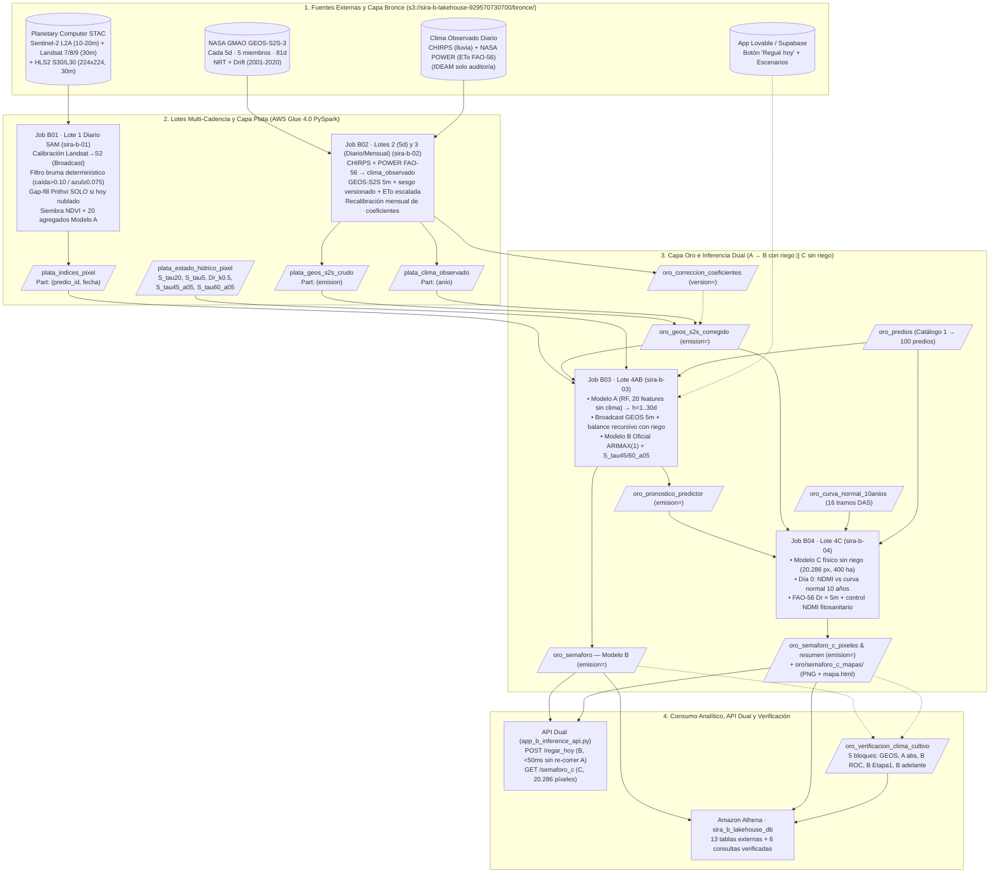

# 02_B — Arquitectura Técnica de Big Data (`B_SIRA_ARCH` · HEAD `8fde03d`)

**Proyecto:** SIRA — Sistema Inteligente de Riego para Arroz en el Alto Magdalena (Equipo 10, EAFIT)  
**Fuente ML y Operación:** [`SIRA\github`](https://github.com/GomSal/SIRA/tree/modelo-humedad) (`https://github.com/GomSal/SIRA/tree/modelo-humedad`, commit `8fde03d`, 21-nov-2026)  
**Bucket S3:** `s3://sira-b-lakehouse-929570730700/` · **Base de Datos Athena:** `sira_b_lakehouse_db` (**13 tablas**)

---

## 1. Arquitectura General del Ecosistema de 3 Modelos (A → B || C)

Las pruebas formales y operativas en `modelo-humedad` demostraron que un único modelo no resuelve todos los escenarios de campo. Por ello, `B_SIRA_ARCH` implementa una **arquitectura Lakehouse Medallion (Bronce → Plata → Oro)** que alimenta una cadena de **tres modelos especializados**:

1. **Modelo A — Predictor Espectral (`Random Forest`, 200 árboles para `NDVI` y `NDMI`, `h = 0..30 d`):**
   - Pronostica la trayectoria de `NDVI` y `NDMI` por píxel de 10 m en escala Sentinel-2 usando **20 variables espectrales, de rezago y fenológicas** (**sin clima ni PCA de Prithvi**).
   - Prueba sellada (`167.939` filas, `8ed983d`): `NDVI` `RMSE 0,120` ($R^2 = 0{,}791$, *skill* `+0,28`); `NDMI` `RMSE 0,093` ($R^2 = 0{,}768$, *skill* `+0,29`).
2. **Modelo B — Semáforo Supervisado con Riego Registrado (`ARIMAX(1)` oficial + Reentreno Etapa 1):**
   - **Oficial (`ec84551`):** `ARIMAX(1)` **sin Prithvi** sobre 7 exógenas (`S_tau20`, `S_tau5`, `Dr_k0.5`, `riego_5d`, `dias_desde_riego`, `eto_5d`, `ndvi`). Prueba sellada (198 TDR): **`AUC-ROC macro = 0,754 [0,678–0,814]`** y **`12/17 rojos detectados`**.
   - **Preparación Reentreno Etapa 1 (`8fde03d`):** Sin contadores de riego, el ganador entre 17 ecuaciones es el reservorio exponencial con $\alpha = 0{,}5$ y memoria larga:
     $$S_\tau(t) = e^{-1/\tau}\,S_\tau(t-1) + 0{,}5\cdot L(t) + R(t) - K_c(t)\cdot\text{ET}_o(t)$$
     con **`S_tau45_a05`** (`AUC val 0,786`, elegido en 3/4 particiones y con todos los datos) y **`S_tau60_a05`** (`AUC val 0,790`). El pipeline Big Data ya materializa y arrastra ambos estados en Plata y Oro.
3. **Modelo C — Semáforo Físico Operativo SIN Riego Registrado (`1a592aa`, `scripts/operacion/semaforo_c.py`):**
   - Diseñado para operar sobre **400 ha (2×2 km, 20.286 píxeles de 10 m)** cuando el agricultor no registra riegos previos. No requiere reentrenamiento:
     - **Día 0 (`h = 0`):** compara el `NDMI` actual del píxel contra la **curva normal de 10 años por DAS** (`oro_curva_normal_10anios`):
       $$z_0 = \frac{\text{NDMI}_0 - \mu_{\text{curva}}(\text{DAS}_0)}{\sigma_{\text{curva}}(\text{DAS}_0)}, \qquad Dr_0 = \text{clip}\!\left(\frac{-0{,}67 - z_0}{-0{,}67 - (-1{,}28)},\;0,\;1\right) \times 4{,}34\text{ mm}$$
     - **Días `1..30`:** propaga el balance radicular FAO-56 (`TAW = 6,7 mm`, `p = 0,65`, `RAW = 4,355 mm`, `DSAT = 26,475 mm`, drenaje `k = 0,5` si $Dr < 0$) sobre los **5 miembros de GEOS-S2S-3 corregido** con $K_c(h) = \text{clip}(1{,}0\cdot\text{NDVI}_A(h) + 0{,}45,\;0{,}6,\;1{,}3)$ y toma la **mediana `DRM`** (`suficiente` $Dr \le 0$, `media` $0 < Dr \le 4{,}34$, `baja` $Dr > 4{,}34$) más la probabilidad `p_baja = mean(DR > 4.34)`.
     - **Control de anomalía de `NDMI` pronosticado por A (alerta fitosanitaria):**
       $$\text{ANOM}(h) \iff \frac{\text{NDMI}_A(h) + \text{RMSE}_A(\Delta) - \mu_{\text{curva}}(\text{DAS}_h)}{\sigma_{\text{curva}}(\text{DAS}_h)} < -1{,}28$$
       Si la clase es `media` y hay anomalía, degrada a **`baja`**; si es `suficiente`, mantiene `suficiente` y activa la **marca morada** (*«posible enfermedad o deficiencia nutricional»*).

---

## 2. Diagrama de Flujo End-to-End (`B_SIRA_ARCH` · 4 Jobs PySpark + 3 Cadencias)

---

## 3. Orquestación Multi-Cadencia (AWS Step Functions + EventBridge)

| Máquina de Estados (Step Functions) | Schedule (EventBridge · `America/Bogota`) | Flujo de Ejecución |
|---|---|---|
| `sira-b-flujo-diario-imagenes-inferencia` | `sira-b-horario-diario-5am` (`cron(0 5 * * ? *)`) | `sira-b-01` (Imágenes) $\rightarrow$ `sira-b-03` (Modelo A + Semáforo B) $\rightarrow$ `sira-b-04` (Semáforo C operativo). |
| `sira-b-flujo-geos-5dias` | `sira-b-horario-geos-5dias` (`rate(5 days)`) | `sira-b-02` (GEOS-S2S 5m) $\rightarrow$ **`Parallel`**: (`sira-b-03` Semáforo B **\|\|** `sira-b-04` Semáforo C). |
| `sira-b-flujo-recalibracion-mensual` | `sira-b-horario-recalibracion-mensual` (`cron(0 6 1 * ? *)`) | `sira-b-02` (Contraste mensual GEOS vs. CHIRPS/POWER → nueva `version=` en `oro_correccion_coeficientes`). |

---

## 4. Decisión Cuantitativa de Spark (`SPARK_ECUACION.md`)

- **MVP (1 predio — Nataima):** $N \approx 3{,}5\times 10^8$ filas históricas (cómputo ~18 s en 4 núcleos, ~14 GB RAM). Como el arranque de Spark ($T_0 \approx 10\text{–}30\text{ s}$) supera el cómputo, **en 1 predio corre en Python puro**.
- **Escala Distrital / 100 Predios ($N \approx 10^{10}$ filas históricas, $1{,}5\times 10^7$ pronósticos por corrida):** cuando $N\cdot b\cdot k > \text{RAM}$, **AWS Glue PySpark** entra en los Jobs **`sira-b-01`** (particionado por `predio_id=/fecha=`), **`sira-b-03`** y **`sira-b-04`** (con `Broadcast` del clima de 5 miembros y la curva normal de 16 filas $\Rightarrow$ cero *shuffle* de píxeles).
- **Dónde Spark NO se requiere ni con 100 predios:** descarga de los 15 archivos globales de GEOS-S2S-3 y recalibración mensual de coeficientes.
