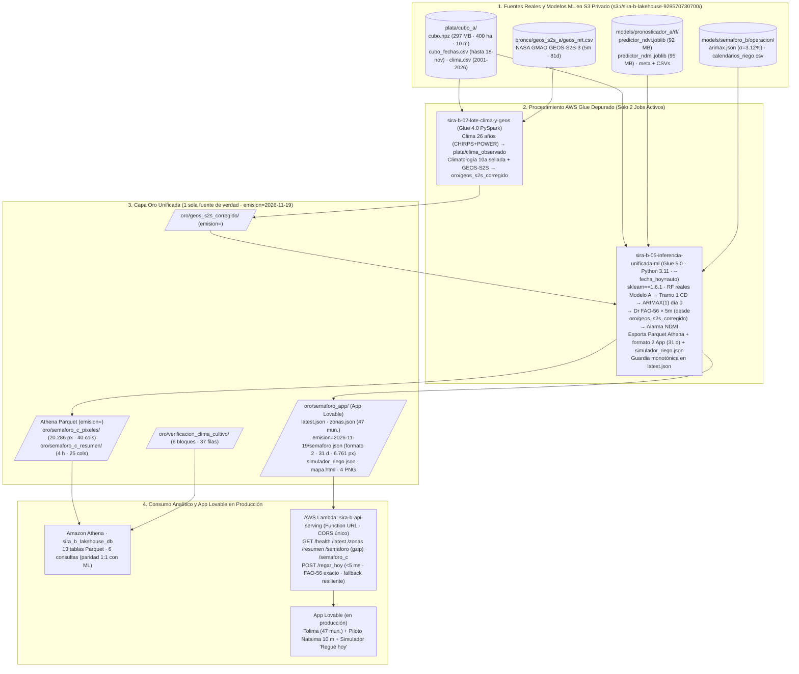

# 02_B — Arquitectura Técnica Unificada ML ↔ Big Data ↔ App (`B_SIRA_ARCH` · HEAD `876be25`)

**Proyecto:** SIRA — Sistema Inteligente de Riego para Arroz en el Alto Magdalena (Equipo 10, EAFIT)  
**Fuente ML y Operación:** [`GomSal/SIRA@modelo-humedad`](https://github.com/GomSal/SIRA/tree/modelo-humedad) (commits `d77ae9c` → `876be25`, emisión activa **`2026-11-19`**)  
**Bucket S3:** `s3://sira-b-lakehouse-929570730700/` · **Base de Datos Athena:** `sira_b_lakehouse_db` (**13 tablas**)  
**API Serving AWS Lambda (en producción con Lovable):** `https://s435rizz22wj6qd3mv37doq76m0widfd.lambda-url.us-east-2.on.aws/`

---

## 1. Arquitectura Científica y Operativa Unificada (`A + B día 0 + Dr FAO-56`)

Tras la prueba de dinámica del 22-nov-2026 (`d77ae9c`, `reports/b_reentreno/dinamica/resultado.json`) —que demostró que ni ARIMAX(1) por colinealidad de signos ni el reentreno con `S_tau45` ($\rho = -0{,}076$) siguen los secados a 30 días, y descartó la regla de probabilidad `P / prior`— el producto SIRA quedó consolidado en **una única cadena secuencial de dos modelos entrenados y dos ecuaciones físicas**, ejecutada en la nube por **`sira-b-05-inferencia-unificada-ml`** (AWS Glue 5.0):

1. **Modelo A — Predictor Espectral (`Random Forest`, 200 árboles, `scikit-learn 1.6.1`, `.joblib` reales en S3):**
   - Cargado directamente desde `s3://.../models/pronosticador_a/rf/predictor_ndvi.joblib` (92,2 MB) y `predictor_ndmi.joblib` (95,3 MB).
   - Detecta la fecha de siembra por la curva `NDVI` y pronostica `NDVI` y `NDMI` por píxel de 10 m (`h = 0..30 d`) usando **20 variables espectrales, de rezago y fenológicas** (**sin clima ni PCA de Prithvi**).
   - Prueba sellada (`167.939` filas): `NDVI` $R^2 = 0{,}791$ (`RMSE 0,120`); `NDMI` $R^2 = 0{,}768$ (`RMSE 0,093`).
2. **Tramo 1 (`siembra → hoy`) — Ecuaciones físicas de entradas de B (`b_entradas.propagar`):**
   - Propaga $S_{20}$, $S_5$, $Dr_{k=0{,}5}$, `riego_5d`, `dias_desde_riego`, `eto_5d` y `ndvi` sobre `plata/cubo_a/clima.csv` (CHIRPS hasta `2026-09-30` con relleno automático `PRECTOTCORR` de NASA POWER en los `50` días de hueco hasta `2026-11-19`) + NDVI observado del píxel + los **3 calendarios de riego `CD`** de Nataima (`models/semaforo_b/operacion/calendarios_riego.csv`), promediando $\mu$.
3. **Día 0 (`hoy`) — Modelo B oficial (`ARIMAX(1)` sin Prithvi, `models/semaforo_b/operacion/arimax.json`):**
   - Corrige únicamente el estado de **hoy** ($\sigma = 3{,}12\,\%$) y aplica el margen **una sola vez al arranque**:
     $$Dr_0 = 1{,}5\cdot(30 - \mu_0) + 1{,}5\cdot\sigma \qquad (1{,}5\cdot\sigma = 4{,}68\text{ mm})$$
4. **Tramo 2 (`hoy → +30 días`) — `Dr_modificada` FAO-56 (`propagar_dr`, sin riego, sin margen):**
   - Propaga desde $Dr_0$ con lluvia y ETo corregidas de los **5 miembros de GEOS-S2S-3** (consumidos desde `oro/geos_s2s_corregido/` generado por `sira-b-02`), $K_c(h) = \text{clip}(1{,}0\cdot\text{NDVI}_A(h) + 0{,}45,\;0{,}6,\;1{,}3)$, `TAW = 6,7 mm`, `p = 0,65`, `DSAT = 26,475 mm`, drenaje `k = 0,5`.
   - Promedia (`mean`) los 5 miembros y pinta con los umbrales de Martínez-Vega et al. (2025): 🟢 `suficiente` ($Dr \le 0$), 🟡 `media` ($0 < Dr \le 4{,}34$), 🔴 `baja` ($Dr > 4{,}34$).
5. **Alarma tardía fitosanitaria del `NDMI`:**
   - Si el píxel es 🟢 `suficiente`, pero $(\text{NDMI}_A + \text{RMSE}_A(\Delta) - \mu_{\text{curva}})/\sigma_{\text{curva}} < -1{,}28$, agrega la **marca morada** 🟣 (*«posible enfermedad o deficiencia nutricional»*) **sin degradar** `media → baja`.

---

## 2. Diagrama de Flujo End-to-End Limpio en AWS (`us-east-2` · 2 Jobs Glue)

---

## 3. Orquestación Multi-Cadencia Limpia (AWS Step Functions + EventBridge)

Se eliminaron los 3 Jobs intermedios/obsoletos (`sira-b-01`, `sira-b-03`, `sira-b-04`) y los 6 Jobs de la Iteración A, dejando **3 flujos secuenciales limpios** sin ramas paralelas redundantes:

| Máquina de Estados (Step Functions) | Schedule (EventBridge · `America/Bogota`) | Flujo Conectado Actual |
|---|---|---|
| `sira-b-flujo-diario-imagenes-inferencia` | `sira-b-horario-diario-5am` (`cron(0 5 * * ? *)`) | **`sira-b-05`** (`--fecha_hoy=auto`, `--prefer_oro_geos=true`): recalcula el semáforo unificado 400 ha y refresca Athena + Lovable si entraron datos nuevos. |
| `sira-b-flujo-geos-5dias` | `sira-b-horario-geos-5dias` (`rate(5 days)`) | **`sira-b-02`** (Clima 26a + GEOS-S2S) $\rightarrow$ **`sira-b-05`** (`--fecha_hoy=auto`, consumiendo `oro/geos_s2s_corregido`). |
| `sira-b-flujo-recalibracion-mensual` | `sira-b-horario-recalibracion-mensual` (`cron(0 6 1 * ? *)`) | **`sira-b-02`** (Recalibración climática mensual sobre 26 años `plata/cubo_a/clima.csv`). |

### Protecciones Operativas Incorporadas
1. **Resolución automática de fecha (`--fecha_hoy=auto`):** `sira-b-05` toma automáticamente el último día con precipitación disponible en `plata/cubo_a/clima.csv` (misma regla que `actualizar_datos.py` de ML → `2026-11-19`), evitando fechas congeladas.
2. **Guardia monotónica sobre `latest.json`:** `sira-b-05` lee el `oro/semaforo_app/latest.json` actual antes de actualizarlo y **nunca lo sobreescribe con una emisión más antigua**, protegiendo las subidas manuales del equipo de ML (`subir_aws.py`).
3. **Resiliencia en `sira-b-api-serving`:** `GET /semaforo_c` lee coordenadas directamente de `semaforo.json`, y `POST /regar_hoy` hace fallback automático al `simulador_riego.json` más reciente si una subida manual aún no ha sido complementada por `sira-b-05`.

---

## 4. Decisión Cuantitativa de Spark (`SPARK_ECUACION.md`) Aplicada a AWS

- **Piloto 400 ha (20.286 píxeles, 6.761 en cultivo al 19-nov):** `cubo.npz` (297 MB) + ambos `.joblib` (187 MB) caben en **1 nodo `G.1X` (16 GB RAM)** de AWS Glue 5.0 (`sira-b-05`) y ejecutan la inferencia real completa + exportación Parquet/App en **`194 s`** sin overhead de serializar 187 MB de árboles a ejecutores distribuidos.
- **Escala Distrital / 100 Predios ($N \approx 10^{10}$ filas históricas, $1{,}5 \times 10^7$ pronósticos por corrida):** cuando $N \cdot b \cdot k > \text{RAM}$, **PySpark distribuido** (`sira-b-02` con `Broadcast Join` climático + distribución por `predio_id` en `sira-b-05`) particiona por `predio_id=/fecha=` y hace `Broadcast` del clima (celda 55 km) y de `arimax.json` (1,4 KB), evitando *shuffles* masivos de píxeles.
- **Capa de Serving (`POST /regar_hoy`):** **AWS Lambda** sin Spark ni `scikit-learn` (solo stdlib + `boto3` leyendo `simulador_riego.json` desde S3 con caché de 60 s) responde en **`< 5 ms`** en caliente con la física exacta de 5 miembros FAO-56.
