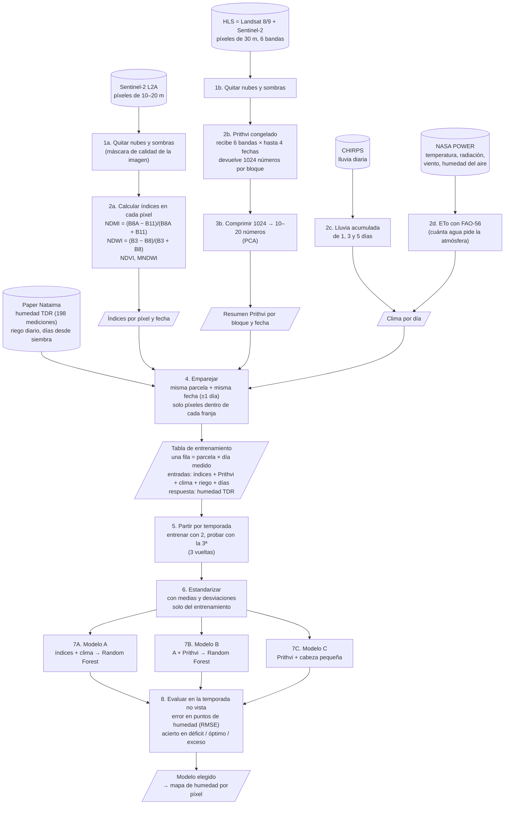
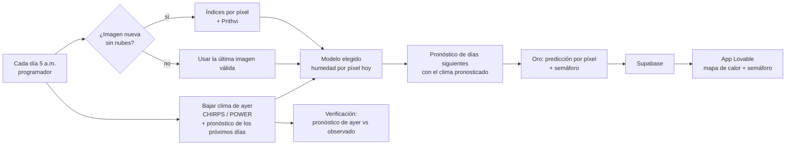

# HANDOVER: SIRA (Equipo 10), estrategia completa

Para la IA del equipo. Resume las decisiones tomadas, por qué, qué ya está hecho y qué falta. Fecha: 12-nov-2026. Entrega final: 23-nov-2026.

---

## 0. Decisiones del 14-nov (mandan sobre lo de abajo cuando se contradigan)

1. **Humedad continua:** las mediciones TDR se interpolan con **PCHIP** a curvas diarias por franja. Cada valor queda marcado como *medido* o *interpolado*. La evaluación final se hace solo sobre valores medidos.
2. **Entrenamiento por píxel y fecha:** cada píxel de cada fecha es una fila.
   - Sentinel-2 a 10 m: ~30 píxeles por franja.
   - Landsat a 30 m: ningún píxel es puro, así que su humedad es **el promedio de las franjas que cubre, ponderado por área**.
   - Las filas no son independientes: se valida dejando una temporada afuera, nunca separando píxeles al azar.
3. **Relleno de huecos (gap-filling) por píxel:** se ajusta una curva a la serie de cada índice para estimar los días nublados. Los valores rellenados quedan marcados y no se usan para evaluar.
4. **Prithvi recibe HLS** (Landsat + Sentinel-2 a 30 m). Da un resumen por bloque de 480 m: es contexto por fecha, no datos por píxel. La cabeza es nuestra.
5. **Entradas del modelo:**
   - **Sí:** imagen e índices, tendencias, Prithvi, clima, agua aplicada (lluvia + riego en mm).
   - **No:** el nombre de la técnica (CD/MIRI/AWD) ni el número de temporada. Las franjas valen como muestras de distintos regímenes de agua; las temporadas solo sirven para validar.
   - **Etapa del cultivo:** se decide comparando. El modelo sin etapa contra el modelo con etapa estimada desde el satélite; si no mejora, se quita. El campesino no ingresa nada sobre la siembra.
6. **Imágenes:**
   - Se buscan en los catálogos oficiales sobre Nataima, 2021–2022:
     - ESA Sentinel-2 L2A: 146 fechas;
     - USGS Landsat C2 L2: 101 fechas (L8 45, L7 44, L9 21). Landsat 7 trae franjas sin datos.
   - Se descargan de **Microsoft Planetary Computer**, sin cuenta. Tiene las mismas 146 fechas de Sentinel-2, pero solo 89 de Landsat; para tener las 101, hace falta la cuenta USGS (M2M).
   - Solo se lee la ventana de interés, no escenas completas.
7. **Infraestructura: Kaggle para el cómputo, Google Drive (2 TB) para guardar.**
   - Cuatro cuadernos en cadena, cada uno con "Save & Run All" en la nube:
     1. ingesta;
     2. ETL con **PySpark**: imagen → tabla píxel·fecha, nubes, índices, relleno de huecos por píxel con `applyInPandas`, uniones;
     3. Prithvi en GPU T4;
     4. entrenamiento.
   - Kaggle ↔ Drive con **rclone**, usando credenciales OAuth en los Secrets de Kaggle (no una cuenta de servicio).
   - Capas bronce, plata y oro en Parquet, particionadas por fecha.
8. **El área grande (mapa de calor) es solo visualización** y se define después. Debe caber en una sola escena, sin mosaicos. El entrenamiento es solo con Nataima.

---

## 1. Qué es SIRA, en una línea

Un modelo que estima **la humedad del suelo/cultivo de arroz por píxel** con imágenes satelitales + clima, entrenado con las mediciones reales de campo de Nataima (Agrosavia, Espinal, Tolima). Una app muestra un **mapa de calor diario** y un semáforo de riego.

- Propuesta original: `Propuesta_del_proyecto_Equipo10_SIRA_unificado.pdf` (referencias [1]–[57]).
- Artículo base (verdad de campo): Martínez-Vega et al. 2025, *Irrigation Science* 43:1615–1633 (ref. [5]). Copia en `data/raw/martinez_vega_2025.pdf`.

---

## 2. Decisiones tomadas (y por qué)

| Tema | Decisión | Por qué |
|---|---|---|
| Verdad de campo | Digitalizar las Figs. 2–4 del artículo | Los datos originales son privados; el artículo solo trae gráficas. La Tabla 2 son 9 totales |
| Base del modelo | **Prithvi-EO-2.0 congelado** + modelo entrenado encima | Es lo prometido a los jurados. Así lo usa NASA en su ejemplo de carbono (GPP) |
| ¿Decoding restringido (base + experto en paralelo)? | **No** | Solo hay una fuente de verdad de campo (Nataima). Un experto en paralelo entrenado con los mismos datos no aporta nada. Solo tendría sentido si existiera una cabeza de humedad entrenada en otro lado, y no existe publicada (ver §7) |
| Qué aprende el modelo | La **humedad TDR** medida en campo | Es la única medición real. Índices, Prithvi, clima y riego son **entradas** |
| Índices | NDMI, NDWI (McFeeters), NDVI, MNDWI por píxel, de Sentinel-2 | Tabla 2 de la propuesta. Sentinel-2 a 10–20 m es lo único que separa las parcelas (ver §3) |
| Comparación obligatoria | A: índices + clima · B: A + Prithvi · C: Prithvi + cabeza pequeña | Mide cuánto aporta Prithvi. El único estudio que lo midió para humedad no encontró mejora (§7) |
| Validación | Dejar una temporada afuera (3 vueltas) | Días vecinos se parecen. Separar al azar infla el resultado |
| Lluvia | **CHIRPS** | Menor sesgo frente a la lluvia medida en el lote (+14 %). Ver `reports/comparacion_lluvia.md` |
| Temperatura, radiación, viento, humedad del aire (ETo) | **NASA POWER** | Serie completa, sin huecos, con todo lo de FAO-56 |
| IDEAM | Descartado para entrenar | Estaciones públicas a 15–36 km, con huecos (ninguna tiene GS2) y sesgo de −36 a −63 % |
| ERA5 | Descartado para lluvia | +142 % de sesgo en GS2 |
| Streaming (Kafka/Kinesis) | **No** | No hay flujo continuo. Basta un proceso en lotes una vez al día |

---

## 3. Hallazgos que cambian el diseño

1. **Escala del lote** (`scripts/escala_lote.py`, plano georreferenciado de la Fig. 1):
   - El lote mide 136 × 70 m (≈0,96 ha): 3 franjas (CD, MIRI, AWD+MIRI) de 23,5 m de ancho, giradas 33°.
   - HLS a 30 m: **0 píxeles puros por franja**.
   - Sentinel-2 a 10 m: **10–15 píxeles puros por franja**. A 20 m (SWIR, necesario para el NDMI): 0 puros, pero hay píxeles con 93–98 % de pureza.
   - **El lote completo cabe en un solo bloque de Prithvi**, que mide 16×16 píxeles, o sea 480 m con HLS.
   - Consecuencia: el detalle por parcela sale de los índices de Sentinel-2. Prithvi aporta contexto del entorno.
2. **Qué es Prithvi:**
   - Es un ViT preentrenado como *masked autoencoder*: rellena pedazos tapados de imágenes HLS. Así aprende a "ver", pero no resuelve ninguna tarea por sí solo.
   - Devuelve 1024 números por bloque. **No están catalogados**: su significado lo aprende el modelo que se entrena encima, con datos de campo.
   - Lee Landsat y Sentinel-2 juntos (HLS, 30 m, 6 bandas).
3. **Fechas de siembra:** el artículo solo da meses. Se estimaron alineando la lluvia del artículo con las fuentes satelitales: **GS1 ≈ 27-may-2021, GS2 ≈ 4-dic-2021, GS3 ≈ 9-jul-2022**. La de GS3 es la menos segura.
4. **Incoherencias del artículo:**
   - La lluvia máxima diaria de GS2 es 87 mm en el texto, pero ≈77 mm en la figura.
   - Las sumas por etapa de la Fig. 4 usan cortes de etapa distintos al sombreado de la figura.
   - En GS1, la línea de AtWD está corrida un día respecto a las barras de lluvia.
5. **El R² = 0,68 de la ref. [7] no sirve como línea base.** Se obtuvo con dron, 768 muestras, variables fisiológicas medidas en campo y validación aleatoria.
6. **La lluvia satelital no acierta el día a día en el lote.** La correlación diaria es ≤ 0,42 (el aguacero de 113 mm aparece como 26–48 mm). El modelo debe usar la lluvia acumulada de varios días, no la diaria exacta.

---

## 4. Flujo de entrenamiento

**Detalles que no deben perderse:**
- **Clases de humedad:** déficit < 27,1 %, óptimo 27,1–30 %, exceso > 30 % (propuesta, Tabla 3). Se derivan de la humedad predicha, no de un clasificador aparte.
- **Bandas de cada satélite:**
  - Landsat 8/9 C2 L2: verde SR_B3, rojo SR_B4, NIR SR_B5, SWIR1 SR_B6. Factor de escala ×0,0000275 − 0,2.
  - Sentinel-2 L2A: B3 y B4 (10 m), B8 (10 m), B8A y B11 (20 m). Factor ÷10000.
- **Pocos datos (~200 mediciones):** los 1024 números de Prithvi se comprimen (PCA) o se regulariza fuerte. Si no, el modelo memoriza.
- **Prueba clave para el informe:** cuánto se relacionan los componentes de Prithvi con la humedad **después de descontar** lo que ya explican el NDMI y el NDWI.
- **Volumen estimado** (falta contarlo en GEE): ~10–15 imágenes despejadas por temporada, ~90–135 pares imagen + medición. El cómputo es de minutos (Colab GPU). Lo que toma tiempo es preparar los datos: 1–2 días.

---

## 5. Estrategia de almacenamiento

Volumen pequeño: una finca de ~1 ha y recortes de pocos km. **No hace falta infraestructura pesada para las imágenes.** Se reutiliza la arquitectura Medallion del Trabajo 1 del curso: S3 + Athena + Iceberg ([repo](https://github.com/tomasguzman0925-ship-it/trabajo1-bigdata)).

| Capa | Qué guarda | Formato |
|---|---|---|
| **Bronce** (S3, tal como llega) | Recortes Sentinel-2 / HLS alrededor de Nataima (COG), respuestas de CHIRPS, NASA POWER y del pronóstico (JSON), datos digitalizados del artículo (CSV) | Archivos crudos, particionados por fuente/fecha |
| **Plata** (Iceberg) | `pixel_dia`: índices + máscara de nubes por píxel y fecha. `prithvi_bloque_dia`: componentes de Prithvi. `clima_dia`: lluvia 1/3/5 d y ETo. `campo`: humedad TDR, riego, etapa | Tablas tipadas, particionadas por año/mes |
| **Oro** (Iceberg) | `entrenamiento`: tabla parcela × día. `prediccion_pixel_dia`: humedad y clase por píxel, hoy y pronóstico. `verificacion`: pronóstico de clima vs observado | Tablas agregadas, listas para consumir |
| **App** (Supabase de Lovable) | Solo lo que muestra la app: el último mapa, el semáforo por parcela y el pronóstico | Postgres |

- **Spark** (Glue o EMR Serverless) en lotes diarios: se justifica al escalar a todo el distrito UsoCoello o al reprocesar años de historia. Para Nataima sola, Python basta.
- **Kafka/Kinesis:** no se usan.

---

## 6. La app (Lovable): mapa de calor diario de Nataima

"Tiempo real" significa **una actualización diaria**: la humedad cambia en días, no en segundos.

**Qué muestra la app:**
- **Mapa de calor:** humedad por píxel de 10 m sobre la finca (≈95 casillas).
- **Semáforo por parcela:**
  - 🔴 déficit hoy, hay que regar;
  - 🟡 déficit dentro de N días;
  - 🟢 el clima alcanza, no hay que regar.
- **Botón "Regué hoy":** en producción nadie registra los riegos, y el riego es la entrada que más mueve la humedad.
- **Fecha de la última imagen y nivel de confianza:** baja si lleva muchos días sin imagen despejada. De abril a junio menos de 1 de cada 10 escenas Landsat sobre Colombia es usable (Trabajo 1, capa oro).

**Ciclos de verificación diarios** (lo único verificable en tiempo real, porque no hay sensores de humedad fuera del artículo):
1. **Clima:** el pronóstico de ayer contra lo observado (CHIRPS / NASA POWER).
2. **Cultivo:** cuando llega una imagen nueva, el índice que esperaba el modelo contra el que mide el satélite.

**Límites a declarar:**
- El modelo queda fijo después de entrenarlo con Nataima 2021–2022; sin mediciones nuevas de humedad no se puede reentrenar.
- El pronóstico pierde confianza después de ~7 días, porque depende del pronóstico de lluvia.

---

## 7. Referencias nuevas (no están en la propuesta)

**Prithvi y su uso:**
1. Szwarcman, D. et al., arXiv:2412.02732, 2024. Ya está en la propuesta como [28]. Lo nuevo es usar su **tarea GPP** como receta: 37 torres de flujo, validación dejando un año afuera, Prithvi congelado + cabeza.
2. NASA-IMPACT, repositorio *Prithvi-EO-2.0*, GitHub: https://github.com/NASA-IMPACT/Prithvi-EO-2.0
   - `README.md`: preentrenamiento MAE y fine-tuning con TerraTorch.
   - `examples/carbon_flux/flux_regress.py`: cabeza de 2 capas lineales sobre Prithvi congelado.
   - `configs/sen1floods11.yaml`: `UperNetDecoder`, `freeze_backbone: false`.
3. IBM–NASA, modelos en Hugging Face: https://huggingface.co/ibm-nasa-geospatial. Son 15; los ajustados a una tarea son solo de inundaciones (Sen1Floods11), cicatrices de incendio y clasificación de cultivos. **No hay ninguno de humedad.**
4. IBM, *TerraTorch*: https://github.com/IBM/terratorch. En `terratorch/tasks/regression_tasks.py`, `ignore_index` permite entrenar con mediciones puntuales, ignorando los píxeles sin sensor.

**Estudios de humedad con modelos fundacionales:**
5. Chavda, R. y Das, K. (IBM Research). "Soil moisture estimation with geospatial foundation models and satellite imagery", AGU 2024. Prithvi-100M con sensores TxSON (Texas), Sentinel-1/2 a 10 m. Resultados con Prithvi "en curso"; no hay código ni pesos publicados.
6. Kontogiorgakis, I. et al. "Comparative assessment of multimodal Earth observation data for soil moisture estimation", arXiv:2602.18083, 2026. 113 estaciones ISMN en Europa. **Los embeddings de Prithvi dieron R² 0,515 frente a 0,514 de los índices con árboles de decisión.**
7. Boston, T. y Yebra, M. "Fine-tuning remote sensing foundation models for improved live fuel moisture content estimation", MODSIM 2025. Humedad de la vegetación con HLS de 6 bandas; resultados preliminares.
8. Marsocci, V. et al. "PANGAEA: A global and inclusive benchmark for geospatial foundation models", arXiv:2412.04204, 2024. Los modelos fundacionales no superan de forma consistente a una U-Net entrenada para la tarea.
9. Read, J. S. et al. "Process-guided deep learning predictions of lake water temperature", *Water Resources Research* 55(11), 2019. Referencia de modelos híbridos física + ML (opcional).

**Clima:**
10. Funk, C. et al. "The climate hazards infrared precipitation with stations (CHIRPS)", *Scientific Data* 2, 150066, 2015. Acceso por ClimateSERV: https://climateserv.servirglobal.net
11. NASA POWER, API diaria: https://power.larc.nasa.gov
12. ERA5 vía Open-Meteo: https://archive-api.open-meteo.com (evaluado y descartado para lluvia).
13. IDEAM, estaciones automáticas, datos.gov.co, dataset `s54a-sgyg` (evaluado y descartado).

---

## 8. Estado y siguientes pasos

**Hecho**, en `C:\Users\santi\SIRA`:
- [x] Digitalización de las Figs. 2–4 → `data/processed/nataima_diario.csv`. Validación en `reports/validacion_digitalizacion.md`; 11 pruebas pasan (`pytest`).
- [x] Comparación de fuentes de lluvia y fechas de siembra → `reports/comparacion_lluvia.md` y `data/interim/lluvia_fuentes_diaria.csv`.
- [x] Medición de escala del lote → `scripts/escala_lote.py`.
- [x] Flujo de entrenamiento → `docs/arquitectura_entrenamiento.md`.

**Pendiente**, en orden:
1. Confirmar la ubicación exacta del lote sobre una imagen real. El plano da un centro ≈200 m distinto de las coordenadas del artículo.
2. Bajar Sentinel-2 L2A y HLS de las 3 temporadas. El cuaderno `Landsat_SIRA.ipynb` (Colab + USGS M2M) sirve de base; contar las imágenes despejadas.
3. Calcular la ETo FAO-56 con NASA POWER y contrastarla con la ETo derivada del AtWD del artículo (columna `eto5_mm`).
4. Pasar las imágenes HLS por Prithvi (Colab GPU) y guardar los componentes.
5. Construir la tabla de entrenamiento y entrenar A, B y C dejando una temporada afuera.
6. Pipeline diario + Supabase + app Lovable.
7. **Actualizar la propuesta:**
   - cambiar Streamlit/HF Spaces por Lovable;
   - corregir "no opera en tiempo real" y "no obtiene pronósticos";
   - quitar el 0,68 de [7] como línea base;
   - cambiar "CNN experta + fusión de logits" por la comparación A/B/C.

**Tiempo estimado** (días de trabajo de una persona; son estimaciones):

| # | Paso | Tiempo | Cómputo |
|---|---|---|---|
| 1 | Confirmar la ubicación del lote | 1–2 h | — |
| 2 | Bajar Sentinel-2 y HLS, quitar nubes, recortar | 1 día | minutos en GEE |
| 3 | ETo con NASA POWER y contraste | 2–3 h | segundos |
| 4 | Prithvi en Colab (instalar TerraTorch, pesos ~1,2 GB, correr) | 0,5 día | ~10–30 min en GPU |
| 5 | Tabla de entrenamiento (emparejar fechas y píxeles) | 0,5 día | segundos |
| 6 | Entrenar y evaluar A, B y C (3 vueltas) | 1 día | A/B segundos, C ~30 min en GPU |
| 7 | Pipeline diario + Supabase + app Lovable | 2–3 días | — |
| 8 | Actualizar propuesta e informe | 1 día | — |
| | **Total** | **≈ 7–9 días-persona** | **< 1 h de GPU** |

- **Con 4 personas en paralelo:** ≈ 3–4 días de calendario. Por ejemplo, una persona en 2–4, otra en 7 y otra en 8, y el paso 6 cuando 2–5 terminen. Hay margen antes del 23-nov.
- **Lo que más tiempo consume no es el entrenamiento, sino preparar los datos (pasos 2 y 5) y la app (paso 7).**
- **Riesgo principal de calendario:** que haya muy pocas imágenes despejadas. Contarlas en el paso 2 antes de seguir.

**Limitaciones conocidas de los datos de campo:**
- Son 198 mediciones de humedad, confirmadas por su barra de error. Faltan marcadores de MIRI tapados por otros (GS1 tiene solo 12).
- El día de cada medición tiene ±1 día de incertidumbre.
- Todo proviene de un solo sitio, una variedad y un suelo. Fuera de Nataima el modelo no está validado.
