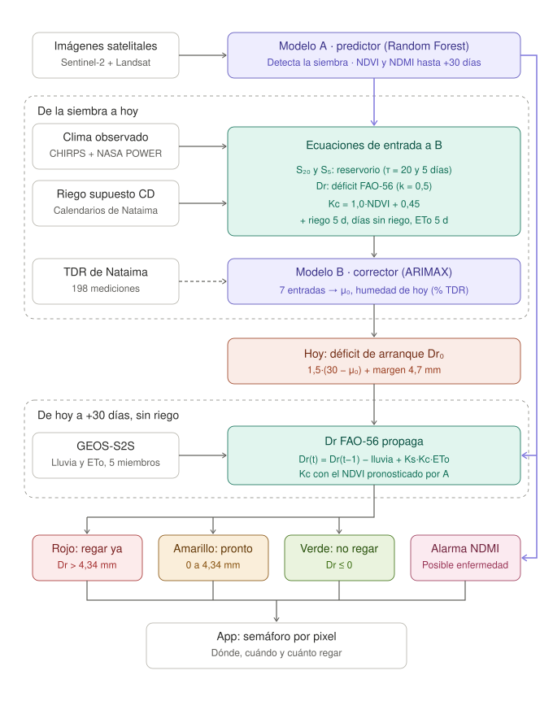
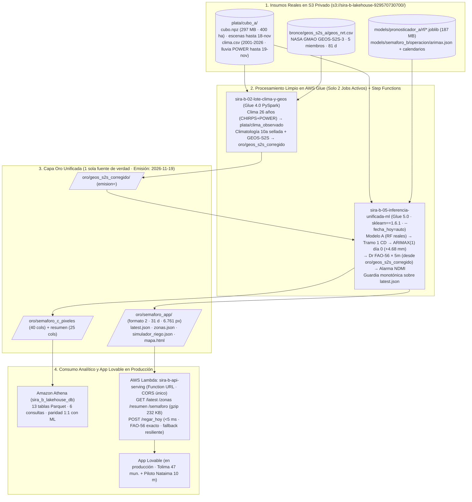

# SIRA — Sistema Inteligente de Riego para Arroz en el Alto Magdalena

**Proyecto Integrador 1** · Maestría en Ciencia de Datos y Analítica — **Universidad EAFIT** (**Equipo 10**)  
**Materias Integradas:** `SI7006` Almacenamiento y Procesamiento de Grandes Datos · `SI7009` Aprendizaje Automático · `SI7007` Visualización de Datos  
**Referencia Científica (Verdad de Campo):** Martínez-Vega et al. (2025), *Irrigation Science* 43:1615–1633 (CC BY 4.0) — C.I. Nataima (Agrosavia, El Espinal, Tolima; `lat 4.1895, lon -74.9621`)  
**API Pública en Producción (App Lovable · AWS Lambda Function URL · CORS):** `https://s435rizz22wj6qd3mv37doq76m0widfd.lambda-url.us-east-2.on.aws/`

---

## 1. Mapa de Ramas del Repositorio

| Rama | Contenido y Propósito | Estado |
|---|---|---|
| **`main`** *(actual)* | **Documentación maestra, diagramas integrados y guía de replicación exacta** (integra el estado vigente de Machine Learning en `modelo-humedad` y de Big Data + AWS Lambda en `Big-Data_Arch`). | Actualizada (`d95f3a3` + `Big-Data_Arch`) |
| **`modelo-humedad`** | **Código y artefactos completos de Machine Learning** (Santiago Vélez Casallas): Fase 0 digitalización Nataima (`src/sira/`), Modelo A (`cloud/modelo_a/`, `scripts/modelo_a/`), Modelo B `ARIMAX(1)` (`models/semaforo_b/arimax.json`), pruebas selladas y dinámicas (`reports/`), Semáforo operativo (`scripts/operacion/semaforo_c.py`, `b_entradas.py`, `guardar_modelo_b.py`), actualización incremental (`actualizar_datos.py`), exportación a app (`exportar_app.py`) y subida a S3 (`subir_aws.py`). | Vigente (`HEAD d95f3a3`) |
| **`Big-Data_Arch`** | **Arquitectura completa y depurada de Big Data en AWS** (`B_SIRA_ARCH/` vigente + `A_SIRA_ARCH/` histórica): Lakehouse Medallion S3/Parquet, **2 Jobs activos en AWS Glue** (`sira-b-02` Glue 4.0 PySpark + `sira-b-05` Glue 5.0 con ML real y `--fecha_hoy=auto`), 3 Step Functions secuenciales, 3 EventBridge Schedules, 13 tablas en Amazon Athena y **AWS Lambda `sira-b-api-serving`** en producción con Lovable (`0 stacks` CloudFormation). | Vigente y verificada en vivo (`us-east-2`) |
| **`General-Documentation`** | Estructura inicial de carpetas (`Big Data/` y `Machine Learning/`). | Carpetas base creadas |

---

## 2. Qué Hace SIRA: Producto, Modelos y Arquitectura Integral

**SIRA** entrega un **semáforo de humedad del suelo por píxel de 10 m, proyectado día a día de hoy a +30 días**, para cultivos de arroz en el Alto Magdalena. El escenario operativo universal es **sin riego desde hoy**: el agricultor **no necesita ingresar ningún dato** para recibir una alerta accionable (*«en $N$ días pasas a rojo»*, lámina faltante en $\text{L/m}^2$ y volumen requerido en $\text{m}^3$), y además la aplicación en **Lovable** integra un simulador interactivo *«Regué hoy»* (`POST /regar_hoy` en `< 5 ms`) para evaluar el efecto de aplicar una lámina de riego en cualquier día futuro.

### 2.1 Umbrales Agronómicos Oficiales (Martínez-Vega et al., 2025)
Con profundidad radicular de `150 mm`, capacidad de campo `FC = 30 %` y déficit crítico `4,34 mm` (`1 %` de humedad volumétrica TDR equivale a **`1,5 mm = 1,5 L/m²`**):

| Color / Estado | Humedad Volumétrica (TDR) | Déficit bajo Capacidad de Campo (`Dr`) | Recomendación |
|---|---|---|---|
| 🔴 **Rojo (Baja)** | `< 27,1 %` | `> 4,34 mm` | **Riego inmediato** |
| 🟡 **Amarillo (Media)** | `27,1 – 30,0 %` | `0 – 4,34 mm` | **Programar riego en el intervalo indicado** |
| 🟢 **Verde (Suficiente)** | `≥ 30,0 %` | `≤ 0 mm` | **No requiere riego** (alcanza con la lluvia pronosticada) |
| 🟣 **Alarma Tardía NDMI** *(sobre píxel verde)* | Suelo suficiente (`verde`), pero `NDMI` pronosticado por A en el 10 % más seco de la curva normal de 10 años (aun sumando el RMSE de A) | No altera el color hídrico | **Revisar en campo: posible enfermedad o deficiencia nutricional** |

### 2.2 Flujo Científico de Machine Learning (`modelo-humedad` · `HEAD d95f3a3`)



El producto final combina **dos modelos entrenados** y **dos ecuaciones físicas**, ejecutados en orden estricto por cada píxel de 10 m (ver [`docs/esquema_semaforo.md`](docs/esquema_semaforo.md)):

| Pieza | Función Exacta | Parámetros / Evidencia Verificada | Archivo (`modelo-humedad`) |
|---|---|---|---|
| **1. Modelo A (Predictor Espectral)** | `Random Forest` (200 árboles) de `NDVI` y `NDMI` por píxel de 10 m. Detecta automáticamente la fecha de siembra por la curva `NDVI` y pronostica `NDVI` y `NDMI` de hoy a **+30 días** en escala Sentinel-2 usando **20 features espectrales/fenológicas** (**sin clima ni PCA de Prithvi**). | Prueba sellada (nov-2025 → sep-2026, `167.939` filas): **NDVI $R^2 = 0{,}791$** (`RMSE 0,120`, `WAPE 16,6 %`), **NDMI $R^2 = 0{,}768$** (`RMSE 0,093`, `WAPE 33,6 %`). QA local reproduce Kaggle con $r = 0{,}995$ (NDVI) y $0{,}998$ (NDMI). | `s3://.../models/pronosticador_a/rf/*.joblib` |
| **2. Ecuaciones de B (Siembra → Hoy)** | Propagan desde la siembra hasta hoy las 7 entradas del modelo B: $S_\tau(t) = e^{-1/\tau}S_\tau(t-1) + L + R - K_c\cdot\text{ET}_0$ ($\tau = 20$ y $5$), déficit FAO-56 $Dr_{k=0,5}$, `riego_5d`, `dias_desde_riego`, `eto_5d` y `ndvi`, usando lluvia **CHIRPS** (con relleno automático **NASA POWER `PRECTOTCORR`** en los días que CHIRPS aún no publica — `50 d` al 19-nov), ETo **NASA POWER** y **riego supuesto CD** (3 calendarios GS1–GS3 de Nataima). $K_c = \text{clip}(1{,}0\cdot\text{NDVI} + 0{,}45,\,0{,}6,\,1{,}3)$. | Reproducción exacta verificada por `guardar_modelo_b.py`: diferencia máxima = **`0,0`** frente a la tabla de entrenamiento unificada. | `scripts/operacion/b_entradas.py` (`propagar`) |
| **3. Modelo B (`ARIMAX(1)`, Corrección Hoy)** | Entrenado sobre las **198 mediciones reales TDR** de Nataima (**sin Prithvi**). Estima hoy $\mu_0$ (humedad esperada en % TDR) y $\sigma = 3{,}12\,\%$. Aplica un **margen único en el arranque** ($1{,}5\sigma = 4{,}68\text{ mm}$): $Dr_0 = 1{,}5\cdot(30 - \mu_0) + 1{,}5\cdot\sigma$. | Prueba sellada por bloques de 10 días: **AUC-ROC macro `0,754 [0,678–0,814]`**. Con regla de margen en el día 0: **9/17 rojos**, **24/42 amarillos**, **70/139 verdes** (`exactitud balanceada 0,53`; sin margen detecta `0/17` rojos). | `models/semaforo_b/arimax.json` · `scripts/operacion/guardar_modelo_b.py` |
| **4. Propagación `Dr_modificada` FAO-56 (Hoy → +30 d)** | Propaga desde $Dr_0$ día a día sin riego: $Dr(t) = Dr(t-1) - L + K_s\cdot K_c\cdot\text{ET}_0$, con `TAW = 6,7 mm`, `p = 0,65`, drenaje `k = 0,5` sobre capacidad de campo, límites `[-26,475, 6,7] mm`, usando **GEOS-S2S-3** (5 miembros corregidos por sesgo) y `NDVI` de A. Se promedia sobre los 5 miembros y se pinta sin volver a sumar margen. | `b_prueba_dinamica.py` demostró que ARIMAX(1) colineal apenas baja `0,3` puntos en 30 d y reentrenar con solo $S_{\tau 45}$ da $\rho = -0{,}08$ en secados. La dinámica a 30 d la impone la física FAO-56. | `scripts/operacion/b_entradas.py` (`propagar_dr`) · `scripts/operacion/semaforo_c.py` |
| **5. `Prithvi-EO-2.0-300M-TL` (Gap-Fill)** | Modelo fundacional satelital reservado **exclusivamente para relleno operativo de huecos en días nublados** sobre recortes `HLS2` ($224\times 224$ px, 30 m). | Reduce error en días nublados (RMSE `0,093` NDVI / `0,077` NDMI vs. `0,110 / 0,094` del último despejado), pero **no entra** como feature en A ni en B. | `cloud/modelo_b/` · `reports/semaforo_clasificador_ndvi_prithvi/` |

**Resultado operativo vigente en producción (`2026-11-19`, paridad 1:1 ML = Glue 5.0 = Athena = Lambda · 400 ha en Nataima, `67,61 ha` en cultivo, `6.761` píxeles activos de `20.286` agrícolas):**
- **Hoy (`h=0`, `2026-11-19`):** **`99,6 %` verde** (`67,34 ha`) · `0,4 %` amarillo (`0,27 ha`) · **`0,0 %` rojo** · `11,4 %` alarma fitosanitaria morada (`hueco CHIRPS: 50 días rellenados con NASA POWER`).
- **+7 días (`h=7`, `2026-11-26`):** **`100,0 %` rojo** (`67,38 ha`, déficit medio `6,61 L/m²`, `4.457 m³`, lluvia/ETo `3,9 / 25,3 mm`).
- **+15 días (`h=15`, `2026-12-04`):** **`100,0 %` amarillo** (`66,37 ha`, déficit medio `1,92 L/m²`, `1.276 m³`, lluvia/ETo `39,9 / 55,2 mm`).
- **+30 días (`h=30`, `2026-12-19`):** **`100,0 %` rojo** (`65,98 ha`, déficit medio `6,63 L/m²`, `4.377 m³`, lluvia/ETo `79,0 / 113,3 mm`).
- **Urgencia sin riego desde hoy:** `0,0 %` ya hoy · **`1,6 %` en 1–2 días** (`111 px`) · **`98,4 %` en 3–5 días** (`6.650 px`).

---

### 2.3 Arquitectura Big Data Limpia y Conectada en AWS (`Big-Data_Arch` · `B_SIRA_ARCH`)



- **Patrón de almacenamiento:** **Lakehouse Medallion** (`bronce/` → `plata/` → `oro/`) en **Amazon S3 privado** (`BlockPublicAccess=True`) con **Apache Parquet (Snappy)** particionado (`predio_id=/fecha=`, `anio=`, `version=`, `emision=`) y JSON comprimido `gzip` (`formato: 2`) para la app.
- **Sin streaming (Kafka/Kinesis):** la humedad del suelo cambia en escala de días y las fuentes son discretas (diaria, cada 5 días y mensual); opera como **batch multi-cadencia**.
- **Infraestructura depurada (0 ruido):** se eliminaron los 9 Glue Jobs, 2 Step Functions y 2 EventBridge Schedules obsoletos de iteraciones previas, dejando únicamente **2 Glue Jobs (`sira-b-02`, `sira-b-05`)**, **3 Step Functions secuenciales**, **3 EventBridge Schedules** y **1 AWS Lambda (`sira-b-api-serving`)**.
- **Regla de aprovisionamiento:** **0 stacks en CloudFormation** — toda la infraestructura en AWS (`us-east-2`) se gestiona directamente vía `boto3`.

---

## 3. Replicación Exacta del Proyecto Paso a Paso

### Paso 0 · Prerrequisitos
1. **Git** (`>= 2.40`) y **Python `3.11+`** (Conda `conda-forge` o `venv`).
2. **Solo si vas a replicar la Fase 0 (digitalización del PDF):** copia local del artículo CC BY 4.0 de Martínez-Vega et al. (2025) en `data/raw/martinez_vega_2025.pdf` *(los CSV ya digitalizados SÍ vienen en `modelo-humedad`)*.
3. **Solo si vas a desplegar en AWS (`us-east-2`):** permisos sobre S3, IAM, Glue, Step Functions, EventBridge Scheduler, Athena, Lambda y CloudWatch Logs vía `aws configure` o `AWS_CREDENTIALS_CSV` *(nunca subas llaves al repositorio)*.

### Paso 1 · Replicación de Machine Learning (Rama `modelo-humedad`)
```bash
git clone https://github.com/GomSal/SIRA.git
cd SIRA
git checkout modelo-humedad
python -m venv .venv
# Windows: .\.venv\Scripts\Activate.ps1 | Linux/macOS: source .venv/bin/activate
pip install -r requirements.txt

# 1. Guardar modelo B oficial y verificar reproducción exacta (dif = 0)
python scripts/operacion/guardar_modelo_b.py

# 2. Actualizar clima (POWER + CHIRPS) y escenas nuevas del cubo + GEOS-S2S
python scripts/modelo_a/bajar_geos.py
python scripts/operacion/actualizar_datos.py

# 3. Correr semáforo operativo (auto-detecta último día con lluvia POWER) y exportar a app
python scripts/operacion/semaforo_c.py --hoy 2026-11-19 --riego CD --lat 4.1895 --lon -74.9621 --lado_km 2
python scripts/operacion/exportar_app.py
python scripts/operacion/subir_aws.py  # sube solo entradas; Glue sira-b-05 produce oro/semaforo_app/
```

### Paso 2 · Replicación de Big Data y AWS (Rama `Big-Data_Arch`)
```bash
git checkout Big-Data_Arch
pip install -r requirements_bigdata.txt

# 1. Corrida local autocontenida (13 tablas Parquet en B_SIRA_ARCH/bigdata_pipeline/data/)
python B_SIRA_ARCH/bigdata_pipeline/deploy_and_run_b_pipeline.py --local-only

# 2. Sincronizar en AWS (2 Glue Jobs, 3 Step Functions, 3 Schedules, Athena y Lambda API · 0 stacks CFN)
python B_SIRA_ARCH/bigdata_pipeline/deploy_and_run_b_pipeline.py --aws-only

# 3. Probar la AWS Lambda API localmente contra la Capa Oro real en S3
python B_SIRA_ARCH/bigdata_pipeline/api/app_b_inference_api.py
```

### Paso 3 · Consumo Directo desde Lovable (Producción)
Base URL activa: **`https://s435rizz22wj6qd3mv37doq76m0widfd.lambda-url.us-east-2.on.aws`**
- `GET /latest` · `GET /zonas` (Tolima + 47 municipios) · `GET /resumen` · `GET /semaforo` (`formato: 2`, `31 d`, `gzip` `232 KB`) · `GET /semaforo_c?lat=4.1895&lon=-74.9621`
- `POST /regar_hoy` (`{"lat": 4.1895, "lon": -74.9621, "lamina_riego_mm": 30, "dia_aplicacion": 2}`) → simulación FAO-56 sobre 5 miembros GEOS-S2S en `< 5 ms`.

---

## 4. Límites Científicos y Operativos (Transparencia del Proyecto)

Tal como se documenta en [`docs/esquema_semaforo.md`](docs/esquema_semaforo.md):
1. **Error del día 0:** por píxel, el Modelo B tiene un error típico de $\sigma = 3{,}12\,\%$ ($\approx 4{,}7\text{ L/m}^2$) y la precisión sobre alertas rojas es baja (solo 1 de cada 5 rojos predichos en día 0 era rojo real en Nataima).
2. **Propagación a 30 días sin validación TDR directa:** es física FAO-56 parametrizada con Martínez-Vega et al. (2025); no existen mediciones TDR de secado continuo por 30 días para contrastarla empíricamente.
3. **Margen constante:** el margen de $1{,}5\sigma$ se aplica una sola vez al arranque y no crece con el horizonte ni incorpora la dispersión interna de GEOS-S2S o el error acumulado de A.
4. **Tope de `TAW = 6,7 mm`:** la formulación FAO-56 acota el déficit máximo a `6,7 mm` (equivalente a `25,5 %` VWC), aunque en Nataima la sonda TDR llegó a medir valores menores puntualmente.
5. **Generalización geográfica:** el Modelo B fue calibrado exclusivamente con el suelo del C.I. Nataima (El Espinal, Tolima); escalar a otros distritos requiere adaptar parámetros hidráulicos en `oro_predios` y calibrar localmente con sensores TDR.

---

## 5. Índice Completo de Documentación

### Documentación de Machine Learning y Ciencia de Datos (`modelo-humedad` → `docs/`)
- **[`docs/esquema_semaforo.md`](docs/esquema_semaforo.md)** — Esquema definitivo del producto (`d95f3a3`): Modelos A y B, ecuaciones `S` y `Dr`, propagación FAO-56, actualización `2026-11-19`, relleno POWER y límites.
- **[`docs/diagrama_semaforo.svg`](docs/diagrama_semaforo.svg)** — Diagrama oficial del flujo del semáforo de humedad.
- **[`docs/informe_preliminar.md`](docs/informe_preliminar.md)** — Informe técnico completo: fuentes de datos, control de bruma, balance hídrico, arquitectura de entrenamiento y operación.
- **[`docs/fase0_verdad_de_campo.md`](docs/fase0_verdad_de_campo.md)** — Digitalización y validación reproducible de las 198 mediciones TDR de Nataima.
- **[`docs/arquitectura_entrenamiento.md`](docs/arquitectura_entrenamiento.md)** y **[`docs/arquitectura_produccion_predictor.md`](docs/arquitectura_produccion_predictor.md)** — Diseño de entrenamiento y producción del Modelo A y criterio de Spark.
- **[`docs/HANDOVER_modelo_A.md`](docs/HANDOVER_modelo_A.md)**, **[`docs/HANDOVER_modelo_B.md`](docs/HANDOVER_modelo_B.md)** y **[`HANDOVER.md`](HANDOVER.md)** — Registro completo de decisiones técnicas.

### Documentación de Big Data y Despliegue AWS (`Big-Data_Arch` → `docs/big_data/`)
- **[`docs/big_data/05_B_Historia_Conexion_ML_BigData_y_App.md`](docs/big_data/05_B_Historia_Conexion_ML_BigData_y_App.md)** — Historia completa de la conexión ML ↔ Big Data ↔ App Lovable, limpieza AWS y blindaje operativo.
- **[`docs/big_data/README_B_BigData.md`](docs/big_data/README_B_BigData.md)** — Resumen ejecutivo de la arquitectura Big Data limpia y cumplimiento de la rúbrica `SI7006`.
- **[`docs/big_data/02_B_BigData_Arch.md`](docs/big_data/02_B_BigData_Arch.md)** — Arquitectura Medallion depurada (2 Glue Jobs, 3 Step Functions secuenciales, Lambda Function URL y criterio Spark).
- **[`docs/big_data/03_B_Guia_Paso_a_Paso_AWS_Consola.md`](docs/big_data/03_B_Guia_Paso_a_Paso_AWS_Consola.md)** — Inventario limpio en AWS (`us-east-2`, `0 stacks` CloudFormation), recorrido de auditoría y evidencia en vivo (`2026-11-19`).
- **[`docs/big_data/04_B_Manual_de_Uso_E2E.md`](docs/big_data/04_B_Manual_de_Uso_E2E.md)** — Guía de lectura de S3, Athena y API Lovable + guion de sustentación de 5 minutos.
- **[`docs/big_data/iteracion_a/README_BigData.md`](docs/big_data/iteracion_a/README_BigData.md)** — Trazabilidad histórica de la Iteración A (`A_SIRA_ARCH`).
