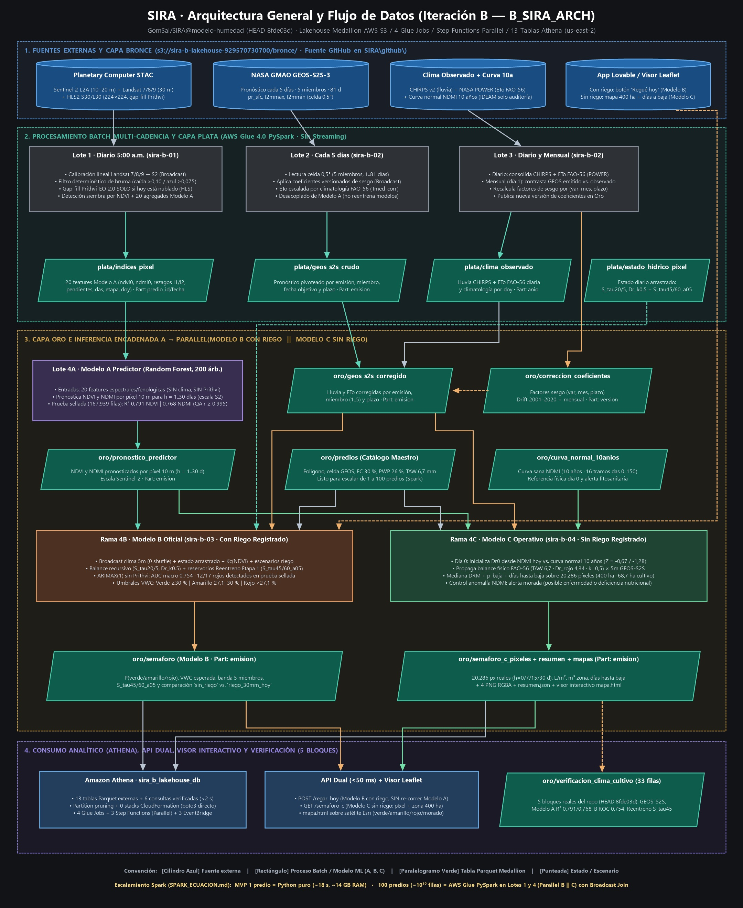
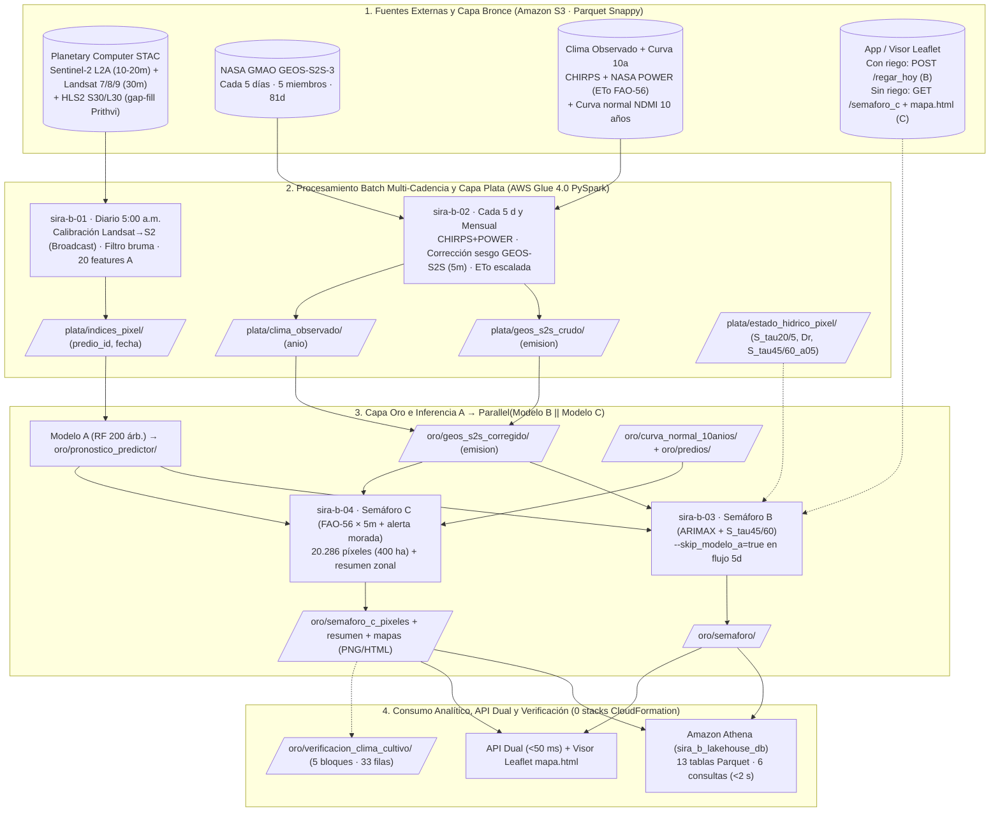

# SIRA — Sistema Inteligente de Riego para Arroz en el Alto Magdalena

**Proyecto Integrador 1** · Maestría en Ciencia de Datos y Analítica — **Universidad EAFIT** (**Equipo 10**)  
**Materias Integradas:** `SI7006` Almacenamiento y Procesamiento de Grandes Datos · `SI7009` Aprendizaje Automático · `SI7007` Visualización de Datos  
**Referencia Científica (Verdad de Campo):** Martínez-Vega et al. (2025), *Irrigation Science* 43:1615–1633 (CC BY 4.0) — C.I. Nataima (Agrosavia, El Espinal, Tolima; `lat 4.1895, lon -74.9621`)

---

## 1. Mapa de Ramas del Repositorio

| Rama | Contenido y Propósito | Estado |
|---|---|---|
| **`main`** *(actual)* | **Documentación maestra, diagramas integrados y guía de replicación exacta a extremo detalle** (integra los avances de Machine Learning de `modelo-humedad` y de Big Data de `Big-Data_Arch`). | Actualizada (`558117c` + `Big-Data_Arch`) |
| **`modelo-humedad`** | **Código y artefactos completos de Machine Learning** (Santiago Vélez Casallas): Fase 0 digitalización Nataima (`src/sira/`), Modelo A (`cloud/modelo_a/`, `scripts/modelo_a/`), Modelo B `ARIMAX(1)` (`models/semaforo_b/arimax.json`), pruebas selladas y dinámicas (`reports/`), y Semáforo operativo (`scripts/operacion/semaforo_c.py`, `b_entradas.py`, `guardar_modelo_b.py`). | Vigente (`HEAD 558117c`) |
| **`Big-Data_Arch`** | **Arquitectura completa de Big Data en AWS** (`B_SIRA_ARCH/` vigente + `A_SIRA_ARCH/` histórica): Lakehouse Medallion S3/Parquet, 4 Jobs PySpark en AWS Glue 4.0, 3 Step Functions (con `Parallel`), 3 EventBridge Schedules, 13 tablas en Amazon Athena, API Dual y scripts de despliegue directo (`boto3`, `0 stacks` CloudFormation). | Vigente y verificada en vivo (`us-east-2`) |
| **`General-Documentation`** | Estructura inicial de carpetas (`Big Data/` y `Machine Learning/`) preparada para consolidar las guías paso a paso y manuales de uso finales del equipo. | Carpetas base creadas |

---

## 2. Qué Hace SIRA: Producto, Modelos y Arquitectura Integral

**SIRA** entrega un **semáforo de humedad del suelo por píxel de 10 m, proyectado de hoy a +30 días**, para cultivos de arroz en el Alto Magdalena. El escenario operativo universal es **sin riego desde hoy**: el agricultor **no necesita ingresar ningún dato** para recibir una alerta accionable (*«en $N$ días pasas a rojo»*, lámina faltante en $\text{L/m}^2$ y volumen requerido en $\text{m}^3$), aunque la plataforma también habilita un simulador interactivo *«Regué hoy»* para fincas que sí registran sus láminas de riego.

### 2.1 Umbrales Agronómicos Oficiales (Martínez-Vega et al., 2025)
Con profundidad radicular de `150 mm`, capacidad de campo `FC = 30 %` y déficit crítico `4,34 mm` (`1 %` de humedad volumétrica TDR equivale a **`1,5 mm = 1,5 L/m²`**):

| Color / Estado | Humedad Volumétrica (TDR) | Déficit bajo Capacidad de Campo (`Dr`) | Recomendación |
|---|---|---|---|
| 🔴 **Rojo (Baja)** | `< 27,1 %` | `> 4,34 mm` | **Riego inmediato** |
| 🟡 **Amarillo (Media)** | `27,1 – 30,0 %` | `0 – 4,34 mm` | **Programar riego en el intervalo indicado** |
| 🟢 **Verde (Suficiente)** | `≥ 30,0 %` | `≤ 0 mm` | **No requiere riego** (alcanza con la lluvia pronosticada) |
| 🟣 **Alarma Tardía NDMI** *(sobre píxel verde)* | Suelo suficiente (`verde`), pero `NDMI` pronosticado por A en el 10 % más seco de la curva normal de 10 años (aun sumando el RMSE de A) | No altera el color hídrico | **Revisar en campo: posible enfermedad o deficiencia nutricional** |

### 2.2 Flujo Científico de Machine Learning (`modelo-humedad` · `HEAD 558117c`)


El producto final combina **dos modelos entrenados** y **dos ecuaciones físicas**, ejecutados en orden estricto por cada píxel de 10 m (ver [`docs/esquema_semaforo.md`](docs/esquema_semaforo.md)):

| Pieza | Función Exacta | Parámetros / Evidencia Verificada | Archivo (`modelo-humedad`) |
|---|---|---|---|
| **1. Modelo A (Predictor Espectral)** | `Random Forest` (200 árboles) de `NDVI` y `NDMI` por píxel de 10 m. Detecta automáticamente la fecha de siembra por la curva `NDVI` y pronostica `NDVI` y `NDMI` de hoy a **+30 días** en escala Sentinel-2 usando **20 features espectrales/fenológicas** (**sin clima ni PCA de Prithvi**). | Prueba sellada (nov-2025 → sep-2026, `167.939` filas): **NDVI $R^2 = 0{,}791$** (`RMSE 0,120`, `WAPE 16,6 %`), **NDMI $R^2 = 0{,}768$** (`RMSE 0,093`, `WAPE 33,6 %`). QA local reproduce Kaggle con $r = 0{,}995$ (NDVI) y $0{,}998$ (NDMI). | `data/interim/modelo_a/kaggle_final/resultados_a/modelos/` |
| **2. Ecuaciones de B (Siembra → Hoy)** | Propagan desde la siembra hasta hoy las 7 entradas del modelo B: $S_\tau(t) = e^{-1/\tau}S_\tau(t-1) + L + R - K_c\cdot\text{ET}_0$ ($\tau = 20$ y $5$), déficit FAO-56 $Dr_{k=0,5}$, `riego_5d`, `dias_desde_riego`, `eto_5d` y `ndvi`, usando lluvia **CHIRPS**, ETo **NASA POWER** y **riego supuesto CD** (inundación continua promediada sobre GS1, GS2 y GS3 de Nataima). $K_c = \text{clip}(1{,}0\cdot\text{NDVI} + 0{,}45,\,0{,}6,\,1{,}3)$. | Reproducción exacta verificada por `guardar_modelo_b.py`: diferencia máxima = **`0,0`** frente a la tabla de entrenamiento unificada. | `scripts/operacion/b_entradas.py` (`propagar`) |
| **3. Modelo B (`ARIMAX(1)`, Corrección Hoy)** | Entrenado sobre las **198 mediciones reales TDR** de Nataima (**sin Prithvi**). Estima hoy $\mu_0$ (humedad esperada en % TDR) y $\sigma = 3{,}12\,\%$. Aplica un **margen único en el arranque** ($1{,}5\sigma = 4{,}68\text{ mm}$): $Dr_0 = 1{,}5\cdot(30 - \mu_0) + 1{,}5\cdot\sigma$. | Prueba sellada por bloques de 10 días: **AUC-ROC macro `0,754 [0,678–0,814]`**. Con regla de margen en el día 0: **9/17 rojos**, **24/42 amarillos**, **70/139 verdes** (`exactitud balanceada 0,53`; sin margen detecta `0/17` rojos). | `models/semaforo_b/arimax.json` · `scripts/operacion/guardar_modelo_b.py` |
| **4. Propagación `Dr_modificada` FAO-56 (Hoy → +30 d)** | Propaga desde $Dr_0$ día a día sin riego: $Dr(t) = Dr(t-1) - L + K_s\cdot K_c\cdot\text{ET}_0$, con `TAW = 6,7 mm`, `p = 0,65`, drenaje `k = 0,5` sobre capacidad de campo, límites `[-26,475, 6,7] mm`, usando **GEOS-S2S-3** (5 miembros corregidos por sesgo con `paso8_geos_correccion.csv`) y `NDVI` de A. Se promedia sobre los 5 miembros y se pinta con los límites del artículo sin volver a sumar margen. | ¿Por qué B solo corrige hoy y FAO-56 propaga? En `b_prueba_dinamica.py`, pasar entradas propagadas al ARIMAX baja $\mu$ solo `0,3` puntos en 30 días por colinealidad, y reentrenar con solo $S_{\tau 45}$ da Spearman `−0,08 [−0,29; 0,10]` en secados. La dinámica de secado de 30 d la impone la física FAO-56. | `scripts/operacion/b_entradas.py` (`propagar_dr`) · `scripts/operacion/semaforo_c.py` |
| **5. `Prithvi-EO-2.0-300M-TL` (Gap-Fill)** | Modelo fundacional satelital reservado **exclusivamente para relleno operativo de huecos en días nublados** sobre recortes `HLS2` ($224\times 224$ px, 30 m). | Reduce error en días nublados (RMSE `0,093` NDVI / `0,077` NDMI vs. `0,110 / 0,094` del último despejado), pero **no entra** como feature en A ni en B (un bloque de 480 m no separa franjas de 23,5 m). | `cloud/modelo_b/` · `reports/semaforo_clasificador_ndvi_prithvi/` |

**Resultado operativo real (`15-nov-2026`, zona de 400 ha en Nataima, `68,68 ha` en cultivo, `20.286` píxeles):**
- **Hoy (`h=0`):** `10,3 %` verde (`7,10 ha`) · `83,6 %` amarillo (`57,39 ha`, mediana `5 días` hasta rojo) · `6,1 %` rojo (`4,19 ha`, `233 m³`) · `2,7 %` alarma fitosanitaria morada.
- **+7 días (`h=7`):** `100,0 %` rojo (`67,61 ha`, déficit medio `6,64 L/m²`, `4.490 m³`, lluvia/ETo `18 / 26 mm`).
- **+15 días (`h=15`):** `8,9 %` amarillo · `91,1 %` rojo (`3.519 m³`, lluvia/ETo `35 / 54 mm`).
- **+30 días (`h=30`):** `100,0 %` amarillo (`870 m³`, lluvia/ETo `92 / 113 mm`).
- **Días hasta rojo sin riego:** `6,1 %` ya hoy · **`89,9 %` en 3–5 días** · `4,0 %` en 6–30 días.

---

### 2.3 Arquitectura Big Data en AWS (`Big-Data_Arch` · `B_SIRA_ARCH`)





- **Patrón de almacenamiento:** **Lakehouse Medallion** (`bronce/` → `plata/` → `oro/`) en **Amazon S3** con **Apache Parquet (Snappy)** y particionamiento Hive (`predio_id=/fecha=`, `anio=`, `version=`, `emision=`).
- **Sin streaming (Kafka/Kinesis):** la humedad del suelo cambia en escala de días y las fuentes son discretas (diaria, cada 5 días y mensual); opera como **batch multi-cadencia**.
- **Cuándo entra Spark (`SPARK_ECUACION.md`):** para **1 predio** (MVP Nataima) basta **Python puro** (`~18 s`, `~14 GB RAM`); al escalar a **100 predios** ($\sim 10^{10}$ filas históricas, $1{,}5\times 10^7$ pronósticos por corrida) entra **AWS Glue 4.0 PySpark** con **`Broadcast Join`** de clima y `applyInPandas`.
- **Regla de aprovisionamiento:** **0 stacks en CloudFormation** — toda la infraestructura en AWS (`us-east-2`) se crea y actualiza directamente vía `boto3`.

---

## 3. Replicación Exacta del Proyecto Paso a Paso (Extremo Detalle)

Sigue estos pasos en orden exacto para reproducir el proyecto completo en cualquier máquina (Windows, macOS o Linux) y en tu propia cuenta AWS.

### Paso 0 · Prerrequisitos Exactos
1. **Git** (`>= 2.40`) instalado y autenticado contra GitHub.
2. **Python `3.11+`** (recomendado **Conda / Miniconda con canal `conda-forge`** para evitar compilar librerías geoespaciales en C/C++ como `pyproj`/`shapely`, o `venv` estándar con binarios precompilados).
3. **Solo si vas a replicar la Fase 0 (digitalización del PDF):** copia local del artículo abierto (CC BY 4.0) de Martínez-Vega et al. (2025) guardada como `data/raw/martinez_vega_2025.pdf` *(excluida del repositorio en `.gitignore` por marca de agua editorial; los CSV ya digitalizados y validados SÍ vienen incluidos en `modelo-humedad`)*.
4. **Solo si vas a desplegar la infraestructura Big Data en AWS:**
   - Cuenta AWS con permisos sobre **S3, IAM, Glue, Step Functions, EventBridge Scheduler, Athena y CloudWatch Logs** en la región **`us-east-2` (Ohio)**.
   - Credenciales configuradas mediante `aws configure` (o variables `AWS_ACCESS_KEY_ID` / `AWS_SECRET_ACCESS_KEY`, o ruta a un archivo CSV vía `AWS_CREDENTIALS_CSV`). **Nunca subas archivos `*accessKeys*.csv` ni `.env` al repositorio.**

---

### Paso 1 · Clonar el Repositorio y Crear el Entorno

#### Opción A — Conda (`conda-forge`, recomendada para geoespacial + ML + Big Data)
```bash
git clone https://github.com/GomSal/SIRA.git
cd SIRA
conda create --name SIRA python=3.11 -y
conda activate SIRA
conda install -c conda-forge numpy pandas scipy matplotlib scikit-learn statsmodels pyarrow pyproj shapely pytest boto3 joblib python-dotenv -y
pip install pymupdf
```

#### Opción B — Windows PowerShell (`venv` con binarios precompilados)
```powershell
git clone https://github.com/GomSal/SIRA.git
cd SIRA
python -m venv .venv
.\.venv\Scripts\Activate.ps1
python -m pip install --upgrade pip
pip install --only-binary=:all: numpy pandas scipy matplotlib scikit-learn statsmodels pyarrow pyproj shapely pytest boto3 joblib python-dotenv pymupdf
```
*(Si PowerShell bloquea la activación del entorno, ejecuta una sola vez: `Set-ExecutionPolicy -ExecutionPolicy RemoteSigned -Scope CurrentUser`).*

#### Opción C — Linux / macOS (`venv`)
```bash
git clone https://github.com/GomSal/SIRA.git
cd SIRA
python3 -m venv .venv
source .venv/bin/activate
pip install --upgrade pip
pip install numpy pandas scipy matplotlib scikit-learn statsmodels pyarrow pyproj shapely pytest boto3 joblib python-dotenv pymupdf
```

---

### Paso 2 · Replicación de Machine Learning (Rama `modelo-humedad`)

Cambia a la rama de modelado ML:
```bash
git checkout modelo-humedad
```

#### 2.1 Fase 0 — Verdad de Campo de Nataima (198 mediciones TDR)
*(Opcional si deseas regenerar desde el PDF `data/raw/martinez_vega_2025.pdf`; los resultados ya están en `data/processed/nataima_diario.csv`)*:
```bash
# 1. Ensamblar digitalización de Figs. 2, 3 y 4 y validar contra Tabla 2 del artículo
cd src && python -m sira.digitalizar.ensamblar && cd ..

# 2. Correr suite de pruebas unitarias de integridad (11+ pruebas automatizadas)
python -m pytest -q

# 3. Generar gráficas de control superpuestas sobre las figuras originales
python scripts/graficas_control.py
```
**Salidas verificables:** `data/processed/nataima_diario.csv`, `reports/validacion_digitalizacion.md`, `reports/control/*.png`.

#### 2.2 Ingesta Climática, Pronóstico GEOS-S2S-3 y Series Satelitales
*(No requieren cuenta paga: Planetary Computer STAC se firma anónimamente con `planetary_computer.sign`, CHIRPS, NASA POWER y NASA GMAO GEOS-S2S-3 son abiertos)*:
```bash
# 1. Clima observado histórico (CHIRPS lluvia + NASA POWER ETo FAO-56)
python scripts/modelo_a/bajar_clima.py

# 2. Pronóstico subestacional NASA GMAO GEOS-S2S-3 (5 miembros, 81 días) y drift histórico
python scripts/modelo_a/bajar_geos.py

# 3. Conteo y extracción de ventana satelital Sentinel-2 + Landsat (Planetary Computer STAC)
python scripts/modelo_a/stac_conteo.py
python scripts/modelo_a/extraer_ventana.py
```

#### 2.3 Entrenamiento del Modelo A (Predictor `NDVI` + `NDMI`, 1–30 días)
El entrenamiento de Modelo A sobre 10 años de imágenes (2016→2026) está empaquetado para ejecutarse en Kaggle (o máquina local con ≥16 GB RAM) mediante dos cuadernos en cadena en `cloud/modelo_a/`:
1. **`cloud/modelo_a/sira_a_1_datos.ipynb`** (código espejo `sira_a_1_datos.py`): calibra Landsat→Sentinel-2, aplica control de bruma determinístico, detecta siembra por curva NDVI y construye el cubo de entrenamiento con las **20 features espectrales/fenológicas**.
2. **`cloud/modelo_a/sira_a_2_entrenar.ipynb`** (código espejo `sira_a_2_entrenar.py`): ejecuta los 8 pasos metodológicos (validación cronológica *rolling origin*, comparación de candidatos + líneas base de persistencia y climatología, corrección de sesgo GEOS-S2S `paso8_geos_correccion.csv` y evaluación sellada en `reports/modelo_a/entrenamiento_final/`).

Los artefactos entrenados de A deben ubicarse en `data/interim/modelo_a/kaggle_final/resultados_a/modelos/` (ver `docs/HANDOVER_modelo_A.md` y `.gitignore`).

#### 2.4 Entrenamiento, Validación Sellada y Auditoría Dinámica del Modelo B (`ARIMAX(1)`)
```bash
# 1. Construir la tabla unificada de 198 mediciones TDR + balance hídrico + NDVI
python scripts/modelo_humedad_unificado.py

# 2. Comparar familias de clasificadores (ARIMAX, RF, XGBoost, GB+Prithvi, Logística) en prueba sellada
python scripts/semaforo_clasificador.py
python scripts/roc_semaforo_familias.py

# 3. Evaluar variantes de ecuación sin contadores de riego (Reentreno Etapa 1) y prueba dinámica de secados
python scripts/b_etapa1_ecuacion.py
python scripts/b_prueba_dinamica.py

# 4. Guardar el modelo oficial de uso ARIMAX(1) y verificar diferencia máxima = 0 en las 7 entradas
python scripts/operacion/guardar_modelo_b.py
```
**Salidas verificables:** `models/semaforo_b/arimax.json`, `models/semaforo_b/calendarios_riego.csv`, `reports/semaforo_clasificador_ndvi_prithvi/roc_auc.csv`, `reports/b_reentreno/etapa1/resumen_por_variante.csv` y `reports/b_reentreno/dinamica/resultado.json`.

#### 2.5 Ejecución del Semáforo Operativo Completo (400 ha · 20.286 píxeles) y Visor Web
```bash
# Control de calidad: reproduce las predicciones selladas de Modelo A (r >= 0.995)
python scripts/operacion/semaforo_c.py --qa

# Corrida operativa completa (A + B hasta hoy con riego supuesto CD + Dr FAO-56 sin riego a +30 días)
python scripts/operacion/semaforo_c.py --hoy 2026-11-15 --riego CD --lat 4.1895 --lon -74.9621 --lado_km 2
```
**Salidas verificables en `reports/semaforo_c/`:**
- `mapa.html` *(abre este archivo en cualquier navegador web para explorar el mapa interactivo Leaflet sobre satélite Esri con deslizador hoy / 7 / 15 / 30 días)*,
- `semaforo_h00.png`, `semaforo_h07.png`, `semaforo_h15.png`, `semaforo_h30.png`,
- `resumen.json` *(porcentajes, hectáreas, déficit $\text{L/m}^2$, $\text{m}^3$ zona y días hasta rojo)*,
- `pixeles.csv.gz` *(tabla completa por píxel de 10 m)*.

---

### Paso 3 · Replicación de Big Data Local y en AWS (Rama `Big-Data_Arch`)

Cambia a la rama de arquitectura Big Data:
```bash
git checkout Big-Data_Arch
pip install -r requirements_bigdata.txt
```

#### 3.1 Ejecución Local Completa (Sin consumir recursos AWS)
```bash
# 1. Ingesta a Capa Bronce (convierte insumos reales de data/ y reports/ a Parquet Snappy)
python B_SIRA_ARCH/bigdata_pipeline/ingestion/fetch_b_bronze_data.py

# 2. Procesamiento local de los 4 lotes (construye las 13 tablas Plata/Oro y parámetros ARIMAX(1))
python B_SIRA_ARCH/bigdata_pipeline/deploy_and_run_b_pipeline.py --local-only

# 3. Prueba del microservicio API Dual (<50 ms, sin re-ejecutar Modelo A)
python B_SIRA_ARCH/bigdata_pipeline/api/app_b_inference_api.py
```
**Verificación local esperada:**
- `fetch_b_bronze_data.py`: exit `0` (~1 s), genera `B_SIRA_ARCH/bigdata_pipeline/data/bronce/`, `oro/curva_normal_10anios/`, `oro/semaforo_c_mapas/` y `models/`.
- `--local-only`: exit `0`, genera las 13 tablas Parquet (incluyendo `20.286` píxeles reales de Modelo C y `33` métricas de los 5 bloques de verificación).
- `app_b_inference_api.py`: imprime dos JSON verificados: **`POST /regar_hoy`** (`re_ejecuto_modelo_a: false`, comparación `sin_riego` vs. `riego_30mm_hoy` con `S_tau45_a05`) y **`GET /semaforo_c`** (consulta por píxel + resumen zonal 400 ha).

#### 3.2 Prerrequisitos IAM en AWS (Solo la primera vez en una cuenta nueva)
Antes de lanzar el despliegue en tu cuenta AWS (`us-east-2`), crea los 3 roles IAM estándar (o reutiliza los existentes si trabajas sobre la cuenta del Equipo 10 `929570730700`):
1. **`sira-glue-service-role`** (Trust: `glue.amazonaws.com`) → políticas: `AWSGlueServiceRole` + lectura/escritura sobre `s3://sira-b-lakehouse-<ACCOUNT_ID>/*`.
2. **`sira-stepfunctions-role`** (Trust: `states.amazonaws.com`) → permisos: `glue:StartJobRun`, `glue:GetJobRun`, `glue:BatchStopJobRun`.
3. **`sira-scheduler-role`** (Trust: `scheduler.amazonaws.com`) → permiso: `states:StartExecution` sobre `arn:aws:states:us-east-2:<ACCOUNT_ID>:stateMachine:sira-b-*`.

Configura tus variables de entorno (si usas tu propia cuenta AWS):
```powershell
# PowerShell (Windows) — o usa `aws configure` sin definir AWS_CREDENTIALS_CSV
$env:SIRA_AWS_REGION = "us-east-2"
$env:SIRA_AWS_ACCOUNT_ID = "929570730700"              # Reemplaza por tu Account ID
$env:SIRA_B_BUCKET = "sira-b-lakehouse-929570730700"   # Reemplaza por tu bucket único
# $env:AWS_CREDENTIALS_CSV = "C:\ruta\privada\accessKeys.csv"   # Opcional si no usas aws configure
```
*(Si usas un Account ID distinto a `929570730700`, actualiza el nombre del bucket en `B_SIRA_ARCH/bigdata_pipeline/orchestration/*.asl.json` y `B_SIRA_ARCH/bigdata_pipeline/sql/ddl_and_analytics_b_athena.sql`).*

#### 3.3 Despliegue Automático en AWS (`0 stacks` CloudFormation) y Validación Athena
```bash
python B_SIRA_ARCH/bigdata_pipeline/deploy_and_run_b_pipeline.py --aws-only
```

Este comando aprovisiona directamente vía `boto3` (verificando **`0 stacks` en CloudFormation**) y valida todo en vivo:

| Servicio AWS (`us-east-2`) | Recursos Creados / Actualizados | Detalle Técnico |
|---|---|---|
| **Amazon S3** | `s3://sira-b-lakehouse-929570730700/` | Zonas `bronce/`, `plata/` (con deduplicación `clear_s3_prefix`), `oro/`, `oro/semaforo_c_mapas/` (`4 PNG` + `mapa.html` + `resumen.json`), `models/`, `scripts/` y `athena-results/`. |
| **AWS Glue 4.0 (4 Jobs PySpark)** | `sira-b-01-lote-imagenes-pixel`<br>`sira-b-02-lote-clima-y-geos`<br>`sira-b-03-lote-inferencia-ab`<br>`sira-b-04-lote-semaforo-c` | `2×G.1X`, Python 3, `MaxConcurrentRuns=2`, particiones `emision`/`fecha` casteadas a `STRING` (0 errores PyArrow), `--skip_modelo_a` en `sira-b-03`. |
| **AWS Step Functions (3)** | `sira-b-flujo-diario-imagenes-inferencia`<br>`sira-b-flujo-geos-5dias`<br>`sira-b-flujo-recalibracion-mensual` | Diario: `01 → 03 → 04` (`499 s`, **`SUCCEEDED`**)<br>Cada 5 d: `02 → Parallel[03 (--skip_modelo_a=true) \|\| 04]` (`256 s`, **`SUCCEEDED`**)<br>Mensual: `02` (`135 s`, **`SUCCEEDED`**) |
| **EventBridge Scheduler (3)** | `sira-b-horario-diario-5am`<br>`sira-b-horario-geos-5dias`<br>`sira-b-horario-recalibracion-mensual` | `cron(0 5 * * ? *)`, `rate(5 days)` y `cron(0 6 1 * ? *)` en zona horaria `America/Bogota` (`ENABLED`). |
| **Amazon Athena** | Base `sira_b_lakehouse_db` (**13 tablas**) | `4` tablas `plata_*` + `9` tablas `oro_*`. **`42/42` sentencias `SUCCEEDED`** (`1 CREATE DB`, `13 DROP`, `13 CREATE EXTERNAL TABLE`, `9 MSCK REPAIR`, `6 SELECT`). |

#### 3.4 Verificar las 6 Consultas Analíticas en Amazon Athena
En la Consola de AWS (`us-east-2` → **Athena** → **Query editor**):
1. Selecciona **Database:** `sira_b_lakehouse_db` y **Output location:** `s3://sira-b-lakehouse-929570730700/athena-results/`.
2. Ejecuta cualquiera de las 6 consultas de `B_SIRA_ARCH/bigdata_pipeline/sql/ddl_and_analytics_b_athena.sql`:
   - **Q1 (`plata_indices_pixel`):** `4.680` filas S2 + `493` filas Landsat calibradas (`5.173` exactos).
   - **Q2 (`oro_geos_s2s_corregido`):** emisión `2026-11-12` (`5` miembros, `225` filas, lluvia `3,52 → 2,67 mm/d`, ETo `3,78 mm/d`).
   - **Q3 (`oro_semaforo`):** impacto de `riego_30mm_hoy` vs. `sin_riego` en `VWC`, `P(rojo)` y `S_tau45_a05 / S_tau60_a05`.
   - **Q4 (`oro_semaforo_c_resumen`):** resumen zonal 400 ha en `h = 0, 7, 15, 30 días` ($\text{ha}$, $\%$, $\text{L/m}^2$, $\text{m}^3$).
   - **Q5 (`oro_semaforo_c_pixeles`):** distribución de los **`20.286` píxeles** por urgencia de riego (`0_ya_hoy`, `1–2 d`, `3–5 d`, `6–30 d`, `no llega`, `fuera_de_cultivo`).
   - **Q6 (`oro_verificacion_clima_cultivo`):** tablero de `33` métricas reales de los 5 bloques oficiales de validación.

---

## 4. Límites Científicos y Operativos (Transparencia del Proyecto)

Tal como se documenta en [`docs/esquema_semaforo.md`](docs/esquema_semaforo.md):
1. **Error del día 0:** por píxel, el Modelo B tiene un error típico de $\sigma = 3{,}12\,\%$ ($\approx 4{,}7\text{ L/m}^2$) y la precisión sobre alertas rojas es baja (solo 1 de cada 5 rojos predichos en día 0 era rojo real en Nataima).
2. **Propagación a 30 días sin validación TDR directa:** es física FAO-56 parametrizada con el artículo de Martínez-Vega et al. (2025); no existen mediciones TDR de secado continuo por 30 días para contrastarla empíricamente.
3. **Margen constante:** el margen de $1{,}5\sigma$ se aplica una sola vez al arranque y no crece con el horizonte ni incorpora la dispersión interna de GEOS-S2S o el error acumulado de A.
4. **Tope de `TAW = 6,7 mm`:** la formulación FAO-56 acota el déficit máximo a `6,7 mm` (equivalente a `25,5 %` VWC), aunque en Nataima la sonda TDR llegó a medir valores menores puntualmente.
5. **Generalización geográfica:** el Modelo B fue calibrado exclusivamente con el suelo del C.I. Nataima (El Espinal, Tolima); escalar a otros distritos requiere adaptar parámetros hidráulicos en `oro_predios` y calibrar localmente con sensores TDR.

---

## 5. Índice Completo de Documentación

### Documentación de Machine Learning y Ciencia de Datos (`modelo-humedad` → `docs/`)
- **[`docs/esquema_semaforo.md`](docs/esquema_semaforo.md)** — Esquema definitivo del producto (`558117c`): Modelos A y B, ecuaciones `S` y `Dr`, propagación FAO-56, resultados 15-nov-2026 y límites.
- **[`docs/diagrama_semaforo.svg`](docs/diagrama_semaforo.svg)** — Diagrama oficial del flujo del semáforo de humedad.
- **[`docs/informe_preliminar.md`](docs/informe_preliminar.md)** — Informe técnico completo: fuentes de datos, control de bruma, balance hídrico, arquitectura de entrenamiento y operación.
- **[`docs/fase0_verdad_de_campo.md`](docs/fase0_verdad_de_campo.md)** — Digitalización y validación reproducible de las 198 mediciones TDR de Nataima.
- **[`docs/arquitectura_entrenamiento.md`](docs/arquitectura_entrenamiento.md)** y **[`docs/arquitectura_produccion_predictor.md`](docs/arquitectura_produccion_predictor.md)** — Diseño de entrenamiento y producción del Modelo A y criterio de Spark.
- **[`docs/HANDOVER_modelo_A.md`](docs/HANDOVER_modelo_A.md)**, **[`docs/HANDOVER_modelo_B.md`](docs/HANDOVER_modelo_B.md)** y **[`HANDOVER.md`](HANDOVER.md)** — Registro completo de decisiones técnicas.

### Documentación de Big Data y Despliegue AWS (`Big-Data_Arch` → `docs/big_data/`)
- **[`docs/big_data/README_B_BigData.md`](docs/big_data/README_B_BigData.md)** — Resumen ejecutivo de la arquitectura Big Data y cumplimiento de la rúbrica `SI7006`.
- **[`docs/big_data/02_B_BigData_Arch.md`](docs/big_data/02_B_BigData_Arch.md)** — Arquitectura Medallion detallada, 20 + 7 agregados, `Broadcast Join`, `Parallel` y ecuación de escalamiento Spark.
- **[`docs/big_data/03_B_Guia_Paso_a_Paso_AWS_Consola.md`](docs/big_data/03_B_Guia_Paso_a_Paso_AWS_Consola.md)** — Guía paso a paso de cómo se creó toda la estructura local y en AWS (`us-east-2`), auditoría de Step Functions (`3/3 SUCCEEDED`) y evidencia `42/42` en Athena.
- **[`docs/big_data/04_B_Manual_de_Uso_E2E.md`](docs/big_data/04_B_Manual_de_Uso_E2E.md)** — Guía detallada de cómo leer cada carpeta S3, tabla Athena, columna, color del mapa y JSON de la API + guion de sustentación.
- **[`docs/big_data/iteracion_a/README_BigData.md`](docs/big_data/iteracion_a/README_BigData.md)** — Trazabilidad histórica de la Iteración A (`A_SIRA_ARCH`).
