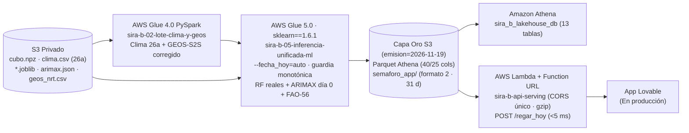

# SIRA · Rama `Big-Data_Arch` (Arquitectura Lakehouse AWS Conectada a ML y Lovable)

Esta rama contiene **exclusivamente la arquitectura, pipelines, infraestructura AWS y documentación de Big Data** del proyecto **SIRA** (Equipo 10 · Universidad EAFIT · `SI7006`), completamente autocontenida, depurada y conectada extremo a extremo a los modelos reales de Machine Learning (`modelo-humedad`, commit `876be25`) y a la aplicación **Lovable** en producción.

> **Otras ramas del repositorio:**
> * **Portada maestra y guía de replicación integral:** [`main`](https://github.com/GomSal/SIRA/tree/main)
> * **Código y entrenamiento de Machine Learning:** [`modelo-humedad`](https://github.com/GomSal/SIRA/tree/modelo-humedad)
> * **Carpetas base de documentación consolidada:** [`General-Documentation`](https://github.com/GomSal/SIRA/tree/General-Documentation)
> * **API Pública en Producción (AWS Lambda Function URL · CORS):** `https://s435rizz22wj6qd3mv37doq76m0widfd.lambda-url.us-east-2.on.aws/`

---

## Diagrama de Flujo Big Data Limpio (`B_SIRA_ARCH` · 2 Glue Jobs + Lambda)



---

## Estructura de esta Rama

```text
Big-Data_Arch/
├── README.md                         # Esta guía rápida de la rama Big Data
├── Diagrama_flujo.jpeg               # Diagrama ilustrativo Lakehouse Medallion
├── requirements_bigdata.txt          # Dependencias Python exactas del subsistema Big Data
├── B_SIRA_ARCH/                      # ITERACIÓN B (VIGENTE — AWS us-east-2, 0 CloudFormation)
│   ├── README_B_BigData.md           # Resumen ejecutivo y rúbrica SI7006
│   ├── 02_B_BigData_Arch.md          # Arquitectura unificada (2 Glue Jobs, 3 Step Functions, Lambda)
│   ├── 03_B_Guia_Paso_a_Paso_AWS_Consola.md   # Inventario limpio AWS + evidencia en vivo (2026-11-19)
│   ├── 04_B_Manual_de_Uso_E2E.md     # Guía de lectura, integración Lovable y guion de sustentación
│   ├── 05_B_Historia_Conexion_ML_BigData_y_App.md # Historia completa de la conexión ML ↔ Big Data ↔ App
│   └── bigdata_pipeline/             # Ingesta, 2 Glue Jobs (b02 y b05), 3 Step Functions, Athena, Lambda API y Parquet
└── A_SIRA_ARCH/                      # ITERACIÓN A (Archivada para trazabilidad histórica)
    ├── README_BigData.md · 02_... · 03_... · 04_... · Diagrama_flujo_A.jpeg
    └── bigdata_pipeline/
```

---

## Recursos Activos y Limpios en AWS (`us-east-2` · `0 stacks` CloudFormation)

| Servicio | Recursos Activos (`sira-b-*`) | Estado Verificado (`2026-11-19`) |
|---|---|---|
| **Amazon S3** | `s3://sira-b-lakehouse-929570730700/` (privado, `510 MB`: `bronce/`, `plata/`, `oro/`, `oro/semaforo_app/`, `models/`, `scripts/`) | Emisión activa `2026-11-19` + histórico `2026-11-15` |
| **AWS Glue (2 Jobs)** | `sira-b-02-lote-clima-y-geos` (Glue 4.0 PySpark) · **`sira-b-05-inferencia-unificada-ml`** (Glue 5.0 · `sklearn==1.6.1` · `--fecha_hoy=auto`) | `SUCCEEDED` (`102 s` y `194 s`) · 9 jobs viejos eliminados |
| **AWS Step Functions (3)** | `sira-b-flujo-diario-imagenes-inferencia` (`b05`) · `sira-b-flujo-geos-5dias` (`b02 → b05`) · `sira-b-flujo-recalibracion-mensual` (`b02`) | Secuenciales limpios · 2 flujos viejos eliminados |
| **EventBridge Scheduler (3)** | `sira-b-horario-diario-5am` · `sira-b-horario-geos-5dias` · `sira-b-horario-recalibracion-mensual` (`America/Bogota`) | `ENABLED` · 2 horarios viejos eliminados |
| **Amazon Athena** | Base `sira_b_lakehouse_db` (`13` tablas Parquet externas + `6` consultas analíticas) | Paridad 1:1 (`2026-11-19`: `99,6 %` suf · `98,4 %` rojo 3–5 d) |
| **AWS Lambda + Function URL** | **`sira-b-api-serving`** (Python 3.11 · CORS nativo único · `gzip` `232 KB` · `POST /regar_hoy` `< 5 ms`) | **`8/8 PASS`** · Activa en producción con Lovable |

---

## Ejecución Rápida para Colaboradores

```bash
git clone -b Big-Data_Arch https://github.com/GomSal/SIRA.git SIRA-BigData
cd SIRA-BigData
python -m venv .venv
# Windows: .\.venv\Scripts\Activate.ps1   |   Linux/macOS: source .venv/bin/activate
pip install -r requirements_bigdata.txt

# 1. Corrida local autocontenida (construye las 13 tablas Plata y Oro en Parquet)
python B_SIRA_ARCH/bigdata_pipeline/deploy_and_run_b_pipeline.py --local-only

# 2. Probar AWS Lambda API localmente contra S3 Oro (/latest, /semaforo_c, POST /regar_hoy)
python B_SIRA_ARCH/bigdata_pipeline/api/app_b_inference_api.py

# 3. Desplegar / sincronizar en AWS (usa `aws configure` o env var AWS_CREDENTIALS_CSV · 0 stacks CloudFormation)
python B_SIRA_ARCH/bigdata_pipeline/deploy_and_run_b_pipeline.py --aws-only
```

*(Opcional — para re-ingestar archivos crudos desde un clon actualizado de la rama `modelo-humedad`, exporta `SIRA_REPO_PATH=/ruta/a/modelo-humedad` y ejecuta `python B_SIRA_ARCH/bigdata_pipeline/ingestion/fetch_b_bronze_data.py`).*

---

## Documentación de la Rama
* [Resumen Ejecutivo y Rúbrica `SI7006`](B_SIRA_ARCH/README_B_BigData.md)
* [Arquitectura Big Data Unificada (2 Glue Jobs + Lambda)](B_SIRA_ARCH/02_B_BigData_Arch.md)
* [Guía Paso a Paso de Infraestructura AWS y Evidencia en Vivo (`2026-11-19`)](B_SIRA_ARCH/03_B_Guia_Paso_a_Paso_AWS_Consola.md)
* [Manual de Uso E2E, Integración Lovable y Guion de Sustentación](B_SIRA_ARCH/04_B_Manual_de_Uso_E2E.md)
* [Historia Completa de la Conexión ML ↔ Big Data ↔ App](B_SIRA_ARCH/05_B_Historia_Conexion_ML_BigData_y_App.md)
* [Iteración A Archivada (`A_SIRA_ARCH`)](A_SIRA_ARCH/README_BigData.md)
