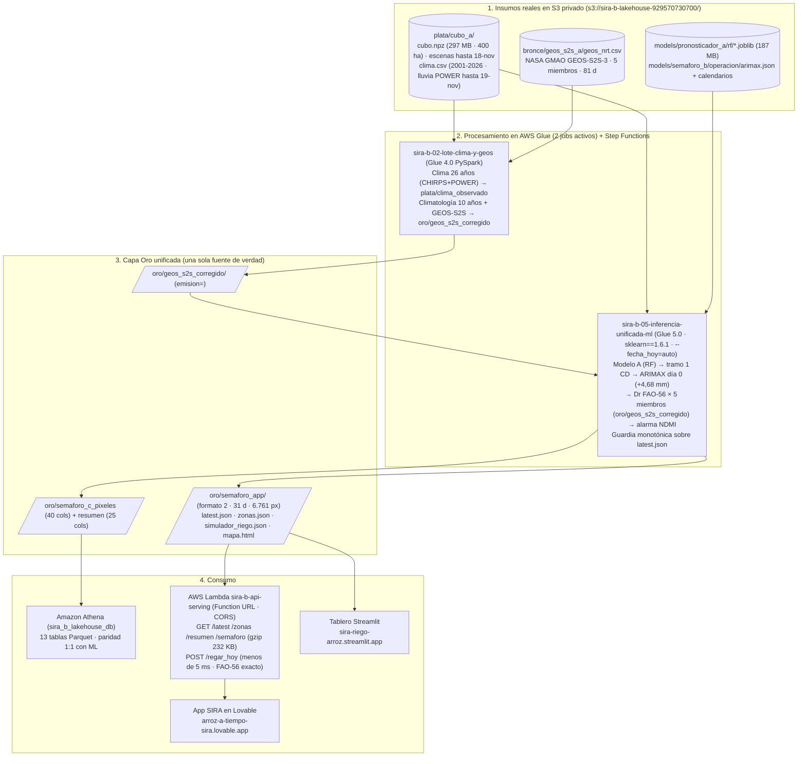

# SIRA — Sistema Inteligente de Riego para Arroz en el Alto Magdalena

**Proyecto Integrador 1** · Maestría en Ciencia de Datos y Analítica — **Universidad EAFIT** · **Equipo 10**  
**Integrantes:** Cristian Miguel Gómez Salazar · Tomás Guzmán Tapias · Alejandro Jiménez Lopera · Santiago Vélez Casallas  
**Materias integradas:** `SI7006` Almacenamiento y Procesamiento de Grandes Datos · `SI7009` Aprendizaje Automático · `SI7007` Visualización de Datos  
**Verdad de campo:** Martínez-Vega et al. (2025), *Irrigation Science* 43:1615–1633 (CC BY 4.0) — C.I. Nataima (Agrosavia), El Espinal, Tolima (`lat 4.1895, lon -74.9621`)

> **SIRA pinta un semáforo de riego por pixel de 10 m, de hoy a +30 días:** le dice al agricultor de arroz qué parte de su lote necesita agua, cuándo y cuántos litros por metro cuadrado, sin que tenga que ingresar ningún dato.

Este README es la **guía de entrada de todo el proyecto**: qué está en línea, dónde está cada pieza (ramas y repositorios), cómo funcionan los modelos y la arquitectura, y cómo replicarlo paso a paso.

---

## Contenido

1. [El producto en línea](#1-el-producto-en-línea)
2. [SIRA en un minuto](#2-sira-en-un-minuto)
3. [Mapa del proyecto: ramas y repositorios](#3-mapa-del-proyecto-ramas-y-repositorios)
4. [Cómo funciona: umbrales, modelos y resultado](#4-cómo-funciona-umbrales-modelos-y-resultado)
5. [Cómo se entrenaron y evaluaron los modelos](#5-cómo-se-entrenaron-y-evaluaron-los-modelos)
6. [Arquitectura Big Data en AWS](#6-arquitectura-big-data-en-aws)
7. [Replicación paso a paso](#7-replicación-paso-a-paso)
8. [Límites científicos y operativos](#8-límites-científicos-y-operativos)
9. [Índice completo de documentación](#9-índice-completo-de-documentación)

---

## 1. El producto en línea

| Pieza | Para quién | Enlace |
|---|---|---|
| 📱 **App SIRA (MVP en funcionamiento)** | El agricultor: semáforo por pixel, línea de tiempo de 30 días y simulador «Regué hoy». Hoy opera en la **zona piloto del distrito de riego de Nataima**. | **https://arroz-a-tiempo-sira.lovable.app** |
| 📊 **Tablero técnico (Streamlit)** | Profesores y equipo técnico: situación de riego, mapa, plan por lote, clima, cultivo y la pestaña **Datos y modelo** (flujos de entrenamiento, curvas ROC, skill y AUC). Se actualiza solo cada día. | **https://sira-riego-arroz.streamlit.app** |
| 🧩 **Código del tablero** | Repositorio aparte del tablero (Streamlit + GitHub Actions diario). | https://github.com/tomasguzman0925-ship-it/sira-dashboard |
| ⚙️ **API pública en producción** | La app consume esta API (AWS Lambda Function URL, CORS). | `https://s435rizz22wj6qd3mv37doq76m0widfd.lambda-url.us-east-2.on.aws/` |
| 📄 **Informe final** | Documento completo del proyecto: contexto, datos, metodología, modelos, arquitectura, resultados y referencias. | [`docs/informe_final/SIRA_informe_final_vista.pdf`](docs/informe_final/SIRA_informe_final_vista.pdf) (PDF) · [`SIRA_informe_final.docx`](docs/informe_final/SIRA_informe_final.docx) (Word) |
| 🎞️ **Presentación final (18 diapositivas)** | Sustentación del proyecto, con notas del orador. | [`docs/presentacion/SIRA_presentacion_final.pptx`](docs/presentacion/SIRA_presentacion_final.pptx) |

---

## 2. SIRA en un minuto

- **Problema.** El arroz es de los cultivos que más agua dulce consume y en Colombia se riega casi siempre por cascada, que gasta mucha más agua que los métodos medidos en el ensayo de Nataima. El agricultor no sabe qué parte de su lote está seca ni cuándo se va a secar.
- **Solución.** Por cada pixel de 10 m, SIRA combina **dos modelos entrenados** y **una ecuación física**:
  1. **Modelo A — Random Forest:** pronostica cómo estará el cultivo (`NDVI` y `NDMI`) de hoy a +30 días con 10 años de Sentinel-2 y Landsat.
  2. **Modelo B — ARIMAX:** corrige la humedad del suelo de **hoy**, entrenado con las **198 mediciones reales de humedad (sonda TDR)** de Nataima.
  3. **Balance hídrico FAO-56:** un propagador iterativo que lleva el déficit de agua día a día de hoy a +30 días, con el pronóstico de lluvia y evapotranspiración **NASA GEOS-S2S** (5 escenarios).
- **Escenario operativo universal: sin riego desde hoy.** Así la alerta no depende de lo que haga cada agricultor: *«en N días pasas a rojo»*, con la lámina faltante en L/m² y el volumen en m³.
- **Arquitectura:** Lakehouse Medallion en Amazon S3, procesamiento por lotes en AWS Glue (PySpark), orquestado con Step Functions y EventBridge, consultable en Athena y servido por AWS Lambda a la app.

---

## 3. Mapa del proyecto: ramas y repositorios

El trabajo está repartido en **4 ramas de este repositorio** y **1 repositorio externo** (el tablero). `main` es la rama de entrada y documentación.

| Dónde | Qué contiene | Estado |
|---|---|---|
| **`main`** *(esta rama)* | **Documentación maestra**: este README, diagramas, documentos de ML y de Big Data, presentación final y requisitos de instalación. | Vigente |
| **[`modelo-humedad`](https://github.com/GomSal/SIRA/tree/modelo-humedad)** | **Todo el código, datos y reportes de Machine Learning**: digitalización de la verdad de campo, Modelo A, Modelo B, semáforo operativo, actualización de datos, exportación a la app y subida a S3. | Vigente |
| **[`Big-Data_Arch`](https://github.com/GomSal/SIRA/tree/Big-Data_Arch)** | **Arquitectura Big Data en AWS**: `B_SIRA_ARCH/` (vigente) y `A_SIRA_ARCH/` (primera iteración, histórica). Glue, Step Functions, EventBridge, Athena y Lambda. | Vigente y verificada en `us-east-2` |
| **[`General-Documentation`](https://github.com/GomSal/SIRA/tree/General-Documentation)** | Estructura inicial de carpetas (`Big Data/`, `Machine Learning/`), ya integrada en `main`. | Histórica |
| **[`sira-dashboard`](https://github.com/tomasguzman0925-ship-it/sira-dashboard)** *(repo externo)* | **Tablero de visualización en Streamlit** (`SI7007`), publicado en sira-riego-arroz.streamlit.app. | Vigente |

### 3.1 Rama `main` (esta)

```text
SIRA/ (main)
├── README.md                          ← esta guía
├── HANDOVER.md                        ← bitácora de decisiones técnicas del proyecto
├── Diagrama_flujo.jpeg                ← diagrama de flujo general del proyecto
├── requirements.txt                   ← dependencias de Machine Learning (rama modelo-humedad)
├── requirements_bigdata.txt           ← dependencias de Big Data (rama Big-Data_Arch)
├── pyproject.toml
└── docs/
    ├── esquema_semaforo.md            ← esquema definitivo del producto (A, B, FAO-56, límites)
    ├── diagrama_semaforo.svg          ← diagrama oficial del semáforo
    ├── informe_preliminar.md          ← informe técnico: fuentes, bruma, balance hídrico, arquitectura
    ├── fase0_verdad_de_campo.md       ← digitalización y validación de las 198 mediciones TDR
    ├── arquitectura_entrenamiento.md  ← diseño del entrenamiento del Modelo A
    ├── arquitectura_produccion_predictor.md ← producción del Modelo A y criterio de Spark
    ├── HANDOVER_modelo_A.md / HANDOVER_modelo_B.md ← decisiones de cada modelo
    ├── plan_trabajo.html              ← plan de trabajo del equipo
    ├── informe_final/
    │   ├── SIRA_informe_final_vista.pdf ← informe final (PDF)
    │   └── SIRA_informe_final.docx    ← informe final (Word); el código que lo construye está en modelo-humedad
    ├── presentacion/
    │   └── SIRA_presentacion_final.pptx ← presentación final (18 diapositivas)
    └── big_data/
        ├── README_B_BigData.md        ← resumen ejecutivo Big Data y rúbrica SI7006
        ├── 02_B_BigData_Arch.md       ← arquitectura Medallion depurada
        ├── 03_B_Guia_Paso_a_Paso_AWS_Consola.md ← recorrido en la consola de AWS
        ├── 04_B_Manual_de_Uso_E2E.md  ← uso de S3, Athena y API + guion de sustentación
        ├── 05_B_Historia_Conexion_ML_BigData_y_App.md ← conexión ML ↔ Big Data ↔ app
        └── iteracion_a/               ← trazabilidad de la primera iteración
```

### 3.2 Rama `modelo-humedad` (Machine Learning)

```text
SIRA/ (modelo-humedad)
├── src/sira/
│   ├── digitalizar/        ← Fase 0: digitaliza las figuras 2, 3, 4 y 7 del artículo de Nataima
│   └── verdad/             ← curvas, franjas de riego y pixeles de la verdad de campo
├── cloud/
│   ├── modelo_a/           ← notebooks del Modelo A (1: datos, 2: entrenamiento) para Kaggle/nube
│   ├── modelo_b/           ← corrida en la nube del Modelo B y Prithvi (relleno de nubes)
│   └── ronda1_b/           ← primera ronda del Modelo B (histórica)
├── scripts/
│   ├── modelo_a/           ← descarga de clima y GEOS-S2S, estudio de años de entrenamiento, costos y Spark
│   ├── operacion/          ← cadena operativa diaria:
│   │   ├── actualizar_datos.py   (clima POWER + CHIRPS y escenas nuevas)
│   │   ├── b_entradas.py         (ecuaciones S y Dr, propagación FAO-56)
│   │   ├── guardar_modelo_b.py   (guarda el ARIMAX oficial y verifica la reproducción exacta)
│   │   ├── semaforo_c.py         (semáforo por pixel de hoy a +30 días)
│   │   ├── exportar_app.py       (JSON para la app)
│   │   └── subir_aws.py          (sube las entradas a S3)
│   ├── semaforo_clasificador.py  ← selección y prueba del Modelo B (5 familias)
│   ├── roc_semaforo_familias.py  ← curvas ROC de las familias del Modelo B
│   └── …                         ← experimentos documentados (radar, dron, térmica, bruma, reservorio)
├── models/
│   ├── pronosticador_a/    ← metadatos del Random Forest (los .joblib pesados están en S3)
│   └── semaforo_b/         ← ARIMAX oficial (arimax.json)
├── reports/                ← evidencia de cada experimento, con su RESULTADOS.md
│   ├── modelo_a/           ← entrenamiento final, estudio de años, estimación de costo y Spark
│   ├── semaforo_clasificador_ndvi_prithvi/ ← comparación de familias del Modelo B y modelo oficial
│   └── …
├── data/                   ← raw (digitalizado del artículo), interim y processed
├── app/datos/              ← semáforo y zonas que consume la app
├── docs/                   ← documentos de ML, fuentes del informe, presentación y
│   └── informe_final/      ← informe final con el código que lo arma (construir_informe.py, figuras_*.py, figs/)
└── tests/                  ← pruebas de la digitalización y del Modelo B
```

### 3.3 Rama `Big-Data_Arch` (AWS)

```text
SIRA/ (Big-Data_Arch)
├── B_SIRA_ARCH/                       ← arquitectura VIGENTE
│   ├── README_B_BigData.md y 02–05_*.md ← documentación (copiada en main/docs/big_data/)
│   └── bigdata_pipeline/
│       ├── deploy_and_run_b_pipeline.py ← despliegue local o en AWS (--local-only / --aws-only)
│       ├── ingestion/                 ← fetch_b_bronze_data.py: ingesta de fuentes a bronce
│       ├── spark_jobs/                ← job_b02 (PySpark: clima y GEOS-S2S) y job_b05 (modelos y semáforo)
│       ├── orchestration/             ← 3 Step Functions: diaria, cada 5 días (GEOS-S2S) y mensual
│       ├── sql/                       ← ddl_and_analytics_b_athena.sql: tablas y consultas de Athena
│       ├── api/                       ← app_b_inference_api.py: AWS Lambda sira-b-api-serving
│       └── data/                      ← salida local de las 13 tablas Parquet
├── A_SIRA_ARCH/                       ← primera iteración (histórica)
└── requirements_bigdata.txt
```

### 3.4 Repositorio externo `sira-dashboard` (visualización)

```text
sira-dashboard/
├── app.py            ← navegación: Hoy · Mapa · Plan de riego · Clima · Cultivo · Datos y modelo
├── paginas/          ← una página por pestaña
├── modelos.py        ← flujos de entrenamiento y gráficas de evaluación de A y B
├── modelos/          ← métricas de evaluación copiadas de los reportes de modelo-humedad
├── datos.py · actualizar.py ← lectura de la última emisión y actualización diaria
├── data/             ← datos que trae GitHub Actions cada día (5:30 a. m.)
└── .github/workflows/actualizar.yml
```

---

## 4. Cómo funciona: umbrales, modelos y resultado

### 4.1 Umbrales agronómicos (Martínez-Vega et al., 2025)

Con profundidad radicular de `150 mm`, capacidad de campo `FC = 30 %` y déficit crítico `4,34 mm` (`1 %` de humedad volumétrica TDR equivale a **`1,5 mm = 1,5 L/m²`**):

| Color / Estado | Humedad volumétrica (TDR) | Déficit bajo capacidad de campo (`Dr`) | Recomendación |
|---|---|---|---|
| 🔴 **Rojo (regar ya)** | `< 27,1 %` | `> 4,34 mm` | **Riego inmediato** |
| 🟡 **Amarillo (regar pronto)** | `27,1 – 30,0 %` | `0 – 4,34 mm` | **Programar riego en el intervalo indicado** |
| 🟢 **Verde (suficiente)** | `≥ 30,0 %` | `≤ 0 mm` | **No requiere riego** |
| 🟣 **Revisar en campo** *(sobre pixel verde)* | Suelo suficiente, pero el `NDMI` pronosticado por A cae en el 10 % más seco de la curva normal de 10 años (aun sumando el RMSE de A) | No altera el color hídrico | **Posible enfermedad o deficiencia nutricional** |

### 4.2 Las piezas del semáforo (rama `modelo-humedad`)


Se ejecutan en orden estricto por cada pixel de 10 m (detalle en [`docs/esquema_semaforo.md`](docs/esquema_semaforo.md)):

| Pieza | Qué hace | Evidencia | Archivo (`modelo-humedad`) |
|---|---|---|---|
| **1. Modelo A (pronóstico del cultivo)** | `Random Forest` (200 árboles) por pixel de 10 m. Detecta la fecha de siembra con la curva del `NDVI` y pronostica `NDVI` y `NDMI` de hoy a **+30 días** con **20 variables espectrales y fenológicas** (sin clima ni Prithvi). | Prueba (nov-2025 → sep-2026, `167.939` pares pixel-fecha): **28 % menos error que repetir el último dato** (IC 95 % 24–31 %); **NDVI $R^2 = 0{,}791$** (`RMSE 0,120`), **NDMI $R^2 = 0{,}768$** (`RMSE 0,093`). | `models/pronosticador_a/` · `cloud/modelo_a/` |
| **2. Ecuaciones de B (siembra → hoy)** | Propagan desde la siembra hasta hoy las 7 entradas del Modelo B: $S_\tau(t) = e^{-1/\tau}S_\tau(t-1) + L + R - K_c\cdot\text{ET}_0$ ($\tau = 20$ y $5$), déficit FAO-56 $Dr_{k=0,5}$, `riego_5d`, `dias_desde_riego`, `eto_5d` y `ndvi`, con lluvia **CHIRPS** (relleno con **NASA POWER** mientras CHIRPS no publica), ETo **NASA POWER** y **riego supuesto en cascada (CD)**. $K_c = \text{clip}(1{,}0\cdot\text{NDVI} + 0{,}45,\,0{,}6,\,1{,}3)$. | `guardar_modelo_b.py` reproduce la tabla de entrenamiento con diferencia máxima **`0,0`**. | `scripts/operacion/b_entradas.py` |
| **3. Modelo B (`ARIMAX`, humedad de hoy)** | Entrenado con las **198 mediciones reales TDR** de Nataima (sin Prithvi). Estima hoy la humedad esperada $\mu_0$ y su error $\sigma = 3{,}12\,\%$. Aplica un **margen solo en el arranque** ($1{,}5\sigma = 4{,}68\text{ mm}$): $Dr_0 = 1{,}5\cdot(30 - \mu_0) + 1{,}5\cdot\sigma$. | Prueba por bloques de 10 días: **AUC-ROC macro `0,754 [0,678–0,814]`**. Con la regla de la app (déficit + margen): **9/17 rojos**, **24/42 amarillos**, **70/139 verdes** (exactitud balanceada `0,53`). | `models/semaforo_b/arimax.json` · `scripts/operacion/guardar_modelo_b.py` |
| **4. Balance FAO-56 (propagador iterativo, hoy → +30 d)** | Propaga desde $Dr_0$ día a día sin riego: $Dr(t) = Dr(t-1) - L + K_s\cdot K_c\cdot\text{ET}_0$, con `TAW = 6,7 mm`, `p = 0,65`, drenaje `k = 0,5`, límites `[-26,475, 6,7] mm`, lluvia y ETo de **GEOS-S2S** (5 miembros corregidos por sesgo) y `NDVI` de A. | Dar al ARIMAX las entradas propagadas apenas baja `0,3` puntos en 30 días; la dinámica a 30 días la impone la física FAO-56 (`b_prueba_dinamica.py`). | `scripts/operacion/b_entradas.py` · `scripts/operacion/semaforo_c.py` |
| **5. `Prithvi-EO-2.0-300M-TL` (relleno de nubes)** | Modelo fundacional de NASA e IBM, usado **solo para rellenar pixeles en días nublados** (recortes HLS de $224\times 224$ px, 30 m). | RMSE en días nublados `0,093` NDVI / `0,077` NDMI frente a `0,110 / 0,094` del último dato despejado. **No entra** como variable en A ni en B. | `cloud/modelo_b/` · `reports/semaforo_clasificador_ndvi_prithvi/` |

### 4.3 Resultado operativo (`2026-11-19`)

Paridad 1:1 entre ML local, Glue 5.0, Athena y Lambda · 400 ha en Nataima, `67,61 ha` en cultivo, `6.761` pixeles activos de `20.286` agrícolas:

- **Hoy (`h=0`):** **`99,6 %` verde** (`67,34 ha`) · `0,4 %` amarillo (`0,27 ha`) · **`0,0 %` rojo** · `11,4 %` con alarma «revisar en campo» (50 días de lluvia rellenados con NASA POWER).
- **+7 días (`2026-11-26`):** **`100 %` rojo** (`67,38 ha`, déficit medio `6,61 L/m²`, `4.457 m³`; lluvia/ETo `3,9 / 25,3 mm`).
- **+15 días (`2026-12-04`):** **`100 %` amarillo** (`66,37 ha`, déficit medio `1,92 L/m²`, `1.276 m³`; lluvia/ETo `39,9 / 55,2 mm`).
- **+30 días (`2026-12-19`):** **`100 %` rojo** (`65,98 ha`, déficit medio `6,63 L/m²`, `4.377 m³`; lluvia/ETo `79,0 / 113,3 mm`).
- **Urgencia sin riego desde hoy:** `0,0 %` ya hoy · **`1,6 %` en 1–2 días** (`111 px`) · **`98,4 %` en 3–5 días** (`6.650 px`).

---

## 5. Cómo se entrenaron y evaluaron los modelos

Los dos modelos siguieron los **8 pasos de la metodología del curso** (análisis exploratorio, calidad de datos, partición, métricas, estandarización, selección de variables, ajuste y selección, evaluación). Los flujos completos y las gráficas están en la pestaña **Datos y modelo** del [tablero](https://sira-riego-arroz.streamlit.app) y en las diapositivas 7 a 11 de la [presentación](docs/presentacion/SIRA_presentacion_final.pptx).

### 5.1 Modelo A — pronóstico del cultivo

| Paso | Decisión |
|---|---|
| **Entradas** | 1.412 imágenes Sentinel-2 y Landsat (10 m, 2012–2026); clima CHIRPS y NASA POWER; Prithvi-EO-2.0 rellena pixeles nublados. |
| **Partición** | Serie de tiempo, **ventana deslizante** que avanza 1 año: entrena 3.652 días (10 años), valida 365 días (3 veces, nov-2022 → nov-2025) y prueba 316 días una sola vez (nov-2025 → sep-2026). |
| **Por qué 10 años** | Bootstrap pareado por bloques de 10 días (Carlstein), 10.000 repeticiones: con 5 años el error es 4 % mayor (p < 0,001); desde 10 años empata con el mejor largo (p = 0,16). |
| **Métrica de selección** | **Skill frente a la persistencia** (1 − RMSE / RMSE de repetir el último dato), promedio en 1, 3, 7, 15 y 30 días. No depende de la escala y mide lo que aporta el modelo; R² y MAE salen altos solo con copiar el último dato. |
| **Estandarización** | Media y desviación del entrenamiento de cada ventana (ARIMAX y GRU); los árboles no la necesitan. |
| **Selección de variables** | Diebold–Mariano (Newey–West + HLN, bloques de 10 días): entran fenología, NDMI y NDVI (p < 0,005); salen lluvia, ETo y Prithvi. |
| **Modelos en competencia** | ARIMAX, Random Forest, Gradient Boosting, XGBoost y GRU, 26 combinaciones de hiperparámetros. Si el IC 95 % de la diferencia con el mejor incluye 0, gana el más simple. |

| Skill medio en validación | NDVI | NDMI |
|---|---|---|
| **Random Forest (elegido)** | **0,194** | **0,204** |
| Gradient Boosting | 0,195 | 0,199 |
| XGBoost | 0,195 | 0,200 |
| GRU | 0,190 | 0,200 |
| ARIMAX | 0,074 | 0,071 |

Los cuatro primeros **empatan** en los dos índices (el IC 95 % de la diferencia incluye 0) y gana el más simple, Random Forest; ARIMAX queda muy atrás. En la prueba, el error del NDVI baja **10 % a 1 día y 32 % a 30 días** frente a repetir el último dato. Evidencia: [`reports/modelo_a/`](https://github.com/GomSal/SIRA/tree/modelo-humedad/reports/modelo_a).

### 5.2 Modelo B — humedad del suelo de hoy

| Paso | Decisión |
|---|---|
| **Entradas** | 198 mediciones TDR de Nataima (3 temporadas × 3 franjas de riego); NDVI de Sentinel-2 por franja (pixeles puros ≥ 90 %); clima CHIRPS y NASA POWER; balance FAO-56 (`S` y `Dr`); Prithvi sobre HLS como candidato. |
| **Etiqueta** | Semáforo: verde ≥ 30 %, amarillo 27,1–30 %, rojo < 27,1 % (139 / 42 / 17 mediciones). |
| **Partición** | Bloques de 10 días con las 3 franjas juntas: **4 particiones de prueba** (cada medición se prueba una sola vez) y validación interna en 5 bloques. |
| **Métrica de selección** | **AUC-ROC macro**, fijada antes de ver resultados: el modelo entrega probabilidades que se cortan con umbrales. |
| **Estandarización** | Media y desviación del entrenamiento (logística y ARIMAX). |
| **Selección de variables** | Entran balance `S` y `Dr`, riego, ETo y NDVI; salen Prithvi (AUC 0,74 vs 0,75) y NDMI (0,76 vs 0,75): el IC de su mejora incluye 0. |
| **Modelos en competencia** | Logística, Random Forest, Gradient Boosting, XGBoost y ARIMAX, 30 combinaciones, cada una con y sin Prithvi. |

| Familia (prueba, 198 mediciones) | AUC-ROC macro [IC 95 %] |
|---|---|
| **ARIMAX (elegido, sin Prithvi)** | **0,75 [0,68–0,81]** |
| Random Forest | 0,74 [0,67–0,80] |
| XGBoost | 0,73 [0,65–0,79] |
| Gradient Boosting + Prithvi | 0,71 [0,62–0,79] |
| Regresión logística | 0,68 [0,60–0,75] |

En validación ARIMAX empata con Gradient Boosting + Prithvi (0,774 frente a 0,777) y gana el más simple. Prithvi no mejora a B porque su vector por bloque de 480 m no distingue las franjas de riego; por eso solo se usa para rellenar nubes. Evidencia: [`reports/semaforo_clasificador_ndvi_prithvi/RESULTADOS.md`](https://github.com/GomSal/SIRA/blob/modelo-humedad/reports/semaforo_clasificador_ndvi_prithvi/RESULTADOS.md).

---

## 6. Arquitectura Big Data en AWS

Rama [`Big-Data_Arch`](https://github.com/GomSal/SIRA/tree/Big-Data_Arch) · carpeta `B_SIRA_ARCH`.



- **Almacenamiento:** **Lakehouse Medallion** (`bronce/` → `plata/` → `oro/`) en **Amazon S3 privado** (`BlockPublicAccess=True`), con **Apache Parquet (Snappy)** particionado (`predio_id=/fecha=`, `anio=`, `version=`, `emision=`) y JSON comprimido con `gzip` (`formato: 2`) para la app.
- **Por lotes, sin streaming:** la humedad del suelo cambia en días y las fuentes llegan por lotes (diaria, cada 5 días y mensual). Tres cadencias: diaria a las 5:00 a. m. (modelos y semáforo), cada 5 días con cada emisión de GEOS-S2S y mensual (recalibración del sesgo).
- **Spark solo donde hace falta:** Spark abarata cuando los datos no caben en memoria (filas × bytes × copias > RAM). Nataima hoy (~110 M filas, 14 GB) cabe en un nodo; el clima ya corre en PySpark (`sira-b-02`) para escalar a 100 predios (~11.000 M filas).
- **Infraestructura depurada:** se eliminaron 9 Glue Jobs, 2 Step Functions y 2 EventBridge Schedules de iteraciones previas. Quedan **2 Glue Jobs**, **3 Step Functions**, **3 EventBridge Schedules** y **1 Lambda**, sin stacks de CloudFormation (todo con `boto3` en `us-east-2`).
- **Tablero:** GitHub Actions trae cada día la última emisión y el clima a [`sira-dashboard`](https://github.com/tomasguzman0925-ship-it/sira-dashboard), que Streamlit Community Cloud publica automáticamente.

---

## 7. Replicación paso a paso

### Paso 0 · Prerrequisitos
1. **Git** (`>= 2.40`) y **Python `3.11+`** (Conda `conda-forge` o `venv`).
2. **Solo para replicar la Fase 0 (digitalización del PDF):** el artículo CC BY 4.0 de Martínez-Vega et al. (2025) está en [`docs/fuentes/`](https://github.com/GomSal/SIRA/tree/modelo-humedad/docs/fuentes) de `modelo-humedad`; los CSV ya digitalizados vienen en `data/`.
3. **Solo para desplegar en AWS (`us-east-2`):** permisos sobre S3, IAM, Glue, Step Functions, EventBridge Scheduler, Athena, Lambda y CloudWatch Logs con `aws configure` o `AWS_CREDENTIALS_CSV`. **Nunca subas llaves al repositorio.**

### Paso 1 · Machine Learning (rama `modelo-humedad`)
```bash
git clone https://github.com/GomSal/SIRA.git
cd SIRA
git checkout modelo-humedad
python -m venv .venv
# Windows: .\.venv\Scripts\Activate.ps1 | Linux/macOS: source .venv/bin/activate
pip install -r requirements.txt

# 1. Guardar el Modelo B oficial y verificar la reproducción exacta (diferencia = 0)
python scripts/operacion/guardar_modelo_b.py

# 2. Actualizar clima (POWER + CHIRPS), escenas nuevas del cubo y GEOS-S2S
python scripts/modelo_a/bajar_geos.py
python scripts/operacion/actualizar_datos.py

# 3. Correr el semáforo operativo y exportarlo a la app
python scripts/operacion/semaforo_c.py --hoy 2026-11-19 --riego CD --lat 4.1895 --lon -74.9621 --lado_km 2
python scripts/operacion/exportar_app.py
python scripts/operacion/subir_aws.py  # sube solo entradas; el job sira-b-05 produce oro/semaforo_app/

# 4. (Opcional) Reproducir la selección del Modelo B y sus curvas ROC
python scripts/semaforo_clasificador.py ndvi_prithvi arimax
python scripts/roc_semaforo_familias.py
```

### Paso 2 · Big Data y AWS (rama `Big-Data_Arch`)
```bash
git checkout Big-Data_Arch
pip install -r requirements_bigdata.txt

# 1. Corrida local autocontenida (13 tablas Parquet en B_SIRA_ARCH/bigdata_pipeline/data/)
python B_SIRA_ARCH/bigdata_pipeline/deploy_and_run_b_pipeline.py --local-only

# 2. Sincronizar en AWS (2 Glue Jobs, 3 Step Functions, 3 Schedules, Athena y Lambda)
python B_SIRA_ARCH/bigdata_pipeline/deploy_and_run_b_pipeline.py --aws-only

# 3. Probar la API localmente contra la capa Oro real en S3
python B_SIRA_ARCH/bigdata_pipeline/api/app_b_inference_api.py
```

### Paso 3 · Consumir la API (producción)
Base URL: **`https://s435rizz22wj6qd3mv37doq76m0widfd.lambda-url.us-east-2.on.aws`**
- `GET /latest` · `GET /zonas` (Tolima + 47 municipios) · `GET /resumen` · `GET /semaforo` (`formato: 2`, 31 días, `gzip` 232 KB) · `GET /semaforo_c?lat=4.1895&lon=-74.9621`
- `POST /regar_hoy` (`{"lat": 4.1895, "lon": -74.9621, "lamina_riego_mm": 30, "dia_aplicacion": 2}`) → simulación FAO-56 sobre los 5 miembros de GEOS-S2S en menos de 5 ms.

### Paso 4 · Tablero (repositorio `sira-dashboard`)
```bash
git clone https://github.com/tomasguzman0925-ship-it/sira-dashboard.git
cd sira-dashboard
python -m venv .venv            # Python 3.12
pip install -r requirements.txt
streamlit run app.py
```

---

## 8. Límites científicos y operativos

Documentados en [`docs/esquema_semaforo.md`](docs/esquema_semaforo.md):

1. **Error del día 0:** el Modelo B tiene un error típico de $\sigma = 3{,}12\,\%$ ($\approx 4{,}7\text{ L/m}^2$ por pixel) y solo 1 de cada 5 rojos del día 0 era rojo real en Nataima: hay que verificar en campo antes de regar.
2. **Propagación a 30 días sin validación TDR directa:** es física FAO-56 con los parámetros de Martínez-Vega et al. (2025); no hay mediciones TDR de 30 días seguidos sin riego para contrastarla.
3. **Margen constante:** el margen de $1{,}5\sigma$ se aplica una sola vez en el arranque; no crece con el horizonte ni suma la dispersión de GEOS-S2S o el error de A.
4. **Tope de `TAW = 6,7 mm`:** FAO-56 acota el déficit máximo a `6,7 mm` (≈ `25,5 %` de humedad), aunque la sonda TDR midió valores menores en algunos días.
5. **Agua útil pequeña:** con `TAW = 6,7 mm` y un consumo de ~4,3 mm/día, sin riego el suelo agota su reserva en pocos días; por eso el dato que distingue un pixel de otro es en cuántos días llega a rojo.
6. **Generalización geográfica:** el Modelo B solo conoce el suelo del C.I. Nataima. Llevarlo a otros distritos exige calibrar los parámetros hidráulicos con sensores TDR locales. **Siguiente paso:** recolectar más datos para entrenar los modelos predictivos en más predios.

---

## 9. Índice completo de documentación

### Producto y sustentación
- **[`docs/informe_final/SIRA_informe_final_vista.pdf`](docs/informe_final/SIRA_informe_final_vista.pdf)** ([Word](docs/informe_final/SIRA_informe_final.docx)) — Informe final. El código que genera sus figuras y el documento está en [`docs/informe_final/`](https://github.com/GomSal/SIRA/tree/modelo-humedad/docs/informe_final) de `modelo-humedad`.
- **[`docs/presentacion/SIRA_presentacion_final.pptx`](docs/presentacion/SIRA_presentacion_final.pptx)** — Presentación final (18 diapositivas, con notas del orador).
- **App:** https://arroz-a-tiempo-sira.lovable.app · **Tablero:** https://sira-riego-arroz.streamlit.app · **Código del tablero:** https://github.com/tomasguzman0925-ship-it/sira-dashboard

### Machine Learning y ciencia de datos (en `main/docs/` y en `modelo-humedad`)
- **[`docs/esquema_semaforo.md`](docs/esquema_semaforo.md)** — Esquema definitivo del producto: Modelos A y B, ecuaciones `S` y `Dr`, propagación FAO-56, relleno con NASA POWER y límites.
- **[`docs/diagrama_semaforo.svg`](docs/diagrama_semaforo.svg)** — Diagrama oficial del flujo del semáforo.
- **[`docs/informe_preliminar.md`](docs/informe_preliminar.md)** — Informe técnico: fuentes de datos, control de bruma, balance hídrico, arquitectura de entrenamiento y operación.
- **[`docs/fase0_verdad_de_campo.md`](docs/fase0_verdad_de_campo.md)** — Digitalización y validación reproducible de las 198 mediciones TDR.
- **[`docs/arquitectura_entrenamiento.md`](docs/arquitectura_entrenamiento.md)** y **[`docs/arquitectura_produccion_predictor.md`](docs/arquitectura_produccion_predictor.md)** — Entrenamiento y producción del Modelo A, y criterio de Spark.
- **[`docs/HANDOVER_modelo_A.md`](docs/HANDOVER_modelo_A.md)**, **[`docs/HANDOVER_modelo_B.md`](docs/HANDOVER_modelo_B.md)** y **[`HANDOVER.md`](HANDOVER.md)** — Registro de decisiones técnicas.
- **[`reports/`](https://github.com/GomSal/SIRA/tree/modelo-humedad/reports)** *(rama `modelo-humedad`)* — Evidencia de cada experimento; cada carpeta tiene su `RESULTADOS.md`. Las principales:
  - [`reports/modelo_a/RESULTADOS.md`](https://github.com/GomSal/SIRA/blob/modelo-humedad/reports/modelo_a/RESULTADOS.md) — entrenamiento y prueba del Modelo A.
  - [`reports/modelo_a/anios/RESULTADOS.md`](https://github.com/GomSal/SIRA/blob/modelo-humedad/reports/modelo_a/anios/RESULTADOS.md) — por qué 10 años de entrenamiento.
  - [`reports/semaforo_clasificador_ndvi_prithvi/RESULTADOS.md`](https://github.com/GomSal/SIRA/blob/modelo-humedad/reports/semaforo_clasificador_ndvi_prithvi/RESULTADOS.md) — comparación de familias y Modelo B oficial.
- **[`docs/fuentes/`](https://github.com/GomSal/SIRA/tree/modelo-humedad/docs/fuentes)** *(rama `modelo-humedad`)* — Referencias del informe final, con el artículo de Nataima (CC BY 4.0).

### Big Data y despliegue en AWS (en `main/docs/big_data/` y en `Big-Data_Arch`)
- **[`docs/big_data/README_B_BigData.md`](docs/big_data/README_B_BigData.md)** — Resumen ejecutivo de la arquitectura y cumplimiento de la rúbrica `SI7006`.
- **[`docs/big_data/02_B_BigData_Arch.md`](docs/big_data/02_B_BigData_Arch.md)** — Arquitectura Medallion (2 Glue Jobs, 3 Step Functions, Lambda Function URL y criterio de Spark).
- **[`docs/big_data/03_B_Guia_Paso_a_Paso_AWS_Consola.md`](docs/big_data/03_B_Guia_Paso_a_Paso_AWS_Consola.md)** — Inventario en AWS (`us-east-2`), recorrido de auditoría y evidencia en vivo.
- **[`docs/big_data/04_B_Manual_de_Uso_E2E.md`](docs/big_data/04_B_Manual_de_Uso_E2E.md)** — Lectura de S3, Athena y la API, y guion de sustentación.
- **[`docs/big_data/05_B_Historia_Conexion_ML_BigData_y_App.md`](docs/big_data/05_B_Historia_Conexion_ML_BigData_y_App.md)** — Historia de la conexión ML ↔ Big Data ↔ app.
- **[`docs/big_data/iteracion_a/README_BigData.md`](docs/big_data/iteracion_a/README_BigData.md)** — Trazabilidad de la primera iteración (`A_SIRA_ARCH`).

---

*SIRA · Equipo 10 · Maestría en Ciencia de Datos y Analítica · Universidad EAFIT · 2026.*
