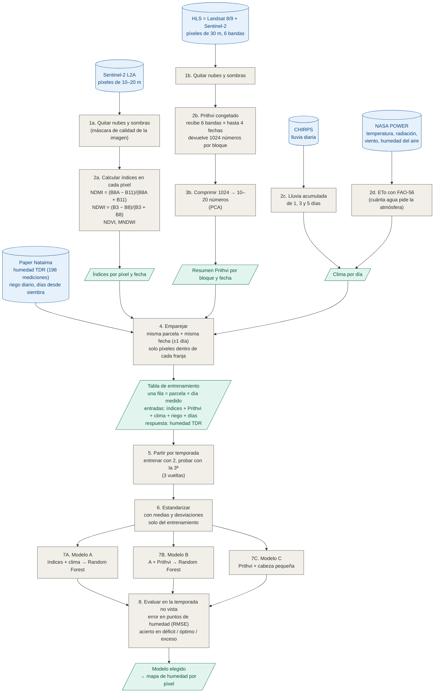

# SIRA: flujo de entrenamiento, paso a paso

Se lee de arriba hacia abajo. **Cilindros** = datos que entran. **Rectángulos** = transformaciones. **Paralelogramos** = lo que produce cada paso.

## Notas

- **Respuesta que aprende el modelo:** la humedad medida en campo. Todo lo demás son entradas.
- **Clima:** se entrena con CHIRPS y NASA POWER porque son las fuentes que habrá en producción. La lluvia medida en el lote solo sirve para medir cuánto se equivocan.
- **Prithvi:** se usa congelado, como en el ejemplo de carbono de NASA. El modelo C es la receta "oficial" (Prithvi + cabeza); A y B permiten medir cuánto aporta Prithvi frente a los índices solos.
