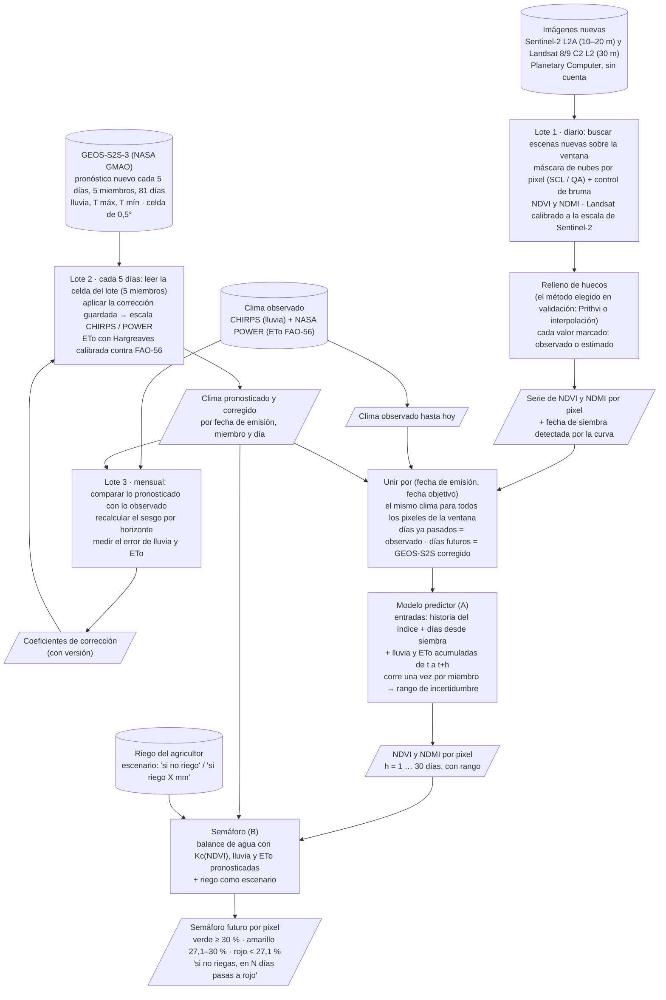

# SIRA: modelo predictor (A) en producción y almacenamiento de datos

**Qué es:** el modelo predictor pronostica el **NDVI y el NDMI de cada pixel de 1 a 30 días adelante**. Con eso, el semáforo (B) dice "si no riegas, en N días pasas a amarillo o rojo".

**Cómo funciona:** todo corre **por lotes** (batch), sin tiempo real ni flujo continuo. No se usan Kafka ni Kinesis. Cada lote se dispara cuando llega un dato nuevo: una imagen de satélite, un pronóstico de GEOS-S2S o el clima observado.

---

## 1. Flujo de producción

Se lee de arriba hacia abajo. **Cilindros** = datos que entran. **Rectángulos** = procesos. **Paralelogramos** = lo que se guarda.

---

## 2. Los tres lotes y su ritmo

| Lote | Cada cuánto | Qué dispara | Qué hace | Qué guarda |
|---|---|---|---|---|
| **1. Imágenes** | Diario | Una escena nueva de Sentinel-2 o Landsat en el catálogo | Nubes y bruma, índices, calibración de Landsat, relleno de huecos | Serie por pixel |
| **2. Clima pronosticado** | Cada 5 días | Un pronóstico nuevo de GEOS-S2S (la NASA lo publica unos 4 días después de su fecha de inicio) | Leer la celda del lote, corregir y calcular la ETo | Clima corregido |
| **3. Recalibración** | Mensual | Ya existe lo observado de los días pronosticados | Comparar pronóstico contra observado y actualizar los coeficientes | Coeficientes con versión + error por horizonte |
| **Predictor + semáforo** | Cuando cambia una entrada (lote 1 o 2) | Serie nueva o clima nuevo | Pronosticar el NDVI y NDMI, y luego el semáforo | Pronóstico por pixel y semáforo |

**Por qué la corrección va aparte del predictor:**
- El predictor se entrena con **clima observado**, que tiene décadas de historia (CHIRPS desde 1981; POWER desde 1981 y con radiación desde 1984).
- En producción recibe GEOS-S2S **corregido a esa misma escala**.
- Si la NASA cambia la versión de GEOS-S2S, solo se recalibra la corrección; el predictor no se toca.
- El error de cada pieza se mide por separado:
  1. el error del clima;
  2. el error del predictor con clima observado (techo);
  3. lo que se pierde al usar el pronóstico.

---

## 3. Almacenamiento: S3 en capas bronce, plata y oro

- **Bucket:** `sira-809411919665-usw2` (us-west-2).
- **Formato:** Parquet particionado por fecha.

| Capa | Ruta | Contenido | Partición |
|---|---|---|---|
| **Bronce** (crudo) | `bronce/sentinel2/`, `bronce/landsat/` | Bandas por pixel recortadas a la ventana + máscara de calidad | `fecha=` |
| | `bronce/geos_s2s/` | Recorte de la celda del lote: lluvia, T máx y T mín por miembro y día de plazo | `emision=` |
| | `bronce/chirps/`, `bronce/power/` | Respuestas originales de cada fuente | `anio=` / `mes=` |
| **Plata** (limpio) | `plata/indices_pixel/` | NDVI y NDMI por pixel y fecha, sensor, marca observado / estimado, nube | `fecha=` |
| | `plata/clima_observado/` | Lluvia y ETo FAO-56 diarias | `anio=` |
| | `plata/geos_s2s_crudo/` | Lluvia, T máx y T mín por emisión, miembro y fecha objetivo | `emision=` |
| **Oro** (listo para usar) | `oro/geos_s2s_corregido/` | Lluvia y ETo corregidas por emisión, miembro y fecha objetivo | `emision=` |
| | `oro/correccion_coeficientes/` | Sesgo por horizonte y variable, con versión y periodo de ajuste | `version=` |
| | `oro/pronostico_predictor/` | NDVI y NDMI por pixel, horizonte y miembro (+ rango) | `emision=` |
| | `oro/semaforo/` | Clase y probabilidades por pixel, horizonte y escenario de riego | `emision=` |

(Con 100 predios se agrega `predio=` delante de cada partición; ver §5.3.)

**Llaves de unión:**
- `pixel_id`;
- `fecha_emision` (el día t en que se pronostica);
- `fecha_objetivo` (t + h);
- `miembro` (1–5).

El clima es uno solo para toda la ventana, porque una celda de GEOS-S2S mide unos 55 km. Por eso se une a todos los pixeles copiando la misma tabla pequeña.

**Evidencia en el repositorio:** el código, los informes y una muestra de cada capa. Los datos completos viven en S3.

---

## 4. Entrenamiento frente a producción

| | Entrenamiento | Producción |
|---|---|---|
| Lluvia y ETo de t a t+h | Observadas (CHIRPS + POWER FAO-56) | GEOS-S2S corregido (ETo por Hargreaves calibrada) |
| Respuesta | El NDVI / NDMI que el satélite midió en t+h | — (es lo que se pronostica) |
| Medición del clima pronosticado | Prueba sellada con los pronósticos reales de GEOS-S2S de 2026; corrección ajustada con la climatología de los hindcasts 2001–2020 y los pronósticos de 2025 | Recalibración mensual |

**Límite conocido:** la NASA no publica los pronósticos pasados de GEOS-S2S de 1991–2024 (están en sus máquinas internas). Por eso su error se mide solo con los pronósticos públicos:
- mayo–agosto de 2025;
- marzo–noviembre de 2026, que pasa de La Niña débil a El Niño fuerte (ONI de NOAA CPC).

Fuentes: `https://portal.nccs.nasa.gov/datashare/gmao/geos-s2s-3/` y su `GEOS-S2S-3-primer.pdf`.

---

## 5. Spark: MVP de un predio frente a 100 predios

**Idea central:** Spark es **procesamiento por lotes**. Sirve cuando el volumen crece: muchos predios, muchos pixeles y años de imágenes. El MVP tiene un solo predio, Nataima, y ahí probablemente no hace falta. Se diseña para un **escenario hipotético de 100 predios distribuidos por el mundo**, cada uno con sus imágenes, su clima y su pronóstico.

### 5.1 Cuánto dato hay en cada escenario (órdenes de magnitud, estimados)

Supuestos:
- ventana de entrenamiento de 5 × 5 km por predio, a 10 m = 250 000 pixeles;
- Sentinel-2 desde 2017 (unas 70 fechas por año) más Landsat (unas 45 por año);
- predio de 10 ha = 1 000 pixeles.

| Escenario | Histórico para entrenar (pixel·fecha) | Producción diaria (pixeles nuevos) | Pronósticos por corrida (pixel × 30 días × 5 miembros) |
|---|---|---|---|
| MVP: 1 predio | ~10⁸ | ~10⁵ (una escena de la ventana) | ~1,5 × 10⁵ (solo los pixeles del predio) |
| 100 predios | ~10¹⁰ | ~10⁷ | ~1,5 × 10⁷ |

En producción solo se pronostican los **pixeles del predio**. La ventana grande sirve para entrenar con más ejemplos.

### 5.2 Dónde entra Spark en cada lote

| Lote | MVP (1 predio) | 100 predios | Por qué |
|---|---|---|---|
| **Entrenamiento histórico** (series por pixel, relleno, calibración Landsat → S2, ejemplos por horizonte) | pandas o Spark: **se mide** | **Spark** | 10¹⁰ filas no caben en una máquina; se reparte por `predio` y `fecha` |
| **1. Imágenes** (diario) | pandas | **Spark** | Escenas de 100 lugares en paralelo; mismo código que el entrenamiento |
| **2. GEOS-S2S** (cada 5 días) | Python simple | Un solo trabajo: lee **una vez** cada archivo global y saca las 100 celdas | Son 15 archivos de 80 MB por emisión, sin importar cuántos predios haya; Spark no aporta |
| **3. Recalibración** (mensual) | Python simple | Spark o Python: agrupar por celda × horizonte × variable | Pocas filas (100 celdas × 30 días × 3 variables) |
| **Predictor + semáforo** | pandas | **Spark** con el modelo copiado a cada nodo (*broadcast*) | 10⁷ predicciones por corrida; cada predio es independiente |

**Conclusión de diseño:**
- Spark va en el **entrenamiento histórico**, en el **lote diario de imágenes** y en la **inferencia por pixel** cuando hay muchos predios.
- La **corrección de GEOS-S2S no lo necesita**: siempre son pocos datos, porque el archivo global se lee una vez para todos los predios.

### 5.3 Qué cambia en el almacenamiento con 100 predios

- **Se agrega la llave `predio_id`** a todas las tablas de plata y oro, y la partición pasa a ser `predio=/fecha=`. Así cada predio se procesa sin leer los demás.
- **Tabla nueva `oro/predios/`:** ubicación, polígono, celda de GEOS-S2S asignada, fecha de siembra y suelo.
- **El clima sigue siendo por celda, no por predio.** Varios predios en la misma celda comparten la misma tabla de clima.

### 5.4 Límites que el escenario de 100 predios destapa (no son de Spark)

- **CHIRPS solo cubre tierra entre 50° S y 50° N.** Fuera de esa franja la lluvia observada tendría que salir de NASA POWER, con su sesgo medido.
- **El semáforo (B) se calibró con el suelo de Nataima**: capacidad de campo del 30 %. Cada predio nuevo necesita sus umbrales de suelo.
- **El modelo predictor (A) se entrenó con arroz de la meseta de Ibagué y el Espinal.** En otras zonas o cultivos hay que revalidarlo.

### 5.5 Cómo se mide en este proyecto

Según el handover del modelo A, §4:
- el **mismo pipeline** en pandas (una máquina) y en PySpark;
- se mide tiempo, costo y memoria pico a **3 tamaños**: un lote, 1 km² y la ventana completa;
- con esa curva de crecimiento se **proyecta** el escenario de 100 predios, dicho como proyección y no como medición.

Si Spark no abarata el MVP, se dice. La arquitectura de 100 predios queda planteada igual.
