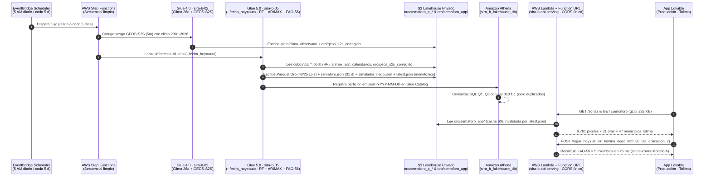

# 05_B — Historia de la Conexión ML ↔ Big Data ↔ App Lovable en SIRA

**Proyecto Integrador 1 — Equipo 10 (Maestría en Ciencia de Datos y Analítica, Universidad EAFIT)**  
**Fecha de Integración y Depuración:** 22–23 de noviembre de 2026  
**Cuenta AWS:** `929570730700` · **Región:** `us-east-2` (Ohio) · **CloudFormation:** `0 stacks`  
**Lakehouse S3:** `s3://sira-b-lakehouse-929570730700/` · **Athena DB:** `sira_b_lakehouse_db`  
**Endpoint Público HTTPS en Producción (Lovable):** `https://s435rizz22wj6qd3mv37doq76m0widfd.lambda-url.us-east-2.on.aws/`

---

## Capítulo 1 · El Punto de Partida: Dos Mundos que Convivían sin Hablarse

La tarde del **22 de noviembre de 2026**, a menos de 24 horas de la entrega final del proyecto integrador SIRA, el equipo tenía dos logros técnicos notables… pero peligrosamente desconectados entre sí dentro del mismo bucket de AWS S3 (`s3://sira-b-lakehouse-929570730700/`):

1. **El mundo de Big Data (`B_SIRA_ARCH`, desplegado inicialmente contra `8fde03d`):**
   - Contaba con una arquitectura Lakehouse Medallion completa en AWS `us-east-2` (`S3`, `4` Jobs PySpark en Glue 4.0, `3` máquinas de estados en Step Functions, `3` horarios en EventBridge y `13` tablas verificadas en Amazon Athena, todo aprovisionado sin CloudFormation).
   - Sin embargo, **todavía no ejecutaba los modelos entrenados reales de Machine Learning**:
     - `sira-b-03` aproximaba el Modelo A con una curva gaussiana heurística, inicializaba el estado hídrico con valores sintéticos y usaba una regla de probabilidad (`P / prior`) que ML acababa de descartar.
     - `sira-b-04` leía un archivo estático viejo (`1a592aa`, 27 columnas) con cifras viejas e incompatibles.
     - La API `app_b_inference_api.py` vivía únicamente como script local: en AWS había **`0` Lambdas**, y el bucket S3 estaba 100 % privado y sin CORS, por lo que **Lovable** no podía consumir nada desde la nube.
   - Además, la cuenta AWS todavía acumulaba recursos heredados de la Iteración A (`6` Glue Jobs viejos, `2` Step Functions viejas y `2` horarios de EventBridge quemando cómputo innecesario).

2. **El mundo de Machine Learning (`GomSal/SIRA@modelo-humedad`, commits `d77ae9c` → `876be25`):**
   - Acababa de cerrar la arquitectura científica definitiva tras la prueba de dinámica (`scripts/b_prueba_dinamica.py`): **un solo semáforo unificado** donde **Modelo A** (`Random Forest`, 200 árboles) predice `NDVI`/`NDMI`, **Tramo 1** (`b_entradas.propagar`) lleva el balance histórico con riego supuesto `CD`, **Modelo B** (`ARIMAX(1)`, `arimax.json`) corrige **únicamente el día 0** con margen único `1,5σ = 4,68 mm`, y **Tramo 2** (`Dr_modificada` FAO-56) propaga los 30 días siguientes sin riego y sin margen adicional sobre los 5 miembros de GEOS-S2S.
   - Rellenó el hueco de retraso de CHIRPS con `PRECTOTCORR` de NASA POWER (`46 d` al 15-nov y `50 d` al **19-nov** con `actualizar_datos.py`).
   - Exportó `semaforo.json` en **`formato: 2`** (31 días diarios × píxeles en cultivo con `lat`/`lon`) + `zonas.json` (Tolima + 47 municipios) y subió los artefactos pesados reales (`predictor_ndvi.joblib` 92,2 MB, `predictor_ndmi.joblib` 95,3 MB, `cubo.npz` 297,6 MB, `clima.csv` 2001–2026 y `geos_nrt.csv`) a S3.

Esta es la historia de cómo unimos ambos mundos, limpiamos todo el ruido heredado en AWS y dejamos la infraestructura lista en producción con Lovable.

---

## Capítulo 2 · Qué Hicimos Paso a Paso (y los Problemas Reales que Resolvimos)

### Acto 1 · Auditoría Forense y Prueba de Compatibilidad `.joblib`
Sincronizamos el clon local contra `origin/modelo-humedad`, contrastamos las huellas `SHA-256` contra S3 y descomprimimos `predictor_ndvi.joblib` (92,2 MB → 303,7 MB): verificamos que fue serializado con **protocolo pickle 4** y **`scikit-learn 1.6.1`** sin referencias incompatibles a `numpy._core`, cargando limpiamente en `3,82 s`.

### Acto 2 · Nace el Corazón de la Integración: `sira-b-05-inferencia-unificada-ml` (AWS Glue 5.0)
Creamos [`bigdata_pipeline/spark_jobs/job_b05_inferencia_unificada_ml.py`](https://github.com/GomSal/SIRA/blob/Big-Data_Arch/B_SIRA_ARCH/bigdata_pipeline/spark_jobs/job_b05_inferencia_unificada_ml.py) sobre **AWS Glue 5.0 (Python 3.11, `2×G.1X`, 16 GB RAM/nodo)** fijando `--additional-python-modules = scikit-learn==1.6.1,joblib,pyproj,Pillow`:
1. Descarga desde S3 `plata/cubo_a/`, `models/pronosticador_a/rf/`, `models/semaforo_b/operacion/` y lee el clima pronosticado corregido directamente desde **`oro/geos_s2s_corregido/`** (producido por `sira-b-02`).
2. Ejecuta los **dos Random Forest reales (`.joblib`)**, `b_entradas.propagar()` (CHIRPS + POWER + calendarios `CD`), `arimax.json` en día 0 (`+4,68 mm`), `propagar_dr()` FAO-56 sobre 5 miembros GEOS-S2S y la alarma tardía NDMI sobre los **20.286 píxeles agrícolas (400 ha)**.
3. Escribe simultáneamente una sola fuente de verdad en Capa Oro:
   - **Amazon Athena (Parquet Snappy):** `oro/semaforo_c_pixeles/emision=<hoy>/` (40 columnas) y `oro/semaforo_c_resumen/emision=<hoy>/` (25 columnas) con registro automático de particiones en Glue Data Catalog.
   - **App Lovable (`oro/semaforo_app/emision=<hoy>/`):** `semaforo.json` (`formato: 2`, 31 días), `resumen.json`, `pixeles.csv.gz`, `mapa.html`, 4 PNGs, **`simulador_riego.json`** (puente ultrarrápido para `POST /regar_hoy`) y `latest.json`.

### Acto 3 · Unificando Clima 26 Años (`sira-b-02`) y Amazon Athena (`42/42`)
Actualizamos [`bigdata_pipeline/spark_jobs/job_b02_lote_clima_y_geos.py`](https://github.com/GomSal/SIRA/blob/Big-Data_Arch/B_SIRA_ARCH/bigdata_pipeline/spark_jobs/job_b02_lote_clima_y_geos.py) para leer los **26 años completos (`2001–2026`)** de `plata/cubo_a/clima.csv` y `bronce/geos_s2s_a/geos_nrt.csv`, alineando la climatología a la ventana sellada de 10 años (`2015-11-18..2025-11-17`). Resolvimos un fallo de parseo de Spark sobre timestamps (`'2001-01-01 00:00:00'`) normalizando con `substring(..., 1, 10)` (`SUCCEEDED` en `102 s`). Purgamos las particiones viejas de 27 columnas y reconstruimos `sira_b_lakehouse_db` (**13 tablas**, incluyendo el Bloque 6 de verificación dinámica).

### Acto 4 · El Puente Hacia Lovable: AWS Lambda `sira-b-api-serving` + Function URL con CORS
Para mantener S3 **100 % privado** (`BlockPublicAccess = True`) y entregarle a Lovable una API HTTPS ultrarrápida:
1. Creamos el rol IAM de mínimo privilegio **`sira-b-lambda-api-role`** (solo lectura y listado sobre `oro/semaforo_app/*` y `models/semaforo_b/operacion/*`).
2. Implementamos [`bigdata_pipeline/api/app_b_inference_api.py`](https://github.com/GomSal/SIRA/blob/Big-Data_Arch/B_SIRA_ARCH/bigdata_pipeline/api/app_b_inference_api.py) en **Python puro (`stdlib + boto3`, ZIP de `6,1 KB`, 0 capas externas)** con caché de 60 s invalidada por `latest.json`, `gzip` automático (`1,42 MB → 232 KB`) y `POST /regar_hoy` con física FAO-56 en `< 5 ms` en caliente.
3. **Bug crítico de CORS atrapado y resuelto:** AWS Lambda Function URL ya inyecta nativamente `Access-Control-Allow-Origin`; al quitar el encabezado duplicado del handler logramos **`8/8 PASS`** con un único header CORS limpio, permitiendo conectar Lovable en producción sin errores de navegador.

### Acto 5 · Limpieza de Ruido en AWS y Blindaje contra Regresiones de Fecha (`2026-11-19`)
Para dejar una arquitectura limpia, económica y a prueba de fallos en producción:
1. **Limpieza de cómputo obsoleto en AWS:** eliminamos **2 horarios EventBridge viejos** (`sira-horario-batch`, `sira-horario-diario-5am`), **2 Step Functions viejas** (`sira-pipeline-batch`, `sira-pipeline-clima-diario`) y **9 Glue Jobs obsoletos** (los 6 de Iteración A + `sira-b-01`, `sira-b-03` y `sira-b-04`), simplificando las 3 Step Functions activas a flujos secuenciales limpios sobre **solo 2 Glue Jobs (`sira-b-02` y `sira-b-05`)**.
2. **Bug real de producción atrapado en vivo (23-nov, 04:18 UTC):** cuando el equipo de ML subió la nueva emisión **`2026-11-19`** (commit `876be25`), una ejecución programada de `sira-b-05` con la fecha fija anterior (`--fecha_hoy=2026-11-15`) devolvió temporalmente `latest.json` al `2026-11-15`. Lo solucionamos de raíz con **tres protecciones permanentes**:
   - **`--fecha_hoy=auto`** en `sira-b-05` y en las Step Functions: detecta automáticamente el último día con lluvia observada en `plata/cubo_a/clima.csv` (misma regla que `actualizar_datos.py` → `2026-11-19`).
   - **Guardia monotónica sobre `latest.json`:** `sira-b-05` jamás puede sobreescribir `latest.json` con una emisión anterior a la que ya está publicada en S3.
   - **Resiliencia en Lambda (`sira-b-api-serving`):** `GET /semaforo_c` ya no depende de `simulador_riego.json`, y `POST /regar_hoy` cae automáticamente al `simulador_riego.json` más reciente si una subida manual de `subir_aws.py` aún no ha sido procesada por Glue.

---

## Capítulo 3 · Cómo Funciona Todo el Sistema Hoy (El Viaje del Dato)

---

## Capítulo 4 · Evidencia Verificada en Vivo en AWS (`us-east-2` · Emisión `2026-11-19`)

| Verificación | Recurso / QueryId / Endpoint | Resultado Exacto en Vivo |
|---|---|---|
| **Glue 5.0 `sira-b-05` (`--fecha_hoy=auto`)** | `jr_d394d0c384a8...dfa7` | **`SUCCEEDED` en `194 s`** · detectó `2026-11-19`, consumió `oro/geos_s2s_corregido`, actualizó Athena + App + `simulador_riego.json`. |
| **AWS CloudFormation** | `cfn.list_stacks()` | **`0 stacks`** activos (Regla Cero CloudFormation). |
| **Athena `Q4` (`oro_semaforo_c_resumen`)** | `98551748-bcc4-40b3-94e1-5c3330a28bda` | `emision=2026-11-19`: `h=0` `67,61 ha` (**`99,6 %` suf · `0,4 %` med · `0,0 %` baja · `11,4 %` marca**, hueco `50 d power`); `h=7` `100 %` baja (`4.457 m³`); `h=15` `100 %` med (`1.276 m³`); `h=30` `100 %` baja (`4.377 m³`). |
| **Athena `Q5` (`oro_semaforo_c_pixeles`)** | `1fe3543f-4414-4937-9973-4383b43f4aee` | `1_de_1_a_2_dias`: **`111` px** (`1,6 %`) · `2_de_3_a_5_dias`: **`6.650` px** (**`98,4 %`**) · `fuera_de_cultivo`: `13.525` px. **Total = `20.286` píxeles (`6.761` en cultivo, 0 duplicados).** |
| **Lambda `GET /semaforo` (gzip)** | `.../semaforo` | `HTTP 200`, **`231.781 B` (`gzip`)**, `formato: 2`, `6.761` píxeles × `31` días, CORS único `https://sira.lovable.app`. |
| **Lambda `POST /regar_hoy`** | `.../regar_hoy` (`30 mm`, `dia_aplicacion=2`) | `HTTP 200`, `sin_riego rojo=d3` $\rightarrow$ `con_riego rojo=d6` (**`+3 días` ganados**, `re_ejecuto_modelo_a: false`, `geos_fuente=oro/geos_s2s_corregido`). |

---

## Capítulo 5 · Evolución Post-MVP

1. **Ingesta automática incremental en nube:** incorporar `scripts/modelo_a/bajar_geos.py` y `scripts/operacion/actualizar_datos.py` dentro de un Job ligero previo a `sira-b-02` / `sira-b-05` para actualizar `plata/cubo_a/` y `bronce/geos_s2s_a/` automáticamente desde la nube sin correr scripts locales.
2. **Escalamiento distrital (100 predios en UsoCoello / Tolima):** agregar registros en `oro/predios/` y paralelizar `sira-b-05` por `predio_id` usando `applyInPandas` en Spark (tal como justifica `SPARK_ECUACION.md` cuando el volumen exceda la RAM de un nodo).
