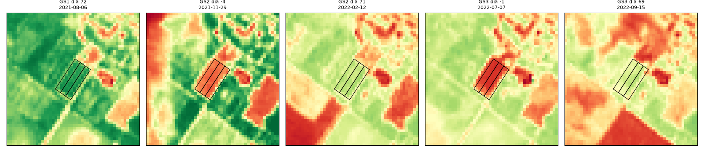
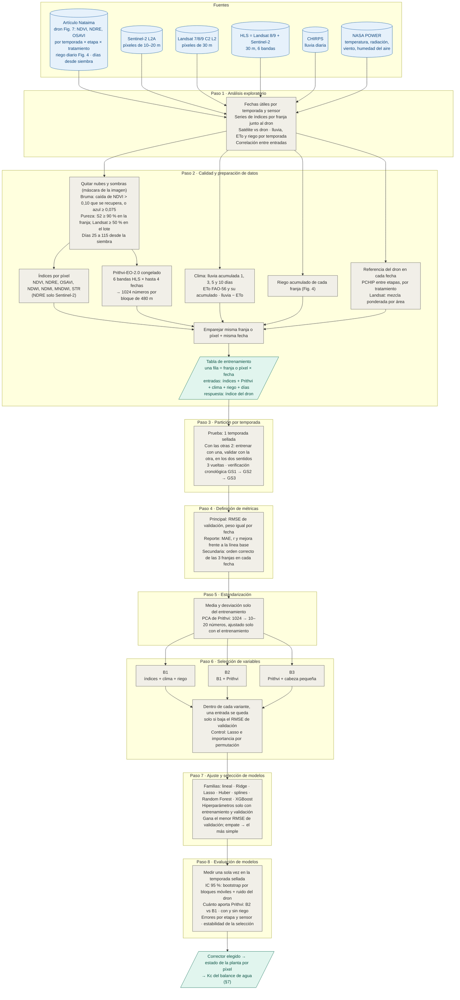
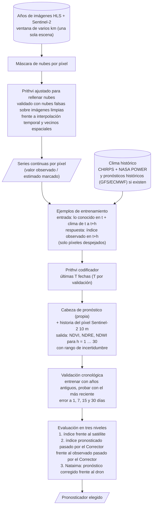
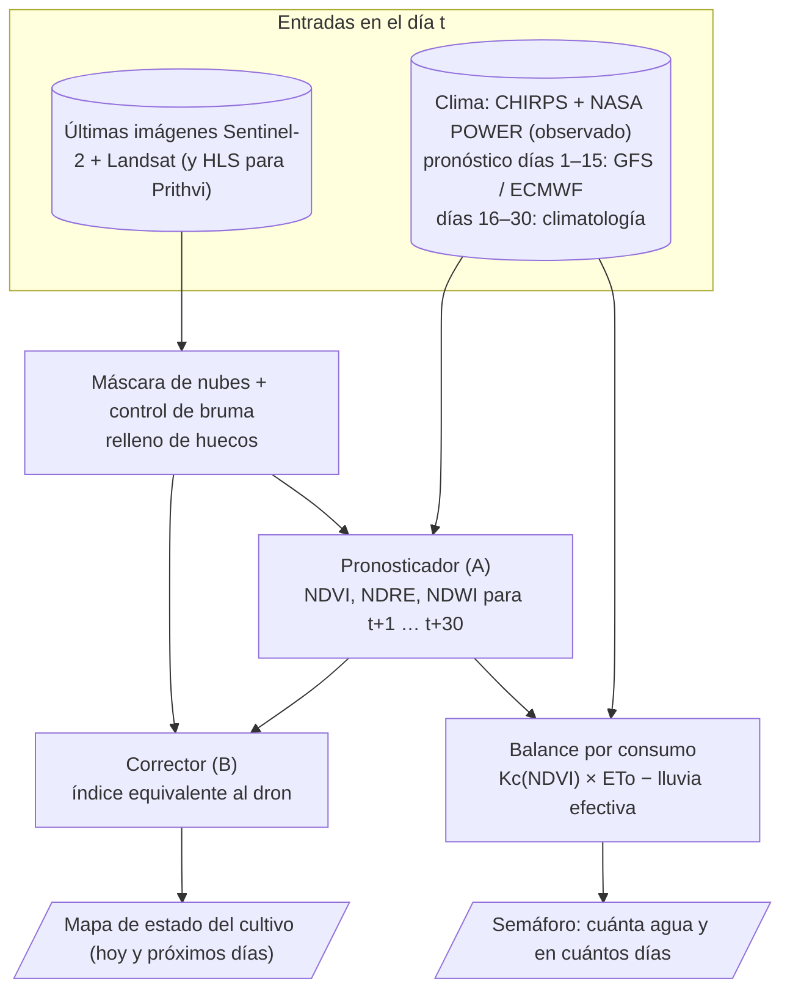

# SIRA: informe preliminar

**Sistema Inteligente de Riego para Arroz · Equipo 10 · Proyecto Integrador · EAFIT 2026-2**
Estado al 17 de noviembre de 2026 (reestructurado: nueva variable de interés del modelo B).

Este informe recoge lo que ya está hecho y verificado (datos de campo, ubicación del lote, imágenes, clima), el diseño de entrenamiento del **Corrector**, el balance de agua, el **Pronosticador** y la bitácora de pruebas. Todo el código y los datos derivados están en este repositorio.

---

## 1. Enfoque

SIRA estima **el estado del cultivo de arroz desde el satélite** y recomienda **cuánta agua aplicar y cuándo**.

**Cambio de la variable de interés (17-nov).** El plan inicial era que el satélite estimara la **humedad del suelo a 20 cm** (TDR). Las pruebas de la sección 11 muestran que eso no es posible con estos datos. Ni los índices (NDMI, NDWI, NDVI, OPTRAM), ni el radar, ni la temperatura de superficie siguen esa humedad, porque depende del riego de las últimas semanas y el satélite no ve los riegos. El dron del propio artículo explica por qué: el tratamiento con el suelo más húmedo (CD) tiene la planta menos vigorosa. **Más agua en el suelo no implica más vigor ni más agua en la planta.**

Por eso SIRA se organiza así:

| Pieza | Pregunta | Respuesta correcta para entrenar o validar | Estado |
|---|---|---|---|
| **Corrector (modelo B)** | ¿Qué índice mediría el dron (planta a 60 m, sin mezcla de suelo ni diques) donde el satélite ve este valor? | Índices del dron del artículo (Fig. 7) | Factible: r 0,72–0,99 en GS2–GS3 (§11.9) |
| **Balance por consumo** | ¿Cuánta agua consume el cultivo y cuándo hay que reponerla? | Riegos reales de MIRI, el manejo óptimo del artículo | ~15–25 % de error en el total (§11.8) |
| **Pronosticador (modelo A)** | ¿Cómo van a evolucionar los índices en los próximos 1–30 días? | La siguiente imagen del satélite | Diseñado, no entrenado |

**En operación:**
1. El Pronosticador proyecta los índices.
2. El Corrector los lleva a escala de planta y da el **mapa de estado del cultivo**.
3. El balance por consumo (Kc × ETo − lluvia) da **cuánta agua y cuándo**.

---

## 2. Verdad de campo: Nataima (Martínez-Vega et al., 2025)

Los datos originales del ensayo son privados. Se reconstruyeron **digitalizando las Figs. 2–4** del artículo (CC BY 4.0) con métodos automáticos y verificables (`src/sira/digitalizar/`).

| Variable | Método | Validación contra el artículo |
|---|---|---|
| Lluvia diaria (Fig. 2) | Barras detectadas por color, siguiéndolas aunque las cruce la línea roja del AtWD | Total GS1 521,5 mm frente a 521,4 de la Tabla 2; GS2 +1,5 %; GS3 +1,0 % |
| Riego por tratamiento (Fig. 4) | Camino de Viterbi (línea continua que nunca baja) anclado a los totales de la Tabla 2 | Sumas por etapa a ≈2 mm en promedio; número de riegos igual en GS3 (24/21/13) |
| Humedad del suelo, TDR a 20 cm (Fig. 3) | Solo marcadores con barra de error simétrica (media ± EE) | Mínimos y máximos a ±1 punto de los citados en el texto |

Detalle: `reports/validacion_digitalizacion.md`.

**Curvas continuas.** Las 198 mediciones se interpolan con **PCHIP**: la curva pasa por cada medición sin inventar picos (a diferencia de la curva suavizada de Excel del artículo). Cada valor queda marcado como *medido* o *interpolado*, junto con la distancia a la medición más cercana (`data/processed/humedad_continua.csv`).

**Índices del dron (Fig. 7).** El artículo también publica índices de dron: DJI Matrice 300 con Micasense Altum a 60 m, con vuelos a los 30 días y luego cada 20. Vienen como medias por temporada × etapa × tratamiento para NDVI, NDRE y OSAVI. Se digitalizaron las 81 barras (`data/processed/dron_indices.csv`); contra las medias por etapa de la Tabla 4, el error medio es de 0,006–0,011. **Son la referencia del Corrector (§6).**

**Incoherencias encontradas en el artículo:**
- **GS2:** la lluvia máxima diaria es 87 mm en el texto, pero ≈77 mm en la figura.
- **Fig. 4:** las sumas por etapa usan cortes distintos al sombreado de la propia figura.
- **GS1:** la línea de AtWD está corrida un día respecto a la lluvia.

---

## 3. Ubicación del lote y escala

Los polígonos de las 3 franjas (MIRI, AWD+MIRI, CD) se obtuvieron del plano georreferenciado de la Fig. 1 (`data/processed/franjas_nataima.geojson`).

**Verificación sobre Sentinel-2 real.** Justo antes de la siembra de GS2 (día −4) y de GS3 (día −1), el área de los polígonos aparece con suelo desnudo (NDVI bajo), con la misma forma y orientación del lote, mientras alrededor hay vegetación. Desplazar el polígono 10 m no mejora el ajuste: la ubicación es correcta a ±10 m.

**Fechas de siembra.** El artículo solo da meses. Se estimaron alineando su lluvia con CHIRPS, NASA POWER y ERA5: **GS1 ≈ 27-may-2021, GS2 ≈ 4-dic-2021, GS3 ≈ 9-jul-2022**. La serie de NDVI del lote sube y baja al ritmo de esas tres siembras, y se diferencia de los alrededores, lo que confirma las fechas.

**Escala (píxeles por franja):**

| Cuadrícula | Píxeles que tocan el lote | Etiquetables (≥50 % dentro) | Puros por franja |
|---|---|---|---|
| Sentinel-2, 10 m | 125 | 97 | MIRI 13 · AWD+MIRI 14 · CD 10 |
| HLS, 30 m (entrada de Prithvi) | 23 | 10 | 0 |
| Landsat C2, 30 m | 20 | 10 | 0 |

- Los píxeles de 30 m mezclan franjas. Su humedad "verdadera" es **el promedio de las franjas que cubren, ponderado por área** (`data/processed/pixeles_franjas_*.csv`).
- El lote completo (≈0,96 ha) cabe en un solo bloque de Prithvi (16×16 píxeles HLS, 480 m).

**Rotación de tratamientos (resuelta).** Los tratamientos se trasladaron de franja en cada temporada, y la Fig. 1 solo muestra GS1. Al comparar el dron con Sentinel-2, la asignación que coincide es la **rotación "oeste"** (§11.6):

| Temporada | Oeste | Centro | Este |
|---|---|---|---|
| GS1 | MIRI | AWD+MIRI | CD |
| GS2 | AWD+MIRI | CD | MIRI |
| GS3 | CD | MIRI | AWD+MIRI |

En GS3 la posición de CD es segura; el orden de MIRI y AWD+MIRI es menos claro.

---

## 4. Imágenes disponibles

Catálogos oficiales para el punto de Nataima, 2021–2022:

| Fuente | Fechas |
|---|---|
| ESA Copernicus, Sentinel-2 L2A | 146 |
| USGS, Landsat C2 L2 | 101 (L8 45, L7 44, L9 21) |

Se descargan de **Microsoft Planetary Computer**, sin cuenta. Tiene las mismas 146 fechas de Sentinel-2 y 89 de Landsat.

**Fechas despejadas sobre el lote** (≥90 % de sus píxeles sin nube ni sombra, según la máscara de calidad de cada producto):

| Satélite | Fechas | Despejadas | Dentro de las siembras |
|---|---|---|---|
| Sentinel-2 | 146 | 41 | 22 |
| Landsat 7/8/9 | 89 | 27 | 14 |
| **Sentinel-2 + Landsat (únicas)** | 217 | **61** | **31** |
| HLS (Prithvi) | 186 | 39 | 20 |

De las 217 fechas, 15 están parcialmente nubladas (30–90 % despejado) y 141 casi tapadas (<30 %). El relleno de huecos espacial sirve en las primeras; en las demás solo sirve el relleno temporal (§8).

**Control de bruma.** La máscara de nubes (SCL) dejó pasar como "despejadas" fechas con bruma o nube fina (7-jul, 11-ago y 15-sep de 2021; 3-ene de 2022). Se descarta una fecha si el NDVI del lote cae > 0,10 frente a la fecha anterior y a la siguiente, o si el azul del lote es ≥ 0,075 entre los días 25 y 115. La regla es la misma para las tres temporadas (`scripts/revisar_bruma.py`, `reports/control/gs*_color_verdadero.png`).

---

## 5. Clima

Se comparó la lluvia de cada fuente contra la medida en el propio lote (`reports/comparacion_lluvia.md`):

| Fuente | Parecido en sumas de 5 días | Sesgo de volumen |
|---|---|---|
| IDEAM San Miguel (25 km, 82 días) | 0,50 | −63 % |
| NASA POWER | 0,47 | +27 % |
| ERA5 | 0,44 | +51 % |
| **CHIRPS** | 0,42 | **+14 %** |
| IDEAM Cucunubá (15 km) | 0,39 | −36 % |

**Decisión:**
- **Lluvia: CHIRPS.** Tiene el menor sesgo y una serie completa.
- **Temperatura, radiación, viento y humedad del aire:** NASA POWER, con los que se calcula la **ETo FAO-56**. Mediana 3,75 mm/d.
- **IDEAM:** descartado. Sus estaciones automáticas públicas están lejos y tienen huecos.

Ninguna fuente reproduce la lluvia diaria exacta del lote (correlación ≤ 0,42), así que los modelos usan **acumulados de 3, 5 y 10 días**.

---

## 6. Modelo B (Corrector): diseño de entrenamiento

### 6.1 Qué aprende

El flujo de entrenamiento es el mismo de la propuesta (índices + Prithvi + clima + riego → modelo). **Lo único que cambia es la respuesta:** antes era la humedad TDR del artículo; ahora es **el índice que midió el dron** del mismo artículo (Fig. 7: NDVI, NDRE y OSAVI). Las entradas incluyen además NDRE y OSAVI.

**La lógica del sistema no cambia: agua + clima entran → la planta responde → sale la recomendación de agua.**

| | Qué es | Dónde entra |
|---|---|---|
| Agua y clima (entrada) | Riego, lluvia (CHIRPS), ETo y radiación (NASA POWER) | Entradas candidatas del Modelo B |
| Planta | Estado del cultivo visto desde el satélite: índices y Prithvi | Entradas del Modelo B. Su salida es el índice equivalente al del dron |
| Agua (salida) | Consumo Kc × ETo − lluvia efectiva | El Kc sale del estado de la planta que da el Modelo B (§7) |

**Variable objetivo:** el índice del dron (NDVI, NDRE y OSAVI) en cada franja o píxel y fecha. Es una regresión; se entrena un corrector por índice.

**Por qué esta variable y no la humedad TDR:**
- es una medición de campo del cultivo a escala de planta (60 m de altura, sin mezcla de suelo ni diques);
- responde al riego: CD tuvo menos vigor que MIRI y AWD+MIRI en GS2 y GS3;
- el satélite sí la sigue (§11.6, §11.9); la humedad del suelo, no (§11.1 a §11.5).

**Qué puede explicar cada grupo de entradas** (no se descarta ninguno de antemano; lo decide la validación):
- **Índices del satélite:** diferencias entre franjas y entre fechas.
- **Riego:** diferencias entre franjas, porque cada tratamiento recibe distinta agua. En la app solo sirve si el agricultor reporta sus riegos, así que el modelo se evalúa con y sin riego.
- **Clima:** es igual para las 3 franjas un mismo día. Explica diferencias entre fechas y temporadas (estrés por calor, lluvia, demanda de la atmósfera) y el agua de fondo bajo la planta, que el satélite de 10 a 30 m mezcla con el follaje y el dron no.
- **Prithvi:** un bloque suyo mide 480 m y cubre todo el lote. Resume el estado del lote y su entorno en cada fecha, pero no separa franjas.

### 6.2 Flujo de entrenamiento: los 8 pasos de la metodología

Es el mismo flujo de la propuesta, ordenado según los 8 pasos obligatorios del curso. Cada caja dice qué entra, qué se hace y qué sale.

### 6.3 Paso 1 · Análisis exploratorio

Antes de entrenar se describe lo que hay:
- cuántas fechas útiles tiene cada temporada y cada sensor (Sentinel-2, Landsat, HLS);
- la serie de tiempo de cada índice por franja, junto a la del dron;
- la dispersión entre el índice del satélite y el del dron, por temporada y sensor;
- lluvia, ETo y riego por temporada y tratamiento;
- la correlación entre las entradas candidatas, para ver cuáles dicen lo mismo;
- si las diferencias entre tratamientos que ve el dron también aparecen en el satélite.

### 6.4 Paso 2 · Calidad y preparación de datos

| Elemento | Detalle |
|---|---|
| Sentinel-2 | Índices por franja: píxeles ≥ 90 % dentro |
| Landsat 7/8/9 | Índices por píxel de 30 m con ≥ 50 % dentro del lote |
| HLS → Prithvi | Prithvi-EO-2.0 congelado con las 6 bandas HLS y hasta 4 fechas. Un bloque de 480 m cubre todo el lote: da un resumen del lote por fecha |
| Índices | NDVI, NDRE (solo Sentinel-2), OSAVI, NDWI, NDMI, MNDWI y STR |
| Nubes y bruma | Máscara de calidad del producto, más el control de bruma de §4: se descarta una fecha si el NDVI del lote cae más de 0,10 frente a la anterior y a la siguiente, o si el azul del lote es ≥ 0,075 |
| Fechas | Despejadas, entre los días 25 y 115 de cada siembra |
| Clima | CHIRPS (lluvia) y NASA POWER (ETo FAO-56), por día; acumulados de 1, 3, 5 y 10 días; lluvia − ETo |
| Riego | Riego diario por tratamiento (Fig. 4, digitalizada), acumulado desde la siembra y en los últimos 5 y 10 días |
| Referencia del dron | La media por etapa se ubica en el día medio de sus vuelos (30, 60 y 100 días) y se interpola con PCHIP por tratamiento. **Solo empareja fechas; no agrega información.** En Landsat, la referencia es la mezcla de los tratamientos que cubre el píxel, ponderada por área |
| Asignación de tratamientos | Rotación "oeste" (§3) |
| Tamaño | NDVI: 23 fechas y 141 pares franja o píxel × fecha. NDRE: 14 fechas y 42 pares. OSAVI: como NDVI |
| Unidad independiente | **La fecha** dentro de cada temporada, y **la temporada** entre temporadas. Los píxeles de una misma fecha no son independientes |

Cada fecha descartada queda registrada con su motivo.

### 6.5 Paso 3 · Partición del conjunto de datos

Hay 3 temporadas, y las fechas dentro de cada una están autocorrelacionadas. Por eso **nunca se separan fechas o píxeles al azar**: la separación es por temporada.

**Esquema principal, validación cruzada anidada por temporada:**
1. **Prueba:** una temporada queda sellada. No se usa para nada hasta el paso 8.
2. **Entrenamiento y validación:** con las otras dos, se entrena con una y se valida con la otra, en los dos sentidos. Con eso se eligen variante, variables, modelo e hiperparámetros.
3. Con lo elegido se reentrena con las dos temporadas y se mide **una sola vez** en la de prueba.
4. Se repite con cada temporada como prueba, y se reportan los 3 resultados de prueba.

**Verificación cronológica** (como en producción, del pasado al futuro): entrenar con GS1, validar con GS2, probar con GS3.

### 6.6 Paso 4 · Definición de métricas

Se fijan antes de ver resultados:
- **principal, la que elige el modelo:** RMSE en validación, con el mismo peso para cada fecha;
- **para reportar:** RMSE, MAE y correlación de Pearson en la prueba, y la mejora frente a la línea base, que es predecir la media del entrenamiento;
- **secundaria:** si el corrector ordena bien las 3 franjas en cada fecha. Es lo que la app muestra al agricultor: qué parte del lote está peor.

### 6.7 Paso 5 · Estandarización

- Cada entrada se lleva a media 0 y desviación 1 con la media y la desviación **del entrenamiento solamente**, y esos mismos valores se aplican a validación y prueba.
- El PCA que comprime los 1024 números de Prithvi a 10–20 también se ajusta **solo con el entrenamiento**.
- Todo va dentro de la misma tubería del modelo, en cada partición, para que la prueba no filtre información al entrenamiento.

### 6.8 Paso 6 · Selección de variables

Se comparan **tres variantes**, como en la propuesta:

| Variante | Entradas | Qué mide |
|---|---|---|
| B1 | Índices + clima + riego + días desde siembra | El modelo sin Prithvi |
| B2 | B1 + componentes de Prithvi | Cuánto aporta Prithvi sobre B1 |
| B3 | Solo Prithvi + cabeza pequeña (lineal o red de una capa) | Prithvi solo, como en la receta GPP de NASA |

- Dentro de cada variante, una entrada se queda **solo si baja el RMSE de validación**. Como control se miran los coeficientes que Lasso deja en cero y la importancia por permutación.
- B2 y B3 solo existen en las fechas con HLS. Para que la comparación sea justa, B1, B2 y B3 se comparan en las mismas filas.
- B1 también se evalúa sin riego, porque en la app el riego solo existe si el agricultor lo reporta.
- No entran el nombre del tratamiento ni el número de temporada.
- Con 10 a 20 fechas de entrenamiento, el modelo final no debería usar más de unas pocas entradas. La selección lo controla.

### 6.9 Paso 7 · Ajuste y selección de modelos

Cada variante se prueba con varias familias. **La familia no se decide aquí, sino en la validación**:

| Modelo | Por qué se prueba |
|---|---|
| Regresión lineal (mínimos cuadrados) | Referencia simple; fue la usada en las pruebas de factibilidad (§11.9) |
| Ridge y Lasso | Varias entradas correlacionadas con pocos datos (clima, componentes de Prithvi) |
| Regresión robusta (Huber) | Fechas con nube residual |
| Splines aditivos (tipo GAM) | Relación no lineal suave entre el índice del satélite y el del dron |
| Random Forest | Interacciones (sensor × etapa, lluvia × riego) sin suponer una forma |
| XGBoost | Igual que Random Forest; con pocos datos puede sobreajustar, y la validación lo dirá |
| Regresión logística | Solo si se decide trabajar con clases de vigor (bajo, normal, alto) en vez del valor continuo |

Los hiperparámetros (penalización, nudos, profundidad, número de árboles, tasa de aprendizaje, número de componentes de Prithvi) se ajustan **solo** con el par entrenamiento–validación.

**Criterio de selección, fijado antes de ver resultados:**
- gana el menor RMSE de validación;
- si dos modelos quedan dentro del intervalo de confianza del otro, se elige el más simple;
- el modelo final tiene que superar a la línea base en la prueba.

### 6.10 Paso 8 · Evaluación de modelos

- El modelo elegido se reentrena con las dos temporadas y se mide una sola vez en la temporada sellada.
- **Incertidumbre:** bootstrap por **bloques móviles** de 2 fechas consecutivas dentro de cada temporada, más ruido del dron según su error estándar (Tabla 4). Son 1000 repeticiones, de las que salen intervalos del 95 % y el porcentaje de repeticiones en que el modelo supera a la línea base. **El bootstrap mide la incertidumbre; no genera datos de entrenamiento.**
- **Comparaciones que se reportan siempre:** B2 frente a B1 (cuánto aporta Prithvi), B3 frente a B1, y B1 con y sin riego.
- Errores por etapa (vegetativa, reproductiva, maduración) y por sensor.
- **Estabilidad de la selección:** cuántas veces gana el mismo modelo si se repite la selección sobre remuestras.
- La versión que usará la app se reentrena con las 3 temporadas. Su error esperado es el medido en las pruebas.

### 6.11 Referencia de factibilidad (no es la selección final)

Con una regresión lineal, solo índices y el esquema de una temporada afuera (§11.9):

| Índice | GS1 | GS2 | GS3 |
|---|---|---|---|
| NDRE (Sentinel-2) | r 0,20 (3 fechas) | r 0,72 [0,17 a 0,97] | r 0,95 [0,40 a 0,97] |
| NDVI (Sentinel-2 + Landsat) | r 0,58 [−0,39 a 0,86] | r 0,52 [−0,01 a 0,82] | r 0,79 [0,14 a 0,89] |

GS1 tiene pocas fechas limpias y diferencias mínimas entre tratamientos (la Tabla 4 las marca "ns"). Es la temporada más difícil. Clima, riego y Prithvi no se han probado todavía en el Corrector.

### 6.12 Dónde se entrena

En AWS EC2 on-demand, con tope de tiempo y paradas ante error que apagan la máquina y avisan de inmediato (§10). El plan detallado está en `docs/HANDOVER_modelo_B.md`.

---

## 7. Agua: balance por consumo

El agua se decide con el balance FAO-56 y no con el Corrector:
- consumo diario = Kc × ETo, con Kc = 1,0·NDVI + 0,45 calibrado en §11.4 (rango físico del arroz);
- se resta la lluvia efectiva (CHIRPS);
- cuando el déficit acumulado llega a un umbral, se recomienda reponerlo.

Contra los riegos reales de MIRI (§11.8), el total recomendado tiene ~15–25 % de error; el NDVI no mejora a la tabla FAO. El reservorio calibrado con el riego real (§11.3–11.4) sí reproduce la humedad del TDR (ρ 0,56–0,74), pero necesita conocer los riegos.

---

## 8. Pronosticador (modelo A): entrenamiento

Aprende cómo evolucionan los índices de cada píxel (NDVI y NDRE para el estado de la planta y el Kc; NDWI y NDMI como apoyo) con el clima. **No necesita datos de campo**: la respuesta correcta es la imagen que el satélite tomó después. Por eso puede entrenarse con años de imágenes de toda una ventana de varios kilómetros, con millones de ejemplos píxel·fecha.

**Hiperparámetros que se validan** (no se fijan a priori): número de fechas *T* que recibe Prithvi (1–4), ventana de días hacia atrás (30/60/90), largo de la historia de cada píxel y horizonte confiable.

## 9. Funcionamiento general (operación diaria)

**Límite honesto del horizonte:** el pronóstico de lluvia es bueno hasta ~7–10 días. Después de eso el rango se abre, y el informe final mostrará el error según el horizonte.

---

## 10. Infraestructura

| Operación | Dónde | Por qué |
|---|---|---|
| Digitalización, curvas, polígonos, informes | Local | Liviano |
| Bajar imágenes y preparar datos (ronda 1 del Corrector) | **AWS EC2 on-demand** (us-west-2) | Las imágenes viven en la nube; no depende del internet local |
| Prithvi (relleno y codificador) | GPU local (RTX 3050) o GPU en la nube | Necesita GPU |
| Almacenamiento | S3 (capas bronce / plata / oro) + este repositorio | Evidencia y reproducibilidad |

**Salvaguardas de cada corrida en AWS:**
- tope duro de 60 minutos, al cabo del cual la máquina se termina y su disco se borra;
- topes internos por etapa;
- prueba corta en la propia máquina antes de la corrida larga;
- ante cualquier final, sube a S3 el log, el estado y lo construido hasta ese momento;
- código en `cloud/ronda1_b/` (preparación de datos) y `cloud/modelo_b/` (entrenamiento del Corrector, con aviso inmediato al apagarse).

**Pendiente:** dejar evidencia del procesamiento con **Spark** para la preparación de datos del Pronosticador, donde el volumen lo justifica (relleno de huecos por píxel sobre millones de píxeles).

---

## 11. Registro de pruebas (bitácora)

Cada prueba con su resultado y lo que se decidió. El detalle sigue abajo.

| § | Prueba | Resultado | Decisión |
|---|---|---|---|
| 11.1 | Índices (NDMI, NDWI, NDVI, MNDWI, OPTRAM) frente a la humedad TDR | ρ ≈ 0, también con la rotación correcta | La humedad del suelo no es visible para el óptico |
| 11.2 | Temperatura de superficie Landsat | No concluyente (8 fechas, sin estrés) | Se descarta con estos datos |
| 11.3–11.4 | Reservorio calibrado (riego real + memoria del suelo; Kc por NDVI) | ρ 0,56–0,74 frente al TDR | La humedad depende del riego del último mes |
| 11.5 | Reservorio sin riego (óptico + radar Sentinel-1) | ρ ≤ 0,28 | El satélite no reemplaza el registro de riego |
| 11.6 | Dron frente a Sentinel-2 | r ≈ 0,9 en GS2–GS3; rotación "oeste" | El satélite ve la respuesta de la planta al manejo |
| 11.7 | Clasificar el régimen de riego por fecha | Al nivel del azar | No sirve como estado actual |
| 11.8 | Semáforo por consumo frente a los riegos de MIRI | 15–25 % de error; el NDVI no mejora a la tabla FAO | El agua se decide con el balance (§7) |
| 11.9 | Corrector satélite → dron, con Landsat, control de bruma y bootstrap | NDRE r 0,72–0,95 (GS2–GS3); NDVI r 0,52–0,79 | **Nueva variable de interés del modelo B (§6)** |

> **Nota:** la ronda 1 (abajo) se corrió primero sin conocer la rotación de tratamientos. La rotación quedó resuelta en §11.6, y la conclusión de 11.1 se mantiene con ella.

### 11.1 Ronda 1 corregida (17-nov)

Se repitió el análisis con las tres correcciones, reutilizando las imágenes ya descargadas:
1. **Rotación de tratamientos:** se probaron las dos rotaciones posibles (hacia el este y hacia el oeste) y la ubicación fija como referencia.
2. **Pureza a 20 m:** la evaluación usa solo píxeles cuyo píxel de 20 m (donde se miden B8A, B11 y B12) cae en una sola franja.
3. **Efecto del crecimiento:** correlación **dentro de cada fecha**. Las tres franjas están en la misma etapa ese día, así que se compara solo qué franja está más húmeda que las otras.

Resultados en `reports/ronda1_b_corregida/{fija,este,oeste}/`.

| Entrada | Rotación este: Spearman / mismo día | Rotación oeste: Spearman / mismo día |
|---|---|---|
| NDMI | −0,07 / −0,11 | −0,10 / −0,01 |
| NDWI | +0,04 / −0,01 | +0,09 / +0,09 |
| NDVI | −0,09 / +0,02 | −0,13 / −0,03 |
| MNDWI | +0,05 / 0,00 | +0,08 / +0,05 |
| OPTRAM (W) | −0,11 / −0,04 | −0,04 / +0,05 |
| **Riego 10 días** | **+0,63 / +0,73** | **+0,66 / +0,78** |

RMSE cronológico (puntos de humedad): con cualquiera de las dos rotaciones, los modelos que solo ven la imagen y el clima quedan en **4,1–4,4**, igual que la línea base de la media (4,3). Solo el modelo con riego baja a **3,2–3,4**.

**Conclusión, ahora con las etiquetas bien asignadas:** el resultado se mantiene. En este ensayo, los índices satelitales (NDMI, NDWI, NDVI, MNDWI, OPTRAM) **no siguen la humedad del suelo a 20 cm**, ni entre fechas ni entre franjas el mismo día. El agua aplicada sí la explica.

La señal de NDVI "mismo día" (ρ = 0,34) que apareció en el análisis anterior de NDVI/NDRE venía de la ubicación equivocada de los tratamientos: con la rotación corregida desaparece.

**Interpretación:** el NDMI mide el agua **en la hoja** y el NDWI el agua **en superficie**. En este ensayo el arroz estuvo casi siempre bien regado (la humedad del suelo rara vez bajó del umbral de estrés de 27,1 %), así que la planta no mostró estrés, y la humedad del suelo a 20 cm, tapada por el follaje, no es visible para un sensor óptico.

**Límites de esta conclusión:** son 22 fechas, 3 siembras y un solo sitio. Una relación débil podría no detectarse con tan pocos datos. Tampoco se sabe el sentido real de la rotación: se probaron los dos posibles.

Corrida autónoma en AWS EC2 (t3.medium, us-west-2), 17-nov-2026. Duró 9,7 minutos y terminó sola. Archivos en `reports/ronda1_b/`.

**Datos:**
- 68 imágenes despejadas (Sentinel-2 + Landsat, 2021–2022). Se omitió 1 imagen de Landsat 7 (23-ago-2022) porque Planetary Computer negó el acceso.
- **1.967 filas píxel·fecha** con humedad real en las 3 siembras (GS1 635, GS2 652, GS3 680), de **22 fechas**. La curva de humedad solo cubre los días ~30–113 de cada siembra, así que no entran todas las fechas despejadas.
- 1.490 filas tienen una medición a 2 días o menos.

**Aporte de cada entrada** (Spearman con la humedad, filas con medición a ≤2 días):

| Entrada | Spearman | Descontando NDMI y NDWI |
|---|---|---|
| NDMI | −0,07 | — |
| NDWI | 0,00 | — |
| NDVI | −0,11 | −0,33 |
| OPTRAM (W) | −0,19 | −0,15 |
| Lluvia 5 días | −0,36 | −0,35 |
| Balance lluvia − ETo, 5 días | −0,35 | −0,35 |
| **Riego 10 días** | **+0,61** | **+0,61** |

**Modelos** (RMSE en puntos de humedad, por franja·fecha, con IC 95 %):

| Modelo | Cronológico (GS1→GS2, GS1+2→GS3) | Una temporada afuera |
|---|---|---|
| Línea base: la media de entrenamiento | 4,27 | 4,06 |
| M0 OPTRAM calibrado | 4,19 (3,75–4,66) | 4,26 (3,26–5,14) |
| M1 índices + clima | 4,80 (4,19–5,53) | 3,82 (3,06–4,51) |
| M2 + OPTRAM | 4,59 (4,01–5,34) | 3,71 (2,93–4,35) |
| M3 + etapa | 4,57 (4,05–5,12) | 3,84 (2,97–4,55) |
| **M4 + riego** | **3,08 (2,28–3,78)** | 3,75 (2,71–4,72) |

**Lectura:**
1. **Los índices de la imagen casi no siguen la humedad del suelo a 20 cm en Nataima.** El NDMI y el NDWI tienen correlación ≈0. Los modelos que solo ven la imagen y el clima (M0–M3) **no superan a la línea base** de predecir la media. Ni siquiera en una misma fecha el NDMI ordena las tres franjas como la humedad: coinciden en 3 de 13 fechas. Probar con la humedad promedio de los 3–10 días previos (por si la planta reacciona con retraso) tampoco cambia el resultado (|ρ| ≤ 0,21).
2. **Lo que sí explica la humedad es el agua aplicada.** El riego de los últimos 10 días tiene ρ = 0,61, y es el único grupo que mejora claramente en la validación cronológica (RMSE 3,08 frente a 4,27 de la línea base).
3. **Causas probables, todas físicas:**
   - el arroz bien regado no muestra estrés en la hoja mientras el suelo se mueve entre capacidad de campo y saturación, así que el NDMI se mantiene alto;
   - el follaje denso tapa el suelo y satura los índices (el artículo lo advierte);
   - el riego cambia la humedad en horas, mientras el satélite pasa cada ~10 días;
   - las franjas de 23 m se mezclan en los píxeles de 20–30 m.

**Consecuencia para la arquitectura:** con estos datos, **traducir el índice en humedad del suelo (el Corrector tal como estaba planteado) no tiene sustento en Nataima**. El balance de agua (lluvia + riego − ETo) sí lo tiene. Se abren tres caminos para decidir:
- **(a)** un Corrector basado en el **balance hídrico**, con el satélite como apoyo para estimar el consumo del cultivo (Kc por NDVI) y la etapa;
- **(b)** sumar **Sentinel-1 (radar)**, que sí es sensible a la humedad del suelo y a la inundación, y no depende de las nubes;
- **(c)** cambiar lo que el Corrector traduce: en vez de la humedad del suelo, una variable de **estado de la planta** que el índice sí pueda ver.

La ronda 2 (Prithvi) queda condicionada a esa decisión: no hay razón física para esperar que Prithvi cambie la conclusión 1.

### 11.2 Prueba térmica con Landsat (17-nov)

Se probó la temperatura de superficie de Landsat (TVDI, LST relativa a la vegetación de alrededor, LST menos la temperatura del aire) contra la humedad del lote. Archivos en `reports/termica_landsat/`.

- De 27 fechas Landsat despejadas en 2021–2022, **solo 8 caen dentro del rango de la curva de humedad**.
- En esas 8 fechas, la humedad promedio del lote estuvo siempre entre **30 y 34 %**, por encima de la capacidad de campo. **No hubo ningún episodio de estrés** que el térmico pudiera detectar.
- Las correlaciones son inestables. Las pocas "significativas" tienen el **signo físicamente contrario** (más calor con más humedad) y aparecen entre 30 pruebas con 8 datos, así que se esperan por azar.
- Además, el lote (136 × 70 m) es más pequeño que un píxel térmico de Landsat 8/9 (100 m nativos) y se mezcla con árboles y edificios vecinos.

**Conclusión:** la prueba **no es concluyente** por falta de datos, no por falla del método. Nataima no tiene suficientes episodios de estrés, fechas despejadas ni tamaño de lote para validar una señal térmica de estrés.

### 11.3 Balance hídrico contra el TDR (17-nov)

Se probó si un balance hídrico reproduce el faltante de agua medido, Dr = 150 × (0,30 − θ_TDR) mm, en los 198 días con medición. Validación: dejar una temporada afuera. Archivos en `reports/balance_hidrico/`.

| Versión | Entradas | Spearman | RMSE (mm) frente a línea base |
|---|---|---|---|
| FAO-56 con parámetros del artículo (TAW 6,7 mm, drenaje rápido) | riego y lluvia reales | 0,04 | 9,3 frente a 6,5 |
| FAO-56 + Kc desde NDVI | riego real, lluvia CHIRPS | 0,03 | 6,8 frente a 6,5 |
| FAO-56 + Kc desde NDVI + reinicios por inundación vista por satélite | **sin riego** | −0,06 | 8,5 frente a 6,5 |
| **Reservorio calibrado** (memoria τ, fracción α de lluvia efectiva) | riego y lluvia reales | **0,52 / 0,57 / 0,73** (GS2 / GS1 / GS3) | 4,3–5,7 frente a 4,3–7,7 |

**Lectura:**
- El balance FAO-56 con los parámetros nominales falla porque el suelo de Nataima, a 20 cm, se mantiene **sobre capacidad de campo semanas después de los riegos** (memoria calibrada de 30–45 días), y **la lluvia aporta poco** (α = 0,25–0,5), coherente con la alta percolación que describe el artículo.
- Con esa calibración, el balance **sí sigue el TDR** en temporadas que no vio (ρ 0,52–0,73) y mejora el RMSE en GS1 y GS3. Pero el acierto de clase no supera a la línea base, porque el 69 % de los días medidos son "exceso".
- **La versión de producción (sin riego, solo con lo que ve el satélite) no funciona todavía:** con ~10 días entre imágenes despejadas no se detectan los 9–24 riegos por temporada.
- **El dato que más pesa es cuánta agua ha recibido el lote en las últimas semanas.** Ahí está el nudo para producción: conseguir el riego sin depender del campesino. Una opción son los turnos de agua del distrito de riego.

### 11.4 Reservorio con Kc desde el NDVI (17-nov)

La sección 11.3 usó el Kc de la tabla FAO-56. Aquí se rehízo con **Kc = a·NDVI + b**, con el NDVI de Sentinel-2 de cada franja interpolado por día, como se acordó en la arquitectura. Se probó con las dos rotaciones posibles de tratamientos (este y oeste). Script: `scripts/prueba_reservorio.py <rotación> <modo>`; resultados en `reports/balance_hidrico/reservorio_resultados_*.csv`.

| Kc | a, b calibrados | Spearman GS1 / GS2 / GS3 | RMSE (mm) GS1 / GS2 / GS3 |
|---|---|---|---|
| Tabla FAO-56 | — | 0,57 / 0,52 / 0,73 | 5,74 / 4,33 / 4,65 |
| **NDVI, rango físico del arroz (Kc 0,6–1,3)** | **a = 1,0, b = 0,45 en todos los pliegues** | **0,56 / 0,58–0,59 / 0,73–0,74** | **5,66 / 4,30 / 4,54–4,58** |
| NDVI, rejilla libre | a = 2–3, b = −0,4–0,8 (en el borde; Kc irreal) | 0,57 / 0,60 / 0,74–0,77 | 5,71 / 4,18–4,45 / 4,71–4,74 |
| Constante (control, sin NDVI) | Kc = 1,3 | 0,57 / 0,50 / 0,73 | 5,71 / 4,43 / 4,62 |

Línea base de RMSE: 7,68 / 4,34 / 6,28 mm.

**Lectura:**
- **Con el NDVI en rango físico, el resultado es igual o algo mejor que con la tabla FAO**, sobre todo en GS2 (ρ 0,52 → 0,59). La recta calibrada (**Kc = 1,0·NDVI + 0,45**) sale idéntica en los tres pliegues y en las dos rotaciones: es estable y físicamente plausible (Kc ≈ 0,65 con NDVI 0,2; ≈ 1,3 con NDVI 0,85).
- **La rejilla libre no se debe usar:** mejora apenas, a costa de un Kc irreal (de hasta 1,5, recortado).
- **El origen del Kc pesa poco.** Hasta el Kc constante da casi lo mismo. La capacidad del reservorio viene del riego y de la memoria del suelo (τ = 30–60 días), no del consumo del cultivo. Esto confirma el nudo de la sección 11.3: para producción hay que estimar el riego desde el satélite (radar Sentinel-1 + NDVI/NDWI).
- El acierto de clase sigue sin superar la línea base (≈ 69 % de días en "exceso").

### 11.5 Versión sin riego: radar Sentinel-1 + NDVI/NDWI (17-nov)

**Objetivo:** reemplazar el registro de riego (que nadie reporta en producción) por lo que ve el satélite. Scripts: `scripts/radar_lote.py`, `scripts/diagnostico_radar.py`, `scripts/reservorio_satelital.py`; resultados en `reports/radar/`.

**Datos:** Sentinel-1 RTC (Planetary Computer) sobre el lote, abril 2021 – diciembre 2022.
- Hay **64 fechas** (S1B 41, S1A 23), de dos órbitas: descendente 69 y ascendente 150.
- Dentro de las siembras: 21 fechas en GS1, **solo 5 en GS2** (S1B falló en diciembre de 2021) y 11 en GS3.
- Unos 18 píxeles de 10 m por franja y fecha.

**Diagnóstico** (Spearman; "dentro de fecha" = las 3 franjas comparadas el mismo día):
- **El riego del mismo día o del anterior se ve:** la franja recién regada sale con más VV y VH (ρ = 0,21–0,25, p < 0,03) en las dos rotaciones.
- **El VH sigue el estado del reservorio** (ρ = 0,30–0,43) y el riego de la última semana (ρ = 0,21–0,32). Es una lectura global, en la que también influye el crecimiento del cultivo.
- **Con la rotación "oeste", el VH sigue al TDR dentro de cada fecha** (ρ = −0,44, n = 60, p < 0,001). Con la rotación "este" no hay relación. Es un indicio de que la rotación real fue la "oeste".
- **La inundación vista con el óptico** (LSWI + 0,05 ≥ NDVI o MNDWI > 0) no se marcó en ninguna de las 66 fechas despejadas dentro de las siembras: en Nataima la lámina de agua no dura lo suficiente para verse.

**Reservorio sin riego**, con asimilación del radar (Ŝ = ridge de VH, VV, VH−VV, órbita, Kc y días desde siembra; dejando una temporada afuera):

| Variante | Spearman GS1 / GS2 / GS3 (rotación oeste) | RMSE (mm) GS1 / GS2 / GS3 |
|---|---|---|
| Con riego real (techo) | 0,56 / 0,58 / 0,74 | 5,67 / 4,30 / 4,54 |
| Sin riego ni satélite (piso) | −0,05 / 0,17 / −0,12 | 7,93 / 4,33 / 6,40 |
| **Sin riego + radar** | **0,19 / 0,08 / 0,24** | 7,44 / 10,62 / 6,29 |
| Sin riego + radar + óptico | igual que el anterior (el óptico no marcó inundación) | igual |

Línea base de RMSE: 7,68 / 4,34 / 6,28 mm. Con la rotación "este" el resultado es parecido o peor.

**Lectura:**
- El radar recupera **una parte pequeña** de la información del riego: sube de ≈ 0 a ≈ 0,2, frente a 0,6–0,7 con el riego real. **No alcanza para decidir el riego** y en GS2 empeora el error, porque solo había 5 fechas de radar.
- La causa es la frecuencia, no el método: el reservorio necesita saber cuándo se regó (9–24 riegos por temporada), y el radar de 2021–2022 pasó cada 6–12 días con una sola órbita útil a la vez.
- **Para 2025 en adelante la frecuencia mejora:** Sentinel-1C (lanzado en diciembre de 2024) devuelve la pasada de 6 días, y NISAR (2025) agrega banda L cada 12 días. Hay que volver a probar con esos datos; los de Nataima 2021–2022 no lo permiten.

**Corrección del diseño: óptico primero, radar de relleno** (`scripts/reservorio_satelital_v2.py`).
- La regla acordada es usar el óptico cuando hay imagen despejada y el radar solo cuando no la hay. En la prueba anterior el radar era la fuente principal y el óptico solo un umbral de inundación.
- Ahora el óptico entra como **señal continua**: NDWI, LSWI (= NDMI), MNDWI, NDVI y STR (la reflectancia transformada del SWIR, base de OPTRAM), de Sentinel-2 y Landsat.
- Observaciones por franja: GS1 13 ópticas + 21 de radar = 32 fechas; GS2 11 + 5 = 15; GS3 6 + 11 = 17. Es una cada 4–8 días.

| Variante (rotación oeste) | Spearman GS1 / GS2 / GS3 | RMSE (mm) GS1 / GS2 / GS3 |
|---|---|---|
| Con riego real (techo) | 0,56 / 0,58 / 0,74 | 5,67 / 4,30 / 4,54 |
| Sin satélite (piso) | −0,05 / 0,17 / −0,12 | 7,93 / 4,33 / 6,40 |
| Solo óptico | 0,02 / 0,15 / −0,01 | 7,56 / 4,51 / 6,68 |
| Solo radar | 0,19 / 0,08 / 0,24 | 7,44 / 10,62 / 6,29 |
| **Óptico + radar de relleno** | **0,28 / 0,10 / 0,04** | 7,58 / 6,72 / 6,08 |

Con la rotación "este", la variante combinada da 0,10 / 0,14 / −0,18.

**Lectura:**
- Combinar las fuentes no supera al radar solo.
- **Los índices ópticos no llevan información del riego reciente en Nataima.** Coincide con la ronda 1, donde los índices no siguieron la humedad del suelo.
- Con los datos 2021–2022, el satélite **no reemplaza el registro de riego** para estimar la humedad a 20 cm.

### 11.6 Dron del artículo frente a Sentinel-2 (17-nov)

El artículo base incluye índices de dron: DJI Matrice 300 con Micasense Altum, a 60 m, con vuelos a los 30 días después de siembra y luego cada 20. Los publica como medias por temporada × etapa × tratamiento (Fig. 7: NDVI, NDRE, OSAVI).
- Se digitalizaron las 81 barras: `src/sira/digitalizar/fig7_dron.py` → `data/processed/dron_indices.csv`.
- Validación contra las medias por etapa de la Tabla 4: error medio 0,006–0,011, máximo 0,016, con un sesgo leve hacia abajo (`reports/dron/validacion_dron_tabla4.csv`).

**Lo que muestra el dron:** el tratamiento con el suelo más húmedo (CD) tiene la planta **menos vigorosa**. En GS3, etapa vegetativa, el NDVI es 0,60 en CD frente a 0,76 en MIRI y 0,72 en AWD+MIRI; en GS2, 0,76 frente a 0,84 y 0,79. En GS1 las diferencias son mínimas (el artículo las reporta no significativas). **Más agua en el suelo no implica más agua ni más vigor en la planta**, y eso explica por qué los índices no siguen la humedad a 20 cm (secciones 11.3–8.5).

**Satélite frente a dron, y rotación de tratamientos** (`scripts/dron_vs_satelite.py`, `reports/dron/`):
- Se compara el NDVI y el NDRE de Sentinel-2 por franja y etapa (1–3 fechas despejadas por etapa) con el dron, usando solo las diferencias entre tratamientos dentro de cada etapa. Así se quita el crecimiento del cultivo.
- Se prueban las 6 asignaciones posibles de tratamiento a franja en cada temporada.

| Temporada | Mejor asignación (oeste/centro/este) | Pearson NDRE / NDVI | Rotación "oeste" | Rotación "este" |
|---|---|---|---|---|
| GS1 | (fija por la Fig. 1: MIRI / AWD+MIRI / CD) | 0,33 / 0,04 | — | — |
| GS2 | **AWD+MIRI / CD / MIRI** | **0,87 / 0,89** | **es la mejor** | −0,38 / −0,48 |
| GS3 | CD / AWD+MIRI / MIRI | 0,92 / 0,91 | 0,73 / 0,59 (2.ª) | −0,08 / 0,34 |

**Lectura:**
- **Sentinel-2 reproduce las diferencias entre tratamientos que mide el dron** en GS2 y GS3 (r ≈ 0,87–0,92 con la asignación correcta). El satélite **sí ve la respuesta de la planta al manejo del riego**, aunque no vea la humedad del suelo a 20 cm. En GS1 el dron casi no muestra diferencias, así que no hay nada que reproducir.
- **La rotación queda resuelta a favor de "oeste".** En GS2 coincide exactamente. En GS3 la posición de CD (oeste, la más clara en el dron) coincide; el orden de MIRI y AWD+MIRI en GS3 queda incierto, porque el dron casi no los separa fuera de la etapa vegetativa. El radar (sección 11.5) apuntaba a lo mismo.
- **Implicación para el modelo:** un objetivo centrado en la planta (vigor y estado frente al lote mejor manejado, por etapa) sí es medible desde el satélite y tiene verificación independiente con el dron.

### 11.7 ¿Distingue el satélite el régimen de riego fecha por fecha? (17-nov)

**Prueba:** clasificar el régimen de cada franja (CD, MIRI o AWD+MIRI) en cada fecha despejada con píxeles puros de Sentinel-2. Rasgos: NDVI, NDWI, NDMI, MNDWI y STR, absolutos y relativos a la media del lote ese día, más los días desde siembra. Random Forest entrenado con 2 temporadas y probado en la 3ª. Como la rotación cambia la posición de cada tratamiento, el modelo no puede aprenderse la ubicación. Script: `scripts/clasificar_regimen.py`; resultados en `reports/regimen/`. El azar da 0,33.

| GS3 asignada como | Exactitud por píxel GS1 / GS2 / GS3 | Franjas bien asignadas por fecha GS1 / GS2 / GS3 |
|---|---|---|
| Rotación "oeste" (rasgos absolutos + relativos) | 0,28 / 0,29 / 0,32 | 0,25 / 0,04 / 0,13 |
| Asignación que prefirió el dron | 0,38 / 0,35 / 0,37 | 0,33 / 0,22 / 0,60 |

**Lectura:**
- **Al nivel del azar.** El satélite **no distingue el régimen fecha por fecha** al pasar de una temporada a otra. En la matriz de confusión, CD y AWD+MIRI se confunden entre sí sistemáticamente.
- El acuerdo con el dron de la sección 11.6 era **dentro de una misma temporada y en promedios por etapa**. Lo que diferencia a los regímenes cambia de temporada en temporada (en GS1 casi no hubo diferencias), así que no hay un patrón estable que aprender con 2 temporadas de entrenamiento.
- **Consecuencia:** con estos datos, el satélite tampoco puede dar el "estado actual" del lote (régimen) como punto de partida del balance. Lo que sí sigue siendo medible desde satélite y clima es **el consumo de agua del cultivo** (Kc(NDVI) × ETo) y su pronóstico.

### 11.8 Semáforo por consumo del cultivo frente a los riegos reales de MIRI (17-nov)

**Prueba:** un programador que solo usa satélite y clima acumula el déficit Dr = Σ (Kc·ETo − α·lluvia). Cuando Dr llega a un umbral T, recomienda regar f·Dr mm. Se compara con los riegos que realmente se aplicaron a MIRI, el manejo óptimo del artículo. T, α y f se calibran con 2 temporadas y se prueban en la 3ª. Script: `scripts/semaforo_consumo.py`; resultados en `reports/semaforo/semaforo_consumo.csv`.

| Variante | Error del total de riego GS1 / GS2 / GS3 | Error medio de la curva acumulada (mm) |
|---|---|---|
| Kc desde NDVI (satélite) | −26 % / +20 % / +7 % | 66 |
| Kc de la tabla FAO (sin satélite) | −27 % / +15 % / +1 % | 60 |
| Kc constante 1,1 | −32 % / +14 % / +3 % | 68 |
| Riego a intervalo fijo (sin satélite ni clima) | −31 % / +33 % / +12 % | 61 |

**Lectura:**
- Todas las variantes reproducen el **total de riego de MIRI con un error de ~15–25 %**, pero **el satélite no mejora a la tabla FAO** y apenas a un calendario fijo.
- Los parámetros calibrados cambian mucho de un pliegue a otro (T de 5 a 30 mm; f de 1,0 a 2,0). El programador no captura cómo se decidió regar MIRI, que se programó con inspección visual del suelo y un balance propio.
- La coincidencia de fechas (riego real a ≤ 3 días del recomendado, 75–100 %) **no es informativa**: MIRI se regó cada 4–6 días, así que casi cualquier calendario acierta. El calendario fijo cubre el 90 % de los riegos reales.
- **Conclusión de las pruebas 11.3–11.8:** en Nataima 2021–2022, el satélite **ve la respuesta de la planta al manejo dentro de una temporada** (11.6), pero **no aporta de forma medible** a la decisión de riego frente al clima y al calendario del cultivo: ni para la humedad del suelo (11.3–11.5), ni para el régimen por fecha (11.7), ni para la lámina recomendada (11.8). Con los datos de esta finca, el valor del satélite no queda demostrado para la decisión de riego.

### 11.9 Modelo B como corrector satélite → dron, y revisión de GS1 (17-nov)

**Propuesta:** B traduce el índice de Sentinel-2 al índice que mediría el dron, que ve la planta a 60 m sin mezcla de suelo ni de diques. Se entrena con 2 temporadas y se prueba en la 3ª.

**Por qué fallaba GS1** (`scripts/revisar_bruma.py`, `reports/control/gs1_color_verdadero.png`): la máscara de nubes (SCL) dejó pasar como "despejadas" tres imágenes que no lo estaban:
- **7-jul** (bruma, NDVI 0,63 entre dos fechas de 0,74);
- **11-ago** (nube fina sobre el lote, NDVI 0,41 y azul 0,133);
- **15-sep** (nubosa).

La de 11-ago hundía el promedio de la etapa reproductiva. **Control de calidad**, igual para las tres temporadas:
- se descarta una fecha si el NDVI del lote cae > 0,10 frente a la anterior y a la siguiente;
- o si el azul del lote es ≥ 0,075 entre los días 25 y 115.

Quedan fuera esas 3 fechas de GS1 y una de GS2 (3-ene).

**Resultado del corrector con control de calidad** (`scripts/corrector_dron.py`, `reports/dron/corrector_dron.csv`):

| Nivel | Índice | GS1 | GS2 | GS3 |
|---|---|---|---|---|
| Medias por etapa (9 casillas) | NDRE | r 0,15 (antes −0,82) | **r 0,95** | **r 0,99**, RMSE 0,078 frente a 0,136 de la línea base |
| Medias por etapa | NDVI | r −0,02 (antes −0,93) | r 0,85 | r 0,91, RMSE 0,076 frente a 0,105 |
| Fecha a fecha (dron interpolado) | NDRE | r 0,20 [IC95 −0,85 a 0,88] | **r 0,72 [0,29 a 0,96]** | **r 0,95 [0,47 a 0,98]** |

- **Serie de tiempo del dron:** cada media por etapa se ubica en el día medio de sus vuelos (30, 60 y 100 días) y se interpola con PCHIP por tratamiento. Así cada fecha de Sentinel-2 tiene su par. **La interpolación no agrega información:** sirve para emparejar fechas.
- **Bootstrap** (1000 repeticiones): por bloques de fechas dentro de cada temporada, más ruido del dron según su error estándar (Tabla 4).

**Lectura:**
- **El control de calidad elimina la inversión de GS1:** ya no hay relación negativa, y el error queda igual a la línea base. GS1 sigue sin capacidad predictiva por dos motivos: solo quedan 3 fechas limpias (una por etapa), y el dron casi no muestra diferencias entre tratamientos ese año (el artículo las reporta no significativas).
- **En GS2 y GS3, el NDRE corregido predice al dron** con intervalos de confianza por encima de cero. Es la relación satélite–campo más sólida del proyecto.
- **El corrector predice el estado de la planta (vigor), no el agua.** La recomendación de cuánta agua y cuándo sigue saliendo del balance por consumo (11.8).

**Versión 2: Sentinel-2 + Landsat y bootstrap por bloques móviles** (`scripts/corrector_dron_v2.py`, `reports/dron/corrector_dron_v2.csv`). La sección anterior usó solo Sentinel-2; lo acordado para B era Sentinel-2 + Landsat.
- **Landsat 7/8/9** entra con NDVI (no tiene banda de borde rojo), por píxel de 30 m con ≥ 50 % en el lote. Su referencia del dron es la mezcla de los tratamientos que cubre, ponderada por área. El modelo incluye una constante por sensor.
- El control de calidad se aplica a la serie conjunta; descarta además una fecha de Landsat en GS3 (20-sep-2022).
- **Bootstrap por bloques móviles:** bloques de 2 fechas consecutivas dentro de cada temporada, más ruido del dron con su error estándar, 1000 repeticiones. Antes se remuestreaban fechas sueltas, lo que ignora la autocorrelación de la serie.

| Índice (sensores) | Temporada de prueba | Fechas (Landsat) | r [IC95] | RMSE frente a la línea base | Repeticiones en que supera a la línea base |
|---|---|---|---|---|---|
| NDVI (S2 + Landsat) | **GS1** | 9 (6) | **0,58 [−0,39 a 0,86]** | 0,037 frente a 0,043 | 61 % |
| NDVI (S2 + Landsat) | GS2 | 8 (2) | 0,52 [−0,01 a 0,82] | 0,055 frente a 0,060 | 50 % |
| NDVI (S2 + Landsat) | GS3 | 6 (2) | 0,79 [0,14 a 0,89] | 0,069 frente a 0,092 | 74 % |
| NDRE (S2) | GS1 | 3 (0) | 0,20 [−0,99 a 0,93] | 0,047 frente a 0,049 | 41 % |
| NDRE (S2) | GS2 | 6 (0) | 0,72 [0,17 a 0,97] | 0,073 frente a 0,083 | 80 % |
| NDRE (S2) | GS3 | 5 (0) | 0,95 [0,40 a 0,97] | 0,065 frente a 0,112 | 83 % |

**Lectura:**
- **Landsat rescata GS1:** pasa de 3 a 9 fechas limpias, y el corrector de NDVI pasa de r ≈ 0 a **r = 0,58**, con menor error que la línea base. El intervalo todavía incluye el cero: es una mejora, no una prueba concluyente.
- **El NDRE de Sentinel-2 sigue siendo el mejor corrector** en GS2 y GS3 (intervalos por encima de cero), pero no se puede usar en GS1 por falta de fechas.
- **Datos:** 23 fechas y 141 pares (franja o píxel × fecha) para el NDVI. Los píxeles de una misma fecha no son independientes; por eso el bootstrap remuestrea fechas, no píxeles.

---

## 12. Próximos pasos

1. **Entrenar el Corrector** siguiendo los 8 pasos de §6.2: índices + clima + riego (B1), más Prithvi (B2) y Prithvi con cabeza pequeña (B3), con la validación cruzada anidada por temporada (§6.5). La validación elige variante y modelo, y la temporada de prueba se usa una sola vez.
2. **Sumar fechas a GS1:** revisar las escenas HLS y Landsat parcialmente nubladas, con relleno de huecos espacial, para pasar de 3 fechas útiles de NDRE.
3. **Pronosticador:** preparación de datos con Spark (evidencia del curso), relleno de nubes con Prithvi validado con nubes falsas, y entrenamiento con el error medido por horizonte.
4. **Balance por consumo:** mejorar el Kc. Una opción es validar la evapotranspiración satelital con las torres AmeriFlux de arroz en Arkansas (AWD frente a inundación).
5. **App (Lovable):** mapa de estado del cultivo, semáforo de cuánta agua y cuándo, y nivel de confianza.

**Limitaciones:**
- La verdad de campo es de un solo sitio, una variedad y un suelo, con 3 temporadas. Fuera de Nataima el Corrector se aplica bajo ese supuesto, y la app mostrará su nivel de confianza.
- La referencia del dron son medias por etapa: 27 por índice.
- La temporada es la unidad independiente; con 3, los intervalos de confianza son amplios.
- El día de cada medición digitalizada tiene una incertidumbre de ±1 día.

---

## Referencias nuevas (además de las de la propuesta)

1. Sadeghi, M. et al. (2017). The optical trapezoid model: A novel approach to remote sensing of soil moisture applied to Sentinel-2 and Landsat-8 observations. *Remote Sensing of Environment*, 198, 52–68.
2. Szwarcman, D. et al. (2024). Prithvi-EO-2.0. arXiv:2412.02732 (receta GPP: Prithvi congelado + cabeza). Código: github.com/NASA-IMPACT/Prithvi-EO-2.0.
3. Jakubik, J. et al. (2023). Foundation models for generalist geospatial artificial intelligence. arXiv:2310.18660 (relleno de huecos de nubes con Prithvi).
4. IBM, *TerraTorch*: github.com/IBM/terratorch (regresión con `ignore_index` para etiquetas puntuales).
5. Chavda, R. y Das, K. (2024). Soil moisture estimation with geospatial foundation models and satellite imagery. AGU Fall Meeting.
6. Kontogiorgakis, I. et al. (2026). Comparative assessment of multimodal Earth observation data for soil moisture estimation. arXiv:2602.18083.
7. Boston, T. y Yebra, M. (2025). Fine-tuning remote sensing foundation models for improved live fuel moisture content estimation. MODSIM 2025.
8. Marsocci, V. et al. (2024). PANGAEA: A global and inclusive benchmark for geospatial foundation models. arXiv:2412.04204.
9. Funk, C. et al. (2015). The climate hazards infrared precipitation with stations (CHIRPS). *Scientific Data*, 2, 150066.
10. Allen, R. G. et al. (1998). FAO-56: Crop evapotranspiration (ya en la propuesta como [32]; base de la ETo y del Kc).
11. NASA POWER (power.larc.nasa.gov) · Microsoft Planetary Computer (planetarycomputer.microsoft.com).
12. Jin, X. et al. (2026). Drainage duration variability and PALSAR-2 sensitivity to rice field water status: insights from large-scale in situ water-level observations. *Remote Sensing*, 18, 2136 (los arrozales drenan en ~19 h: el satélite rara vez ve el agua de riego).
13. Martínez-Vega, R. R. et al. (2025), Fig. 7 y Tabla 4 (ya en la propuesta como [5]): índices de dron usados como referencia del Corrector.

