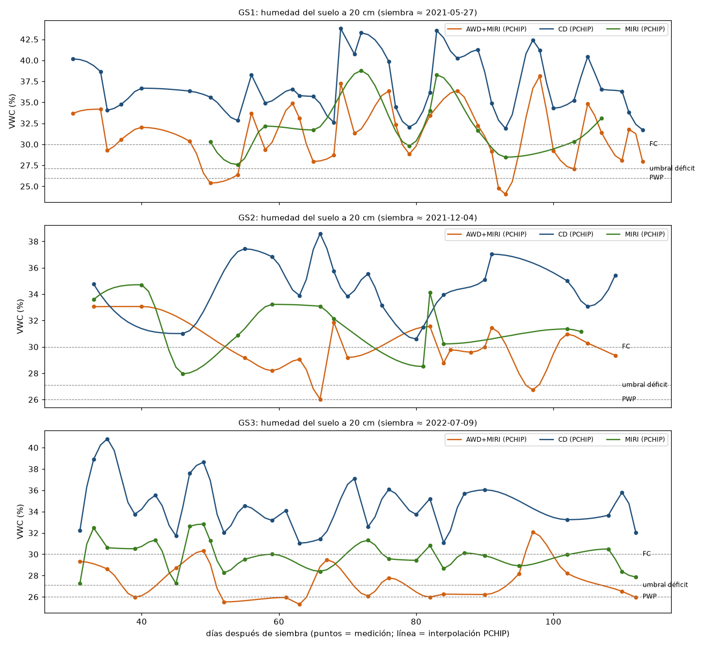
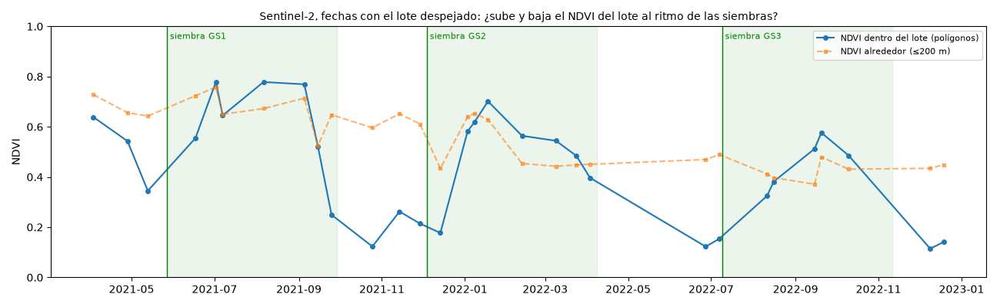
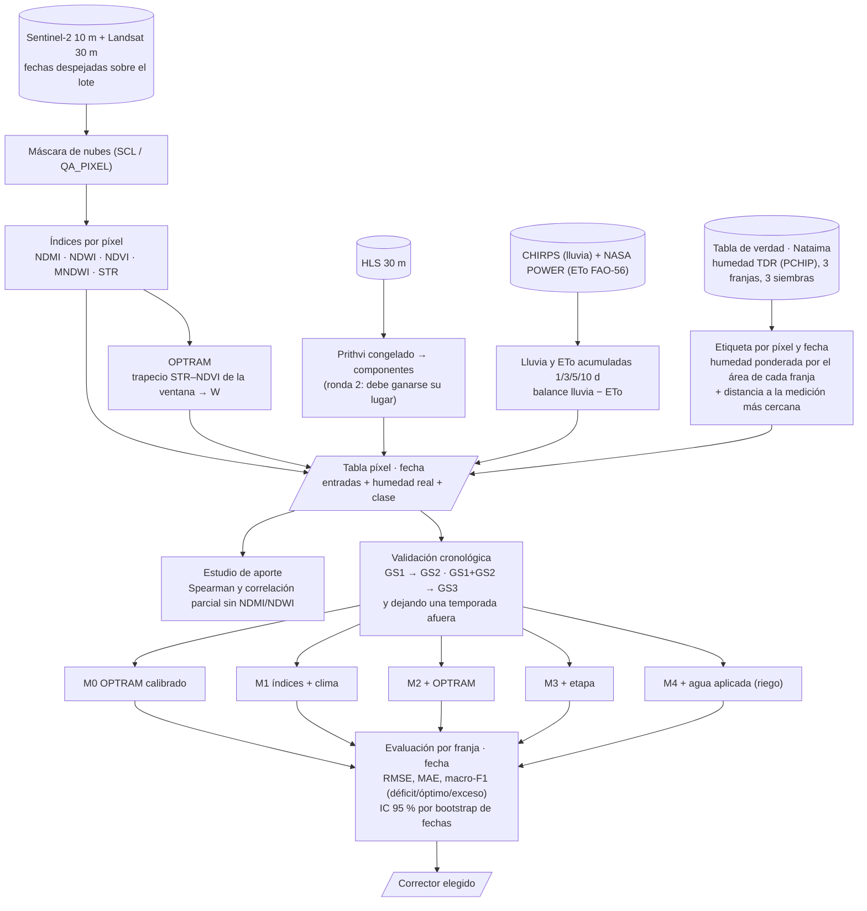
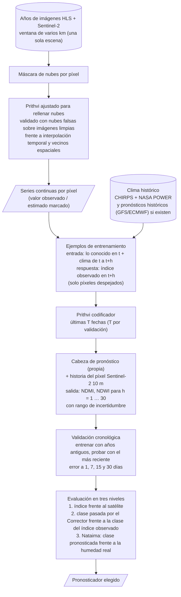
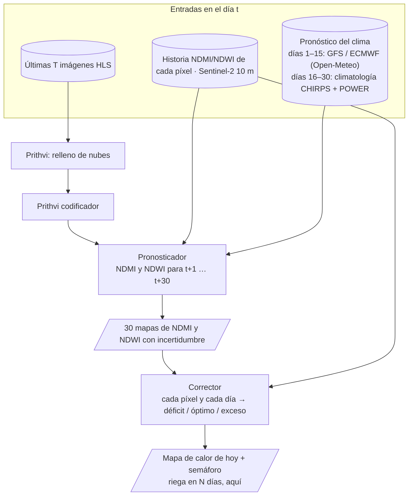

# SIRA: informe preliminar

**Sistema Inteligente de Riego para Arroz · Equipo 10 · Proyecto Integrador · EAFIT 2026-2**
Estado al 17 de noviembre de 2026.

Este informe recoge lo que ya está hecho y verificado (datos de campo, ubicación del lote, imágenes, clima) y la arquitectura de los dos modelos: el **Corrector** y el **Pronosticador**. Todo el código y los datos derivados están en este repositorio.

---

## 1. Enfoque

SIRA estima **el estado del agua de la planta de arroz** desde el satélite y anticipa **cuándo y dónde hay que regar**.

- El centro del sistema es la **planta**. Los índices **NDMI** (agua en la hoja) y **NDWI** (agua en superficie) son el dato bruto que entregan Landsat y Sentinel-2 en cualquier fecha y lugar.
- El **NDVI** mide el follaje y permite estimar el consumo de agua del cultivo, ETc = Kc(NDVI) × ETo (FAO-56). Así se cierra el balance: **agua que entra (lluvia + riego) → arroz → agua que sale (evapotranspiración)**.
- Los índices no son medidas perfectas del agua: se saturan con follaje denso, cambian con la etapa y mezclan coberturas. Por eso se calibran con **mediciones reales en tierra** (Nataima, Agrosavia).

El sistema tiene dos modelos que trabajan en cadena:

| | **Corrector** (diagnóstico) | **Pronosticador** (pronóstico) |
|---|---|---|
| Pregunta | ¿Qué estado real del agua corresponde a lo que ve el satélite? | ¿Cómo van a evolucionar los índices en los próximos 1–30 días? |
| Respuesta correcta para entrenar | Humedad del suelo medida en Nataima | La siguiente imagen del satélite |
| Datos | 3 siembras en Nataima (2021–2022) | Años de imágenes de toda una ventana de varios km |
| Salida | Déficit / óptimo / exceso (y humedad %) por píxel | Mapas de NDMI y NDWI por píxel para t+1 … t+30 |

**En operación:** el Pronosticador predice los índices futuros, el Corrector traduce cada píxel de cada día a estado real del agua, y el primer día con déficit da el consejo: *"riega en N días, aquí"*.

---

## 2. Verdad de campo: Nataima (Martínez-Vega et al., 2025)

Los datos originales del ensayo son privados. Se reconstruyeron **digitalizando las Figs. 2–4** del artículo (CC BY 4.0) con métodos automáticos y verificables (`src/sira/digitalizar/`).

| Variable | Método | Validación contra el artículo |
|---|---|---|
| Lluvia diaria (Fig. 2) | Barras detectadas por color, siguiéndolas aunque las cruce la línea roja del AtWD | Total GS1 521,5 mm frente a 521,4 de la Tabla 2; GS2 +1,5 %; GS3 +1,0 % |
| Riego por tratamiento (Fig. 4) | Camino de Viterbi (línea continua que nunca baja) anclado a los totales de la Tabla 2 | Sumas por etapa a ≈2 mm en promedio; número de riegos igual en GS3 (24/21/13) |
| Humedad del suelo, TDR a 20 cm (Fig. 3) | Solo marcadores con barra de error simétrica (media ± EE) | Mínimos y máximos a ±1 punto de los citados en el texto |

Detalle: `reports/validacion_digitalizacion.md`.

**Curvas continuas.** Las 198 mediciones se interpolan con **PCHIP**: la curva pasa por cada medición sin inventar picos (a diferencia de la curva suavizada de Excel del artículo). Cada valor queda marcado como *medido* o *interpolado*, junto con la distancia a la medición más cercana (`data/processed/humedad_continua.csv`).

**Incoherencias encontradas en el artículo:**
- **GS2:** la lluvia máxima diaria es 87 mm en el texto, pero ≈77 mm en la figura.
- **Fig. 4:** las sumas por etapa usan cortes distintos al sombreado de la propia figura.
- **GS1:** la línea de AtWD está corrida un día respecto a la lluvia.

---

## 3. Ubicación del lote y escala

Los polígonos de las 3 franjas (MIRI, AWD+MIRI, CD) se obtuvieron del plano georreferenciado de la Fig. 1 (`data/processed/franjas_nataima.geojson`).

**Verificación sobre Sentinel-2 real.** Justo antes de la siembra de GS2 (día −4) y de GS3 (día −1), el área de los polígonos aparece con suelo desnudo (NDVI bajo), con la misma forma y orientación del lote, mientras alrededor hay vegetación. Desplazar el polígono 10 m no mejora el ajuste: la ubicación es correcta a ±10 m.

**Fechas de siembra.** El artículo solo da meses. Se estimaron alineando su lluvia con CHIRPS, NASA POWER y ERA5: **GS1 ≈ 27-may-2021, GS2 ≈ 4-dic-2021, GS3 ≈ 9-jul-2022**. La serie de NDVI del lote sube y baja al ritmo de esas tres siembras, y se diferencia de los alrededores, lo que confirma las fechas.

**Escala (píxeles por franja):**

| Cuadrícula | Píxeles que tocan el lote | Etiquetables (≥50 % dentro) | Puros por franja |
|---|---|---|---|
| Sentinel-2, 10 m | 125 | 97 | MIRI 13 · AWD+MIRI 14 · CD 10 |
| HLS, 30 m (entrada de Prithvi) | 23 | 10 | 0 |
| Landsat C2, 30 m | 20 | 10 | 0 |

- Los píxeles de 30 m mezclan franjas. Su humedad "verdadera" es **el promedio de las franjas que cubren, ponderado por área** (`data/processed/pixeles_franjas_*.csv`).
- El lote completo (≈0,96 ha) cabe en un solo bloque de Prithvi (16×16 píxeles HLS, 480 m).

---

## 4. Imágenes disponibles

Catálogos oficiales para el punto de Nataima, 2021–2022:

| Fuente | Fechas |
|---|---|
| ESA Copernicus, Sentinel-2 L2A | 146 |
| USGS, Landsat C2 L2 | 101 (L8 45, L7 44, L9 21) |

Se descargan de **Microsoft Planetary Computer**, sin cuenta. Tiene las mismas 146 fechas de Sentinel-2 y 89 de Landsat.

**Fechas despejadas sobre el lote** (≥90 % de sus píxeles sin nube ni sombra, según la máscara de calidad de cada producto):

| Satélite | Fechas | Despejadas | Dentro de las siembras |
|---|---|---|---|
| Sentinel-2 | 146 | 41 | 22 |
| Landsat 7/8/9 | 89 | 27 | 14 |
| **Sentinel-2 + Landsat (únicas)** | 217 | **61** | **31** |
| HLS (Prithvi) | 186 | 39 | 20 |

De las 217 fechas, 15 están parcialmente nubladas (30–90 % despejado) y 141 casi tapadas (<30 %). El relleno de huecos espacial sirve en las primeras; en las demás solo sirve el relleno temporal (§6.2).

---

## 5. Clima

Se comparó la lluvia de cada fuente contra la medida en el propio lote (`reports/comparacion_lluvia.md`):

| Fuente | Parecido en sumas de 5 días | Sesgo de volumen |
|---|---|---|
| IDEAM San Miguel (25 km, 82 días) | 0,50 | −63 % |
| NASA POWER | 0,47 | +27 % |
| ERA5 | 0,44 | +51 % |
| **CHIRPS** | 0,42 | **+14 %** |
| IDEAM Cucunubá (15 km) | 0,39 | −36 % |

**Decisión:**
- **Lluvia: CHIRPS.** Tiene el menor sesgo y una serie completa.
- **Temperatura, radiación, viento y humedad del aire:** NASA POWER, con los que se calcula la **ETo FAO-56**. Mediana 3,75 mm/d.
- **IDEAM:** descartado. Sus estaciones automáticas públicas están lejos y tienen huecos.

Ninguna fuente reproduce la lluvia diaria exacta del lote (correlación ≤ 0,42), así que los modelos usan **acumulados de 3, 5 y 10 días**.

---

## 6. Arquitectura

### 6.1 Corrector (modelo B): entrenamiento

Traduce lo que ve el satélite en el **estado real del agua**. Se entrena solo con el intervalo de la tabla de verdad, respetando el orden del tiempo: cada fila usa información del pasado y del presente, nunca del futuro.

- **Línea base física: OPTRAM** (Sadeghi et al., 2017). Relaciona la humedad del suelo con la reflectancia SWIR transformada, STR = (1 − SWIR)² / (2·SWIR), y el NDVI. Los bordes seco y húmedo del trapecio se ajustan con los píxeles despejados de la ventana, y la ecuación se calibra con Nataima.
- **Modelos de aprendizaje automático:** Random Forest con grupos de entradas que se agregan uno a uno (M1–M4). Cada grupo debe ganarse su lugar.
- **Criterio de decisión, fijado antes de ver resultados:** gana el que menos se equivoca en la temporada no vista, con intervalos de confianza. Si dos empatan dentro del intervalo, se elige el más simple.

**Qué entra y qué no:**
- **No entran** el nombre de la técnica de riego (CD/MIRI/AWD) ni el número de temporada. Las franjas valen como muestras de regímenes de agua distintos; las temporadas solo sirven para validar.
- **La etapa del cultivo** solo se queda si mejora el resultado. En operación se estima desde el satélite, sin pedirle nada al campesino.

### 6.2 Pronosticador (modelo A): entrenamiento

Aprende cómo evolucionan el NDMI y el NDWI de cada píxel con el clima. **No necesita datos de campo**: la respuesta correcta es la imagen que el satélite tomó después. Por eso puede entrenarse con años de imágenes de toda una ventana de varios kilómetros, con millones de ejemplos píxel·fecha.

**Hiperparámetros que se validan** (no se fijan a priori): número de fechas *T* que recibe Prithvi (1–4), ventana de días hacia atrás (30/60/90), largo de la historia de cada píxel y horizonte confiable.

### 6.3 Funcionamiento general (operación diaria)

**Límite honesto del horizonte:** el pronóstico de lluvia es bueno hasta ~7–10 días. Después de eso el rango se abre, y el informe final mostrará el error según el horizonte.

---

## 7. Infraestructura

| Operación | Dónde | Por qué |
|---|---|---|
| Digitalización, curvas, polígonos, informes | Local | Liviano |
| Bajar imágenes y preparar datos (ronda 1 del Corrector) | **AWS EC2 on-demand** (us-west-2) | Las imágenes viven en la nube; no depende del internet local |
| Prithvi (relleno y codificador) | GPU local (RTX 3050) o GPU en la nube | Necesita GPU |
| Almacenamiento | S3 (capas bronce / plata / oro) + este repositorio | Evidencia y reproducibilidad |

**Salvaguardas de cada corrida en AWS:**
- tope duro de 60 minutos, al cabo del cual la máquina se termina y su disco se borra;
- topes internos por etapa;
- prueba corta en la propia máquina antes de la corrida larga;
- ante cualquier final, sube a S3 el log, el estado y lo construido hasta ese momento;
- código en `cloud/ronda1_b/`.

**Pendiente:** dejar evidencia del procesamiento con **Spark** para la preparación de datos del Pronosticador, donde el volumen lo justifica (relleno de huecos por píxel sobre millones de píxeles).

---

## 8. Ronda 1 del Corrector: resultados

> **⚠️ Corrida invalidada para concluir (corrección del 17-nov).** El artículo indica que los tratamientos **se trasladaron a la franja vecina en cada temporada**. La Fig. 1 muestra solo la distribución de GS1, y esta corrida usó esa misma ubicación para GS2 y GS3, así que **las etiquetas de humedad de GS2 y GS3 están asignadas a la franja equivocada**. Además:
> - hay pocas fechas por temporada (3–5 con las tres franjas despejadas);
> - el NDMI usa bandas de 20 m sobre franjas de 23 m, así que mezcla franjas;
> - a lo largo de la temporada los índices los domina el crecimiento del cultivo;
> - la franja oeste colinda con una hilera de árboles.
>
> Con la ubicación corregida, ninguna de las 6 asignaciones posibles por temporada da un patrón estable (`reports/rotacion_tratamientos.csv`). Una prueba que no depende de la asignación, el promedio del lote contra la humedad promedio del lote, tiene solo 13 fechas y no es concluyente.
>
> **Los resultados de abajo se conservan como registro, pero no sirven para afirmar ni para negar que los índices sigan el agua.** Antes de la ronda 2 hay que: (1) conocer el sentido de la rotación de tratamientos; (2) calcular el NDMI solo en píxeles de 20 m puros; (3) controlar el efecto del crecimiento del cultivo.

### 8.1 Ronda 1 corregida (17-nov)

Se repitió el análisis con las tres correcciones, reutilizando las imágenes ya descargadas:
1. **Rotación de tratamientos:** se probaron las dos rotaciones posibles (hacia el este y hacia el oeste) y la ubicación fija como referencia.
2. **Pureza a 20 m:** la evaluación usa solo píxeles cuyo píxel de 20 m (donde se miden B8A, B11 y B12) cae en una sola franja.
3. **Efecto del crecimiento:** correlación **dentro de cada fecha**. Las tres franjas están en la misma etapa ese día, así que se compara solo qué franja está más húmeda que las otras.

Resultados en `reports/ronda1_b_corregida/{fija,este,oeste}/`.

| Entrada | Rotación este: Spearman / mismo día | Rotación oeste: Spearman / mismo día |
|---|---|---|
| NDMI | −0,07 / −0,11 | −0,10 / −0,01 |
| NDWI | +0,04 / −0,01 | +0,09 / +0,09 |
| NDVI | −0,09 / +0,02 | −0,13 / −0,03 |
| MNDWI | +0,05 / 0,00 | +0,08 / +0,05 |
| OPTRAM (W) | −0,11 / −0,04 | −0,04 / +0,05 |
| **Riego 10 días** | **+0,63 / +0,73** | **+0,66 / +0,78** |

RMSE cronológico (puntos de humedad): con cualquiera de las dos rotaciones, los modelos que solo ven la imagen y el clima quedan en **4,1–4,4**, igual que la línea base de la media (4,3). Solo el modelo con riego baja a **3,2–3,4**.

**Conclusión, ahora con las etiquetas bien asignadas:** el resultado se mantiene. En este ensayo, los índices satelitales (NDMI, NDWI, NDVI, MNDWI, OPTRAM) **no siguen la humedad del suelo a 20 cm**, ni entre fechas ni entre franjas el mismo día. El agua aplicada sí la explica.

La señal de NDVI "mismo día" (ρ = 0,34) que apareció en el análisis anterior de NDVI/NDRE venía de la ubicación equivocada de los tratamientos: con la rotación corregida desaparece.

**Interpretación:** el NDMI mide el agua **en la hoja** y el NDWI el agua **en superficie**. En este ensayo el arroz estuvo casi siempre bien regado (la humedad del suelo rara vez bajó del umbral de estrés de 27,1 %), así que la planta no mostró estrés, y la humedad del suelo a 20 cm, tapada por el follaje, no es visible para un sensor óptico.

**Límites de esta conclusión:** son 22 fechas, 3 siembras y un solo sitio. Una relación débil podría no detectarse con tan pocos datos. Tampoco se sabe el sentido real de la rotación: se probaron los dos posibles.

Corrida autónoma en AWS EC2 (t3.medium, us-west-2), 17-nov-2026. Duró 9,7 minutos y terminó sola. Archivos en `reports/ronda1_b/`.

**Datos:**
- 68 imágenes despejadas (Sentinel-2 + Landsat, 2021–2022). Se omitió 1 imagen de Landsat 7 (23-ago-2022) porque Planetary Computer negó el acceso.
- **1.967 filas píxel·fecha** con humedad real en las 3 siembras (GS1 635, GS2 652, GS3 680), de **22 fechas**. La curva de humedad solo cubre los días ~30–113 de cada siembra, así que no entran todas las fechas despejadas.
- 1.490 filas tienen una medición a 2 días o menos.

**Aporte de cada entrada** (Spearman con la humedad, filas con medición a ≤2 días):

| Entrada | Spearman | Descontando NDMI y NDWI |
|---|---|---|
| NDMI | −0,07 | — |
| NDWI | 0,00 | — |
| NDVI | −0,11 | −0,33 |
| OPTRAM (W) | −0,19 | −0,15 |
| Lluvia 5 días | −0,36 | −0,35 |
| Balance lluvia − ETo, 5 días | −0,35 | −0,35 |
| **Riego 10 días** | **+0,61** | **+0,61** |

**Modelos** (RMSE en puntos de humedad, por franja·fecha, con IC 95 %):

| Modelo | Cronológico (GS1→GS2, GS1+2→GS3) | Una temporada afuera |
|---|---|---|
| Línea base: la media de entrenamiento | 4,27 | 4,06 |
| M0 OPTRAM calibrado | 4,19 (3,75–4,66) | 4,26 (3,26–5,14) |
| M1 índices + clima | 4,80 (4,19–5,53) | 3,82 (3,06–4,51) |
| M2 + OPTRAM | 4,59 (4,01–5,34) | 3,71 (2,93–4,35) |
| M3 + etapa | 4,57 (4,05–5,12) | 3,84 (2,97–4,55) |
| **M4 + riego** | **3,08 (2,28–3,78)** | 3,75 (2,71–4,72) |

**Lectura:**
1. **Los índices de la imagen casi no siguen la humedad del suelo a 20 cm en Nataima.** El NDMI y el NDWI tienen correlación ≈0. Los modelos que solo ven la imagen y el clima (M0–M3) **no superan a la línea base** de predecir la media. Ni siquiera en una misma fecha el NDMI ordena las tres franjas como la humedad: coinciden en 3 de 13 fechas. Probar con la humedad promedio de los 3–10 días previos (por si la planta reacciona con retraso) tampoco cambia el resultado (|ρ| ≤ 0,21).
2. **Lo que sí explica la humedad es el agua aplicada.** El riego de los últimos 10 días tiene ρ = 0,61, y es el único grupo que mejora claramente en la validación cronológica (RMSE 3,08 frente a 4,27 de la línea base).
3. **Causas probables, todas físicas:**
   - el arroz bien regado no muestra estrés en la hoja mientras el suelo se mueve entre capacidad de campo y saturación, así que el NDMI se mantiene alto;
   - el follaje denso tapa el suelo y satura los índices (el artículo lo advierte);
   - el riego cambia la humedad en horas, mientras el satélite pasa cada ~10 días;
   - las franjas de 23 m se mezclan en los píxeles de 20–30 m.

**Consecuencia para la arquitectura:** con estos datos, **traducir el índice en humedad del suelo (el Corrector tal como estaba planteado) no tiene sustento en Nataima**. El balance de agua (lluvia + riego − ETo) sí lo tiene. Se abren tres caminos para decidir:
- **(a)** un Corrector basado en el **balance hídrico**, con el satélite como apoyo para estimar el consumo del cultivo (Kc por NDVI) y la etapa;
- **(b)** sumar **Sentinel-1 (radar)**, que sí es sensible a la humedad del suelo y a la inundación, y no depende de las nubes;
- **(c)** cambiar lo que el Corrector traduce: en vez de la humedad del suelo, una variable de **estado de la planta** que el índice sí pueda ver.

La ronda 2 (Prithvi) queda condicionada a esa decisión: no hay razón física para esperar que Prithvi cambie la conclusión 1.

### 8.2 Prueba térmica con Landsat (17-nov)

Se probó la temperatura de superficie de Landsat (TVDI, LST relativa a la vegetación de alrededor, LST menos la temperatura del aire) contra la humedad del lote. Archivos en `reports/termica_landsat/`.

- De 27 fechas Landsat despejadas en 2021–2022, **solo 8 caen dentro del rango de la curva de humedad**.
- En esas 8 fechas, la humedad promedio del lote estuvo siempre entre **30 y 34 %**, por encima de la capacidad de campo. **No hubo ningún episodio de estrés** que el térmico pudiera detectar.
- Las correlaciones son inestables. Las pocas "significativas" tienen el **signo físicamente contrario** (más calor con más humedad) y aparecen entre 30 pruebas con 8 datos, así que se esperan por azar.
- Además, el lote (136 × 70 m) es más pequeño que un píxel térmico de Landsat 8/9 (100 m nativos) y se mezcla con árboles y edificios vecinos.

**Conclusión:** la prueba **no es concluyente** por falta de datos, no por falla del método. Nataima no tiene suficientes episodios de estrés, fechas despejadas ni tamaño de lote para validar una señal térmica de estrés.

### 8.3 Balance hídrico contra el TDR (17-nov)

Se probó si un balance hídrico reproduce el faltante de agua medido, Dr = 150 × (0,30 − θ_TDR) mm, en los 198 días con medición. Validación: dejar una temporada afuera. Archivos en `reports/balance_hidrico/`.

| Versión | Entradas | Spearman | RMSE (mm) frente a línea base |
|---|---|---|---|
| FAO-56 con parámetros del artículo (TAW 6,7 mm, drenaje rápido) | riego y lluvia reales | 0,04 | 9,3 frente a 6,5 |
| FAO-56 + Kc desde NDVI | riego real, lluvia CHIRPS | 0,03 | 6,8 frente a 6,5 |
| FAO-56 + Kc desde NDVI + reinicios por inundación vista por satélite | **sin riego** | −0,06 | 8,5 frente a 6,5 |
| **Reservorio calibrado** (memoria τ, fracción α de lluvia efectiva) | riego y lluvia reales | **0,52 / 0,57 / 0,73** (GS2 / GS1 / GS3) | 4,3–5,7 frente a 4,3–7,7 |

**Lectura:**
- El balance FAO-56 con los parámetros nominales falla porque el suelo de Nataima, a 20 cm, se mantiene **sobre capacidad de campo semanas después de los riegos** (memoria calibrada de 30–45 días), y **la lluvia aporta poco** (α = 0,25–0,5), coherente con la alta percolación que describe el artículo.
- Con esa calibración, el balance **sí sigue el TDR** en temporadas que no vio (ρ 0,52–0,73) y mejora el RMSE en GS1 y GS3. Pero el acierto de clase no supera a la línea base, porque el 69 % de los días medidos son "exceso".
- **La versión de producción (sin riego, solo con lo que ve el satélite) no funciona todavía:** con ~10 días entre imágenes despejadas no se detectan los 9–24 riegos por temporada.
- **El dato que más pesa es cuánta agua ha recibido el lote en las últimas semanas.** Ahí está el nudo para producción: conseguir el riego sin depender del campesino. Una opción son los turnos de agua del distrito de riego.

### 8.4 Reservorio con Kc desde el NDVI (17-nov)

La sección 8.3 usó el Kc de la tabla FAO-56. Aquí se rehízo con **Kc = a·NDVI + b**, con el NDVI de Sentinel-2 de cada franja interpolado por día, como se acordó en la arquitectura. Se probó con las dos rotaciones posibles de tratamientos (este y oeste). Script: `scripts/prueba_reservorio.py <rotación> <modo>`; resultados en `reports/balance_hidrico/reservorio_resultados_*.csv`.

| Kc | a, b calibrados | Spearman GS1 / GS2 / GS3 | RMSE (mm) GS1 / GS2 / GS3 |
|---|---|---|---|
| Tabla FAO-56 | — | 0,57 / 0,52 / 0,73 | 5,74 / 4,33 / 4,65 |
| **NDVI, rango físico del arroz (Kc 0,6–1,3)** | **a = 1,0, b = 0,45 en todos los pliegues** | **0,56 / 0,58–0,59 / 0,73–0,74** | **5,66 / 4,30 / 4,54–4,58** |
| NDVI, rejilla libre | a = 2–3, b = −0,4–0,8 (en el borde; Kc irreal) | 0,57 / 0,60 / 0,74–0,77 | 5,71 / 4,18–4,45 / 4,71–4,74 |
| Constante (control, sin NDVI) | Kc = 1,3 | 0,57 / 0,50 / 0,73 | 5,71 / 4,43 / 4,62 |

Línea base de RMSE: 7,68 / 4,34 / 6,28 mm.

**Lectura:**
- **Con el NDVI en rango físico, el resultado es igual o algo mejor que con la tabla FAO**, sobre todo en GS2 (ρ 0,52 → 0,59). La recta calibrada (**Kc = 1,0·NDVI + 0,45**) sale idéntica en los tres pliegues y en las dos rotaciones: es estable y físicamente plausible (Kc ≈ 0,65 con NDVI 0,2; ≈ 1,3 con NDVI 0,85).
- **La rejilla libre no se debe usar:** mejora apenas, a costa de un Kc irreal (de hasta 1,5, recortado).
- **El origen del Kc pesa poco.** Hasta el Kc constante da casi lo mismo. La capacidad del reservorio viene del riego y de la memoria del suelo (τ = 30–60 días), no del consumo del cultivo. Esto confirma el nudo de la sección 8.3: para producción hay que estimar el riego desde el satélite (radar Sentinel-1 + NDVI/NDWI).
- El acierto de clase sigue sin superar la línea base (≈ 69 % de días en "exceso").

### 8.5 Versión sin riego: radar Sentinel-1 + NDVI/NDWI (17-nov)

**Objetivo:** reemplazar el registro de riego (que nadie reporta en producción) por lo que ve el satélite. Scripts: `scripts/radar_lote.py`, `scripts/diagnostico_radar.py`, `scripts/reservorio_satelital.py`; resultados en `reports/radar/`.

**Datos:** Sentinel-1 RTC (Planetary Computer) sobre el lote, abril 2021 – diciembre 2022.
- Hay **64 fechas** (S1B 41, S1A 23), de dos órbitas: descendente 69 y ascendente 150.
- Dentro de las siembras: 21 fechas en GS1, **solo 5 en GS2** (S1B falló en diciembre de 2021) y 11 en GS3.
- Unos 18 píxeles de 10 m por franja y fecha.

**Diagnóstico** (Spearman; "dentro de fecha" = las 3 franjas comparadas el mismo día):
- **El riego del mismo día o del anterior se ve:** la franja recién regada sale con más VV y VH (ρ = 0,21–0,25, p < 0,03) en las dos rotaciones.
- **El VH sigue el estado del reservorio** (ρ = 0,30–0,43) y el riego de la última semana (ρ = 0,21–0,32). Es una lectura global, en la que también influye el crecimiento del cultivo.
- **Con la rotación "oeste", el VH sigue al TDR dentro de cada fecha** (ρ = −0,44, n = 60, p < 0,001). Con la rotación "este" no hay relación. Es un indicio de que la rotación real fue la "oeste".
- **La inundación vista con el óptico** (LSWI + 0,05 ≥ NDVI o MNDWI > 0) no se marcó en ninguna de las 66 fechas despejadas dentro de las siembras: en Nataima la lámina de agua no dura lo suficiente para verse.

**Reservorio sin riego**, con asimilación del radar (Ŝ = ridge de VH, VV, VH−VV, órbita, Kc y días desde siembra; dejando una temporada afuera):

| Variante | Spearman GS1 / GS2 / GS3 (rotación oeste) | RMSE (mm) GS1 / GS2 / GS3 |
|---|---|---|
| Con riego real (techo) | 0,56 / 0,58 / 0,74 | 5,67 / 4,30 / 4,54 |
| Sin riego ni satélite (piso) | −0,05 / 0,17 / −0,12 | 7,93 / 4,33 / 6,40 |
| **Sin riego + radar** | **0,19 / 0,08 / 0,24** | 7,44 / 10,62 / 6,29 |
| Sin riego + radar + óptico | igual que el anterior (el óptico no marcó inundación) | igual |

Línea base de RMSE: 7,68 / 4,34 / 6,28 mm. Con la rotación "este" el resultado es parecido o peor.

**Lectura:**
- El radar recupera **una parte pequeña** de la información del riego: sube de ≈ 0 a ≈ 0,2, frente a 0,6–0,7 con el riego real. **No alcanza para decidir el riego** y en GS2 empeora el error, porque solo había 5 fechas de radar.
- La causa es la frecuencia, no el método: el reservorio necesita saber cuándo se regó (9–24 riegos por temporada), y el radar de 2021–2022 pasó cada 6–12 días con una sola órbita útil a la vez.
- **Para 2025 en adelante la frecuencia mejora:** Sentinel-1C (lanzado en diciembre de 2024) devuelve la pasada de 6 días, y NISAR (2025) agrega banda L cada 12 días. Hay que volver a probar con esos datos; los de Nataima 2021–2022 no lo permiten.

---

## 9. Próximos pasos

1. Analizar la ronda 1 del Corrector y decidir sus entradas.
2. Ronda 2 del Corrector con Prithvi.
3. Preparación de datos del Pronosticador: varios años de la ventana, con Spark.
4. Ajustar Prithvi para rellenar nubes y validarlo con nubes falsas.
5. Entrenar y validar el Pronosticador por horizonte.
6. App (Lovable): mapa de calor, semáforo y botón "Regué hoy".

**Limitaciones:**
- La tabla de verdad es de un solo sitio, una variedad y un suelo. Fuera de Nataima, el Corrector se aplica bajo ese supuesto, y la app mostrará su nivel de confianza.
- El día de cada medición digitalizada tiene una incertidumbre de ±1 día.

---

## Referencias nuevas (además de las de la propuesta)

1. Sadeghi, M. et al. (2017). The optical trapezoid model: A novel approach to remote sensing of soil moisture applied to Sentinel-2 and Landsat-8 observations. *Remote Sensing of Environment*, 198, 52–68.
2. Szwarcman, D. et al. (2024). Prithvi-EO-2.0. arXiv:2412.02732 (receta GPP: Prithvi congelado + cabeza). Código: github.com/NASA-IMPACT/Prithvi-EO-2.0.
3. Jakubik, J. et al. (2023). Foundation models for generalist geospatial artificial intelligence. arXiv:2310.18660 (relleno de huecos de nubes con Prithvi).
4. IBM, *TerraTorch*: github.com/IBM/terratorch (regresión con `ignore_index` para etiquetas puntuales).
5. Chavda, R. y Das, K. (2024). Soil moisture estimation with geospatial foundation models and satellite imagery. AGU Fall Meeting.
6. Kontogiorgakis, I. et al. (2026). Comparative assessment of multimodal Earth observation data for soil moisture estimation. arXiv:2602.18083.
7. Boston, T. y Yebra, M. (2025). Fine-tuning remote sensing foundation models for improved live fuel moisture content estimation. MODSIM 2025.
8. Marsocci, V. et al. (2024). PANGAEA: A global and inclusive benchmark for geospatial foundation models. arXiv:2412.04204.
9. Funk, C. et al. (2015). The climate hazards infrared precipitation with stations (CHIRPS). *Scientific Data*, 2, 150066.
10. Allen, R. G. et al. (1998). FAO-56: Crop evapotranspiration (ya en la propuesta como [32]; base de la ETo y del Kc).
11. NASA POWER (power.larc.nasa.gov) · Microsoft Planetary Computer (planetarycomputer.microsoft.com).
